# Cloud Terraform Project - reader-web

Author: Parth Agarwal

## Goal

Provision a complete small web stack for the library's public catalogue page with Terraform:
a VPC with public subnets in two AZs, an internet gateway and routes, a security group, an IAM role +
instance profile, a private S3 bucket holding the static site, and EC2 web servers that pull the site
from S3 at first boot via a **templated `user_data`** script. Run it end to end against LocalStack,
verify it, test the bootstrap script, scale it, move state to a remote backend, and destroy it.

## Concepts in brief

- **Split configuration** - Terraform loads every `*.tf` in the folder as one module; splitting by concern
  (network, security, iam, storage, compute) is purely for readability.
- **Variables, locals, outputs** - inputs with types/validation, computed values (`cidrsubnet`, tags),
  and results printed after apply.
- **`count` / `for_each`** - one block, many resources (subnets per AZ, instances, one object per site file).
- **`templatefile()`** - renders `user_data.sh.tftpl` with the bucket name, region, title and server name.
  `user_data_replace_on_change = true` replaces the instance when the script changes, since cloud-init only
  runs it on first boot.
- **Implicit vs explicit dependencies** - references create edges in the graph; `depends_on` adds the ones
  Terraform can't see (the site must be uploaded and the internet route exist before an instance boots).
- **Instance profile** - how an EC2 instance gets IAM role credentials (no access keys on the box). IMDSv2 is
  enforced (`http_tokens = "required"`).
- **Remote state** - S3 backend with `use_lockfile` (S3-native locking, Terraform >= 1.10).

## Layout

```
Cloud Terraform Project/
├── terraform-project/
│   ├── versions.tf             terraform + provider constraints (aws ~> 5.80, random ~> 3.6)
│   ├── provider.tf             LocalStack endpoints when localstack_endpoint != null, default tags
│   ├── variables.tf            inputs with validation (environment, admin_cidr, subnet count ...)
│   ├── locals.tf               names, tags, AZs, subnet CIDRs, site file list, MIME map
│   ├── network.tf              VPC, IGW, public subnets, route table, route, associations
│   ├── security.tf             security group + separate ingress/egress rule resources
│   ├── iam.tf                  trust policy, read-site policy, role, instance profile
│   ├── storage.tf              random suffix, S3 bucket (versioned, SSE, public access blocked), site objects
│   ├── compute.tf              AMI lookup, aws_instance with templated user_data, IMDSv2, encrypted root
│   ├── user_data.sh.tftpl      bootstrap script template
│   ├── outputs.tf              ids, subnets, bucket, web server IPs and URLs
│   ├── terraform.tfvars        LocalStack values (comments show what to change for real AWS)
│   ├── backend.tf.example      S3 remote state
│   ├── localstack.s3.tfbackend backend overrides for LocalStack
│   ├── site/index.html         the page served by nginx
│   └── .terraform.lock.hcl     provider pins (committed)
├── scripts/boot-test.sh        runs the instance's real user_data in an Amazon Linux 2023 container
├── diagrams/architecture.md    Mermaid: infrastructure, boot sequence, dependency graph
└── screenshots/
```

## Running it

```bash
# LocalStack
docker run -d --name lib-localstack -p 4566:4566 localstack/localstack:4.9
cd "Cloud Terraform Project/terraform-project"

terraform init
terraform fmt -check -recursive && terraform validate
terraform plan -out=tfplan
terraform apply tfplan
terraform output
terraform state list
terraform graph > graph.dot            # dot -Tpng graph.dot -o graph.png  (needs graphviz)
```

Real AWS: comment out `localstack_endpoint` and `ami_name_pattern` in `terraform.tfvars` (the default pattern
picks the newest Amazon Linux 2023 AMI), set `admin_cidr` to your IP/32, then run the same commands. This
creates billable resources - destroy them afterwards.

## What happened when I ran it (LocalStack 4.9.2, Terraform 1.16.6, aws provider 5.100.0)

Everything below was run again on 18 Oct 2026; the screenshots are the real terminal output (some long outputs are
narrowed with `grep`, which is visible in each command).

**Init, fmt, validate** - providers come from the lock file; `fmt -check -recursive` and `validate` are clean.

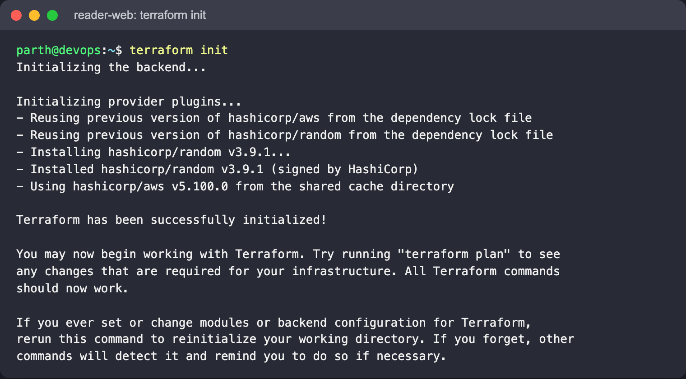

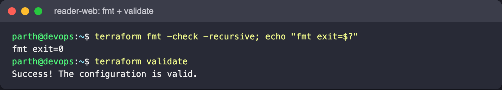

**Plan / apply** - `Plan: 22 to add, 0 to change, 0 to destroy.` then `Apply complete! Resources: 22 added`.
LocalStack's mock image catalogue has no Amazon Linux 2023, so the AMI is an old Amazon Linux one (see
`ami_name_pattern` in `terraform.tfvars`).

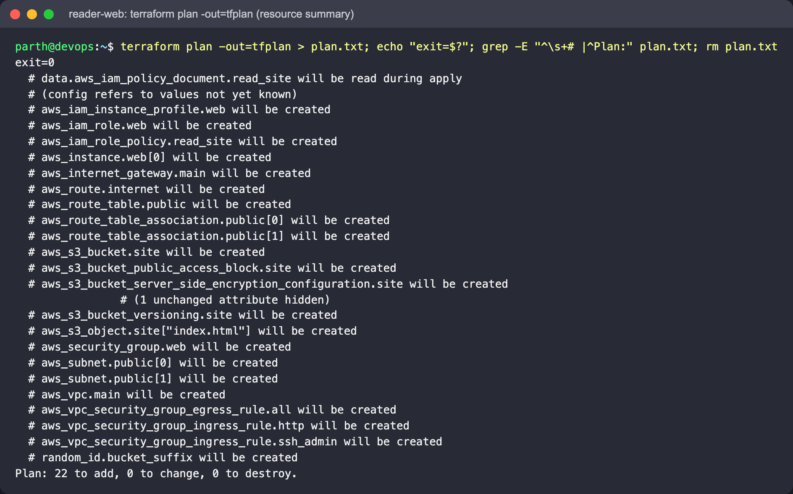

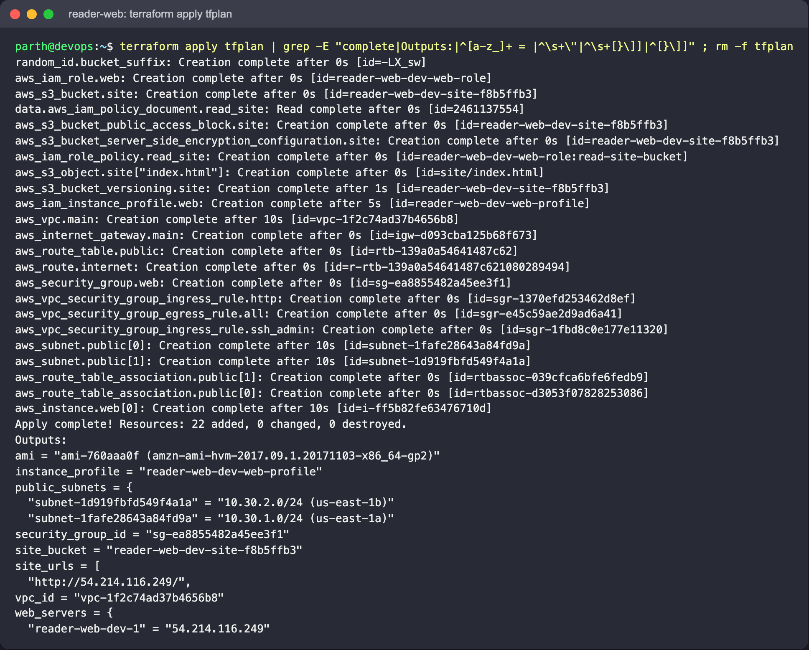

`terraform state list` shows 26 entries: the 22 managed resources plus 4 data sources (`aws_ami`,
`aws_availability_zones`, two `aws_iam_policy_document`). `terraform graph` has 28 edges; the instance depends on the AMI,
instance profile, internet route, site object, security group and subnets (graphviz is not installed here, so the DOT
edges are shown as text; `dot -Tpng graph.dot -o graph.png` renders it where graphviz exists).

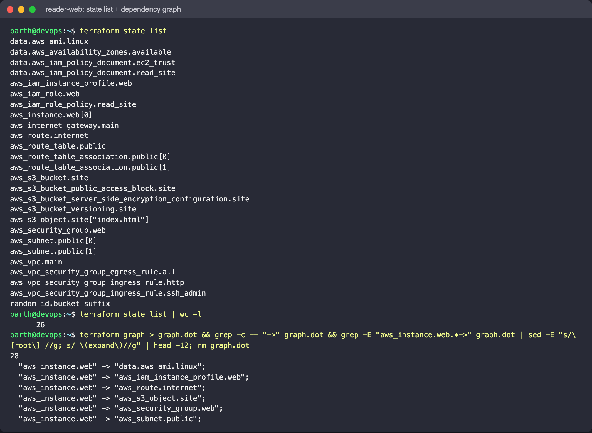

**Verifying with the AWS CLI** - both subnets auto-assign public IPs, the instance carries the instance profile and
enforces IMDSv2 (`required`), the site object is in the bucket, all four public-access blocks are on, the public route
table sends `0.0.0.0/0` to the IGW, and the security group allows 80 from anywhere and 22 only from `admin_cidr`:

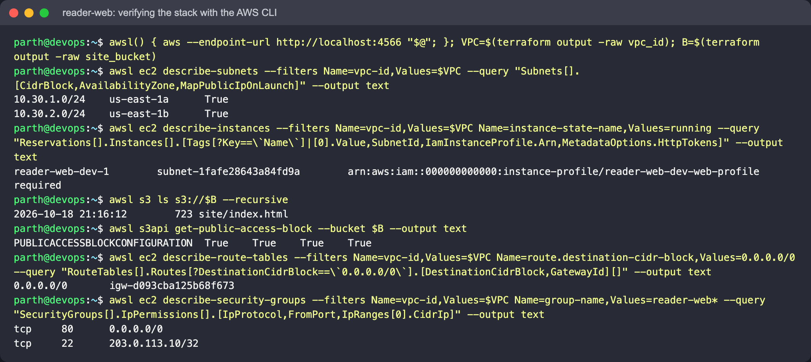

**Boot-testing user_data.** LocalStack never boots a VM, so `scripts/boot-test.sh` fetches the user data Terraform
attached to the instance (`describe-instance-attribute --attribute userData`), checks it with `bash -n`, and runs it as
root in an `amazonlinux:2023` container that can reach LocalStack's S3 (systemctl is stubbed). dnf installs nginx and the
AWS CLI, the page is copied from the private bucket, stamped with the server name, and served:

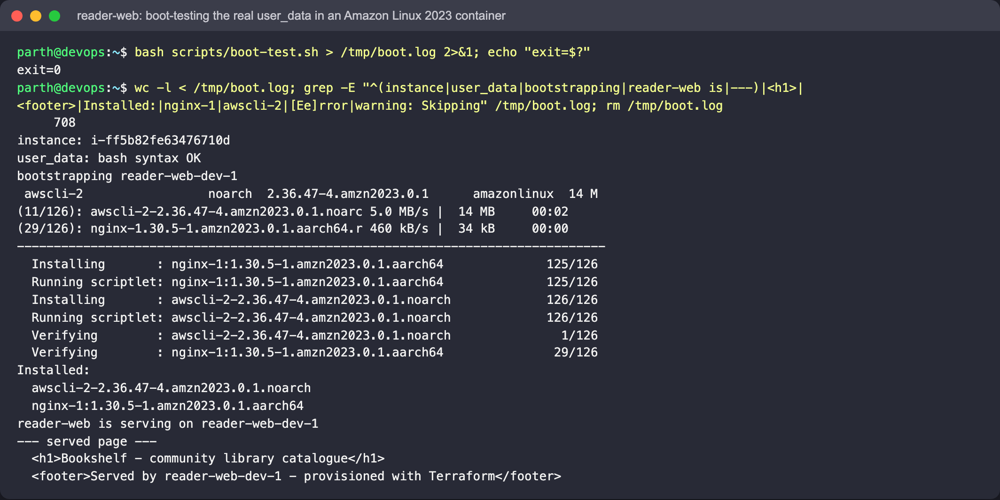

With `SERVE_PORT=18088 bash scripts/boot-test.sh` the container keeps running and publishes nginx, so the page the
instance would serve can be opened in a browser:

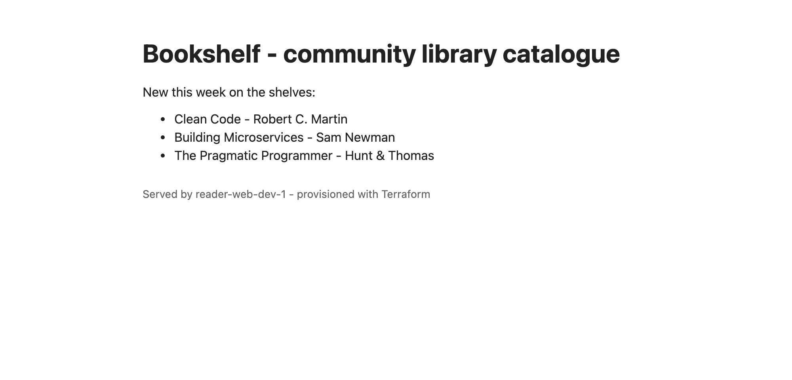

**The bug the boot test found.** The first version of the script used `aws s3 sync ... /usr/share/nginx/html/ --delete`.
Deleting the stock nginx files leaves the `poweredby.png` symlink dangling, `aws s3 sync` prints
`warning: Skipping file ... File does not exist.` and exits 2, and under `set -e` the bootstrap would stop before nginx
starts. To show it, the old line was put back temporarily: because of `user_data_replace_on_change` the plan replaces the
instance, and the boot test fails with exit code 2:

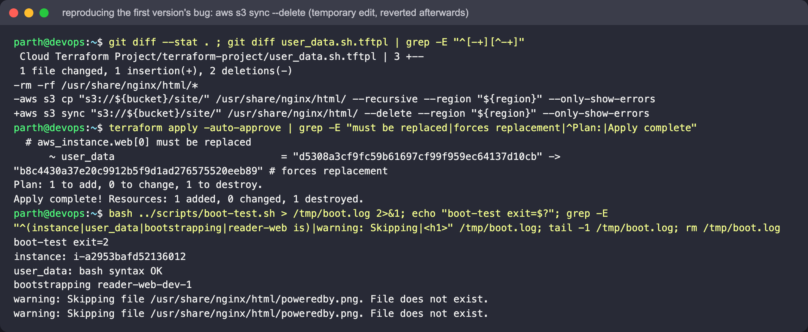

The fix (clear the directory, then `aws s3 cp --recursive`) was restored from git; the plan replaces the instance again
and the boot test passes:

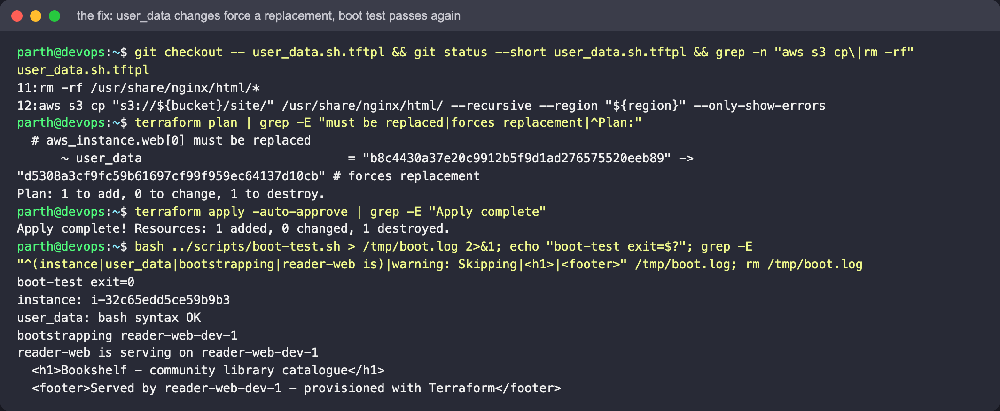

**Scaling out** - `-var instance_count=2` adds only `aws_instance.web[1]`; it lands in the second subnet/AZ
(`count.index % public_subnet_count`):

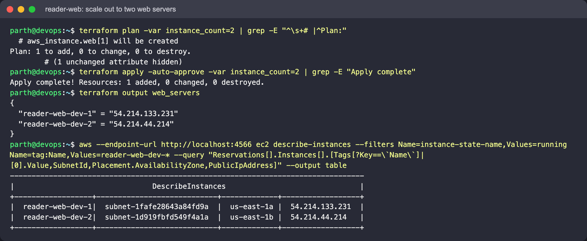

**Remote state** - create `reader-web-tfstate`, copy `backend.tf.example` to `backend.tf`, and
`terraform init -migrate-state -force-copy -backend-config=localstack.s3.tfbackend`. The state object appears at
`s3://reader-web-tfstate/cloud-terraform-project/dev.tfstate` (the local file is left empty), and
`terraform plan -detailed-exitcode` exits 0, so the remote copy matches reality:

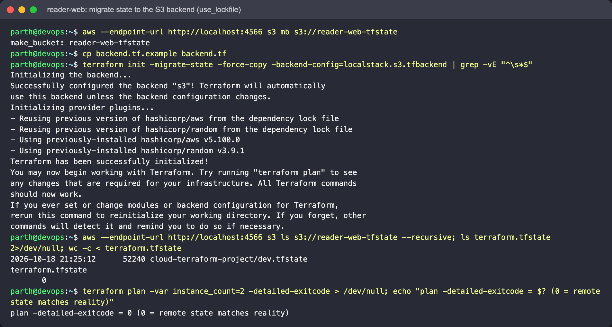

**Destroy** - `Destroy complete! Resources: 23 destroyed.`, no running instances left; then the state bucket,
`.terraform/`, `backend.tf` and the state files are removed (none are committed):

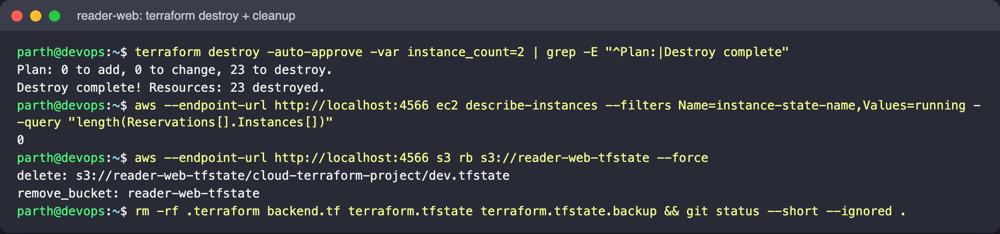

## Commands for each step

```bash
bash ../scripts/boot-test.sh                          # after apply
SERVE_PORT=18088 bash ../scripts/boot-test.sh         # same, but keep nginx running on localhost:18088
docker rm -f lib-reader-web-boot                      # stop it again
terraform plan -var instance_count=2                  # scale out
terraform apply -var instance_count=2

# remote state
aws --endpoint-url http://localhost:4566 s3 mb s3://reader-web-tfstate
cp backend.tf.example backend.tf
terraform init -migrate-state -backend-config=localstack.s3.tfbackend
aws --endpoint-url http://localhost:4566 s3 ls s3://reader-web-tfstate --recursive

terraform destroy -var instance_count=2
```

## Cleanup

```bash
terraform destroy
rm -rf .terraform terraform.tfstate* backend.tf
docker rm -f lib-localstack
```
