# Docker Fundamentals - six Hello World containers

Author: Parth Agarwal

## Goal

Containerise the same "Hello World from the Bookshelf" page in six different runtimes, build an
image for each, run them side by side and confirm each one answers over HTTP.

## Concepts in brief

- **Image vs container** - an image is a read-only, layered filesystem plus metadata (`CMD`,
  `EXPOSE`, env). A container is a running instance of an image with its own writable layer.
- **Layer caching** - each Dockerfile instruction is a layer. Copying the dependency manifest
  (`package.json`, `requirements.txt`) before the source code means `npm install` / `pip install`
  is only re-run when dependencies change.
- **Port publishing** - `-p HOST:CONTAINER` maps a host port to the port the process listens on
  inside the container. `EXPOSE` is documentation only; it does not publish anything.
- **Bind to 0.0.0.0** - a server listening on `127.0.0.1` inside a container is unreachable from
  outside it, which is why Flask is started with `host="0.0.0.0"`.
- **Multi-stage builds** - the Java and React images compile in one stage and copy only the
  output into a smaller runtime stage (covered in depth in `DockerFiles and Images`).
- **Non-root user** - Node and Python images drop to an unprivileged user with `USER`.

## Layout

| Folder | Runtime / base image | Container port | Host port | Image / container name |
|---|---|---|---|---|
| `node-hello/` | `node:20-alpine`, plain `http` module | 3000 | 18101 | `lib-node-hello` |
| `python-hello/` | `python:3.12-slim` + Flask | 5000 | 18102 | `lib-python-hello` |
| `java-hello/` | `eclipse-temurin:21-jdk-alpine` -> `21-jre-alpine` (JDK `HttpServer`) | 8080 | 18103 | `lib-java-hello` |
| `apache-hello/` | `httpd:2.4-alpine`, static page | 80 | 18104 | `lib-apache-hello` |
| `react-hello/` | `node:20-alpine` (Vite build) -> `nginx:1.27-alpine` | 80 | 18105 | `lib-react-hello` |
| `nginx-hello/` | `nginx:1.27-alpine` + custom `default.conf` | 80 | 18106 | `lib-nginx-hello` |

Host ports in the 181xx range were picked so they do not clash with local dev servers or with
macOS AirPlay (which occupies 5000).

Helper scripts:

- `run-all.sh` - builds all six images, starts the containers, curls each one, prints `docker ps`.
- `cleanup.sh` - removes the six containers and images.

## Commands

Build and run one app by hand (Node shown; the others follow the same pattern with the ports above):

```bash
cd "Docker Fundamentals/node-hello"
docker build -t lib-node-hello .
docker run -d --name lib-node-hello -p 18101:3000 lib-node-hello
curl http://localhost:18101/
docker logs lib-node-hello
docker rm -f lib-node-hello
```

Or everything at once:

```bash
cd "Docker Fundamentals"
./run-all.sh
docker images --filter reference='lib-*-hello'
./cleanup.sh
```

## Real output from this machine

`./run-all.sh` (Docker 29.5.2 in a Colima VM on macOS), trimmed to the curl checks:

```text
lib-node-hello     http://localhost:18101  <h1>Hello World from the Bookshelf (Node.js v20.20.2)</h1>
lib-python-hello   http://localhost:18102  <h1>Hello World from the Bookshelf (Python 3.12.15)</h1>
lib-java-hello     http://localhost:18103  <h1>Hello World from the Bookshelf (Java 21.0.12.1)</h1>
lib-apache-hello   http://localhost:18104  <title>Bookshelf on Apache httpd</title>
lib-react-hello    http://localhost:18105  <title>Reader Web - Hello</title>
lib-nginx-hello    http://localhost:18106  <title>Bookshelf on Nginx</title>
```

The React page is rendered client-side, so curl only sees the `<title>` and a `<script>` tag
pointing at `assets/index-<hash>.js`; the heading text lives inside that bundle and appears in a
browser.

Image sizes reported by `docker images`:

| Image | Size |
|---|---|
| lib-nginx-hello | 75.9MB |
| lib-react-hello | 76.1MB |
| lib-apache-hello | 115MB |
| lib-node-hello | 194MB |
| lib-python-hello | 210MB |
| lib-java-hello | 286MB |

The React image is almost the same size as plain nginx: the ~200 MB of `node_modules` used to build
it stayed behind in the build stage.

## What to look for

- `docker ps --filter "name=^lib-.*-hello$"` lists six containers, each with its `0.0.0.0:181xx->port/tcp` mapping.
- Each browser page shows the runtime name; Node, Python and Java also print the container ID
  (the hostname inside a container defaults to its short ID).
- The React page has a "Books borrowed" button whose counter increases on click (proves the JS
  bundle loaded).
- `curl http://localhost:18106/health` and `curl http://localhost:18101/health` return `ok`.

## Screenshots

All captured from a real run on this machine (Docker 29.5.2 in a Colima VM on macOS).

`./run-all.sh` - six builds, six curl checks, and the `docker ps` table:

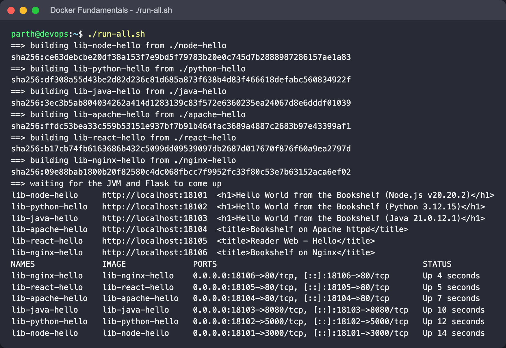

Image sizes, the two `/health` endpoints and the Node container log:

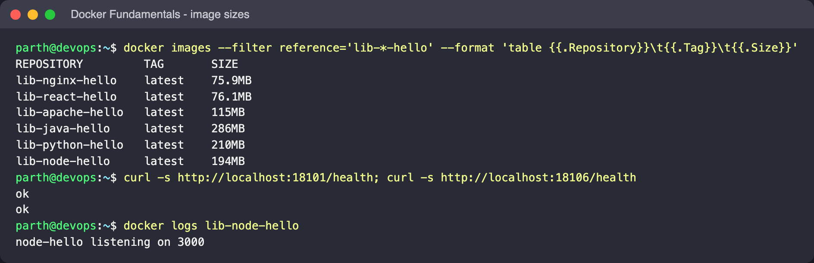

curl against the Node, Python and Java apps (each prints its container ID), and the React
`index.html`, which only contains a `<script>` tag because the page is rendered client-side:

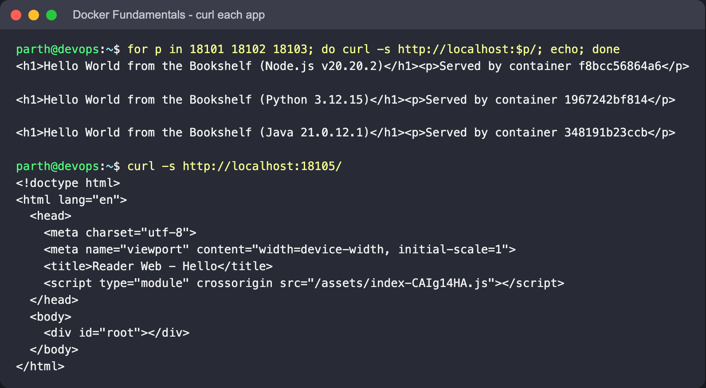

### Each app in a browser

| Node.js - `localhost:18101` | Python/Flask - `localhost:18102` |
|---|---|
| 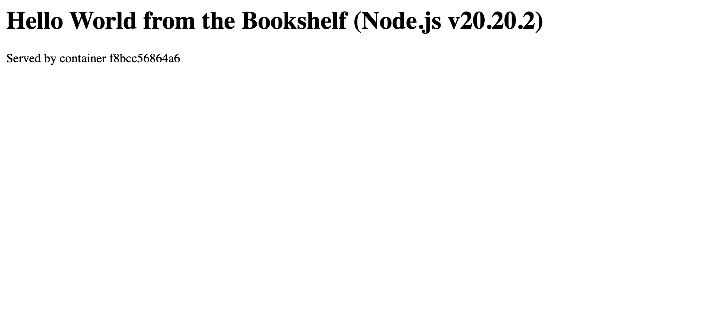 | 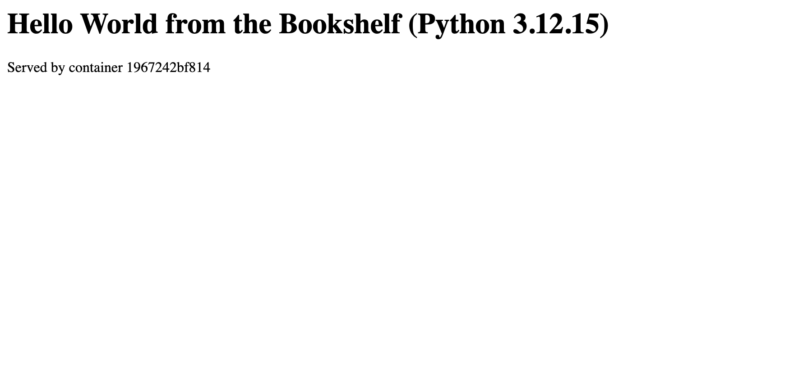 |
| **Java - `localhost:18103`** | **Apache httpd - `localhost:18104`** |
| 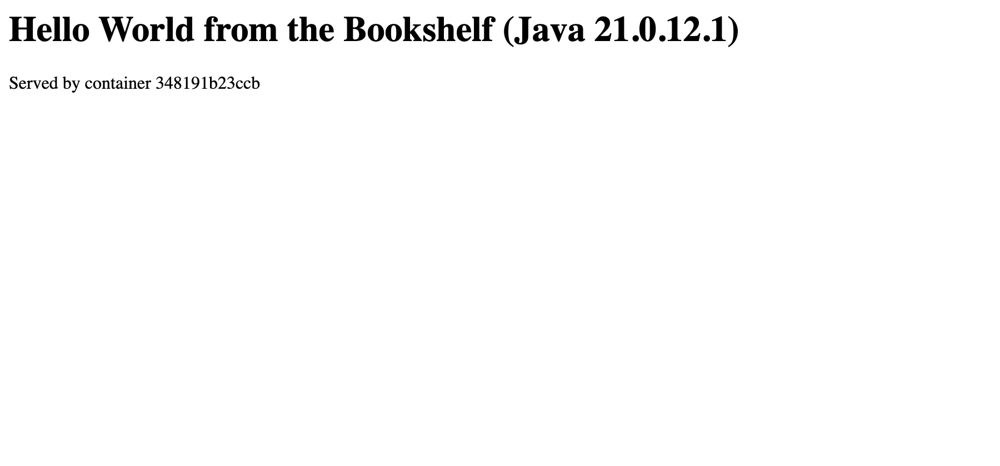 | 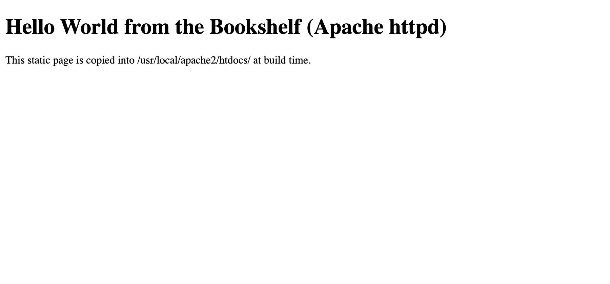 |
| **React + Vite - `localhost:18105`** | **Nginx - `localhost:18106`** |
| 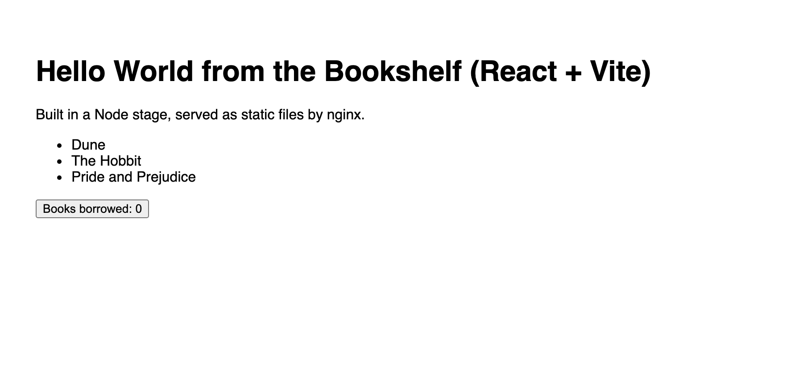 | 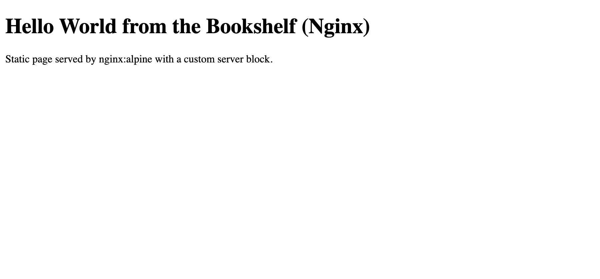 |

The React page after clicking "Books borrowed" once (the counter proves the JS bundle loaded):

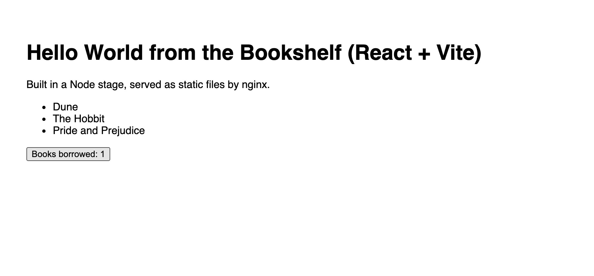

`./cleanup.sh` removes the six containers and images:

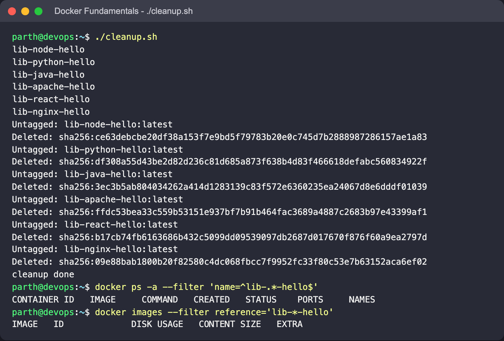
