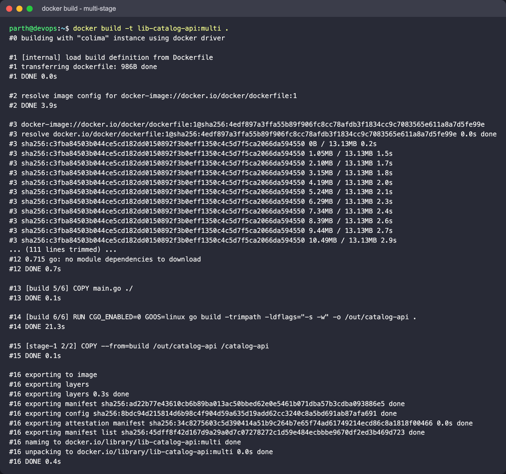
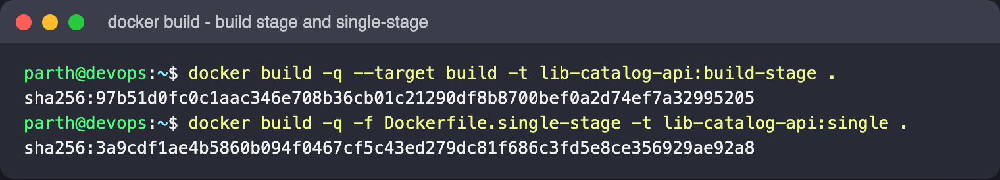
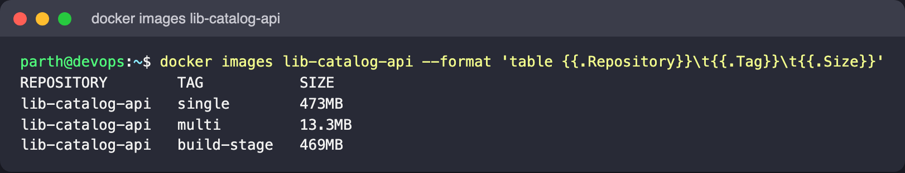
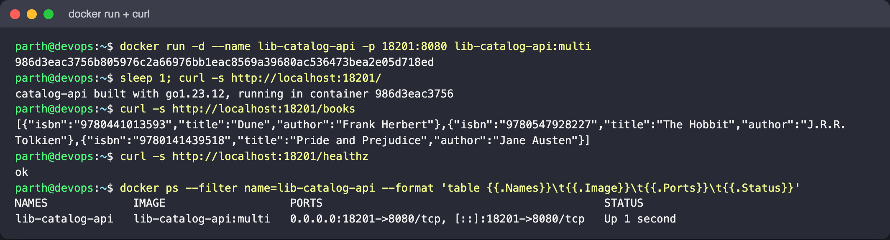
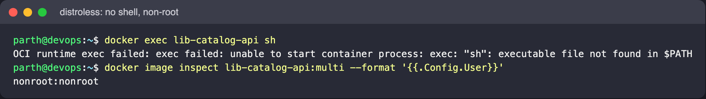
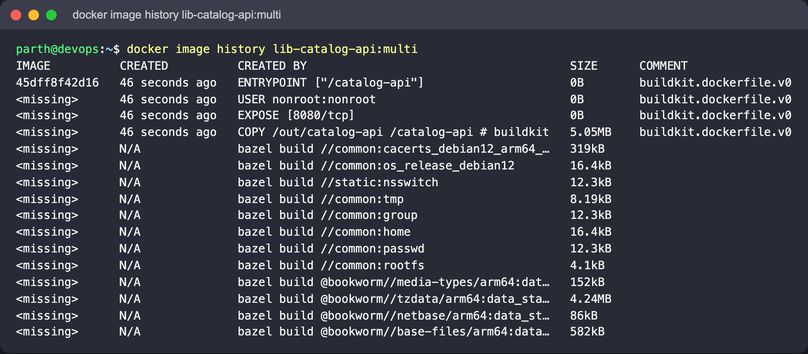
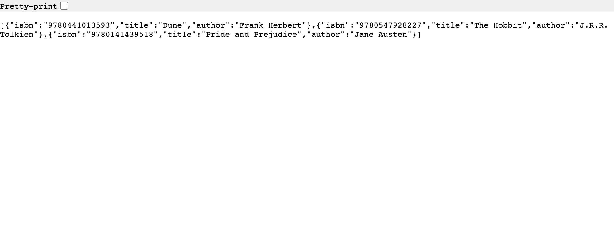
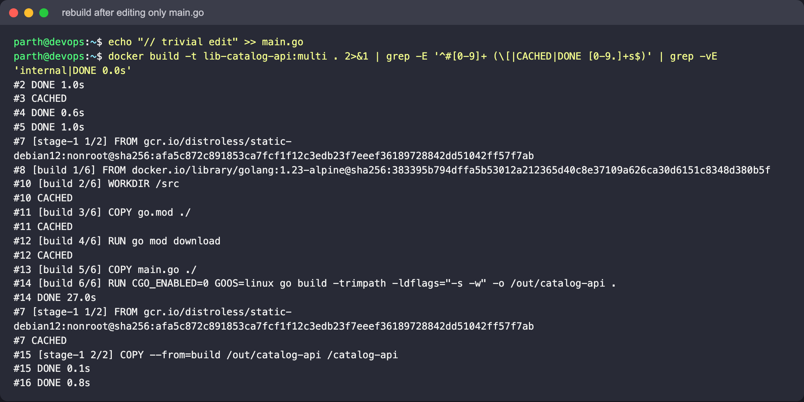
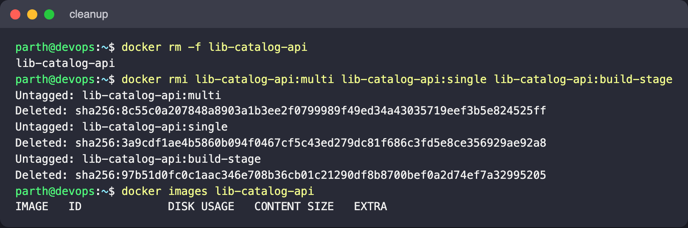

# Dockerfiles and Images - multi-stage build

Author: Parth Agarwal

## Goal

Write a Dockerfile for a small Go service (`catalog-api`) that compiles inside Docker, and show
how a multi-stage build keeps the heavy toolchain out of the image that actually ships. Compare it
against a naive single-stage Dockerfile using real measured sizes.

## Concepts in brief

- **Dockerfile instructions** - `FROM` picks the base, `WORKDIR` sets the working dir, `COPY`
  adds files, `RUN` executes at build time, `ENV`/`EXPOSE`/`USER` set metadata,
  `CMD`/`ENTRYPOINT` define what runs at container start.
- **Layers and cache** - every `RUN`/`COPY` creates a layer. Copying `go.mod` before the source
  lets `go mod download` be cached when only code changes.
- **Multi-stage builds** - several `FROM` lines in one file. Each stage is a separate image;
  `COPY --from=<stage>` pulls specific files forward. Only the last stage becomes the tagged image
  (unless `--target` picks another).
- **Static binary** - `CGO_ENABLED=0` produces a Go binary with no libc dependency, so it can run
  on `distroless/static`, which has no shell, no package manager and runs as `nonroot`.
- **Smaller attack surface** - fewer packages means fewer CVEs to patch and nothing for an
  attacker to `exec` into.

## Files

| File | Purpose |
|---|---|
| `main.go` | HTTP service: `/` (build info), `/books` (JSON list), `/healthz` |
| `go.mod` | Module definition (no third-party deps) |
| `Dockerfile` | Two-stage build: `golang:1.23-alpine` -> `gcr.io/distroless/static-debian12:nonroot` |
| `Dockerfile.single-stage` | Same app in one stage, for size comparison only |
| `.dockerignore` | Keeps README and screenshots out of the build context |

## Commands

```bash
cd "DockerFiles and Images"

# final, multi-stage image
docker build -t lib-catalog-api:multi .

# just the build stage, to see how big it is on its own
docker build --target build -t lib-catalog-api:build-stage .

# naive single-stage image for comparison
docker build -f Dockerfile.single-stage -t lib-catalog-api:single .

docker images lib-catalog-api

docker run -d --name lib-catalog-api -p 18201:8080 lib-catalog-api:multi
curl http://localhost:18201/
curl http://localhost:18201/books
curl http://localhost:18201/healthz

# there is no shell in distroless - this is expected to fail
docker exec lib-catalog-api sh

docker image history lib-catalog-api:multi
```

Cleanup:

```bash
docker rm -f lib-catalog-api
docker rmi lib-catalog-api:multi lib-catalog-api:single lib-catalog-api:build-stage
```

## Real results from this machine

Measured on this machine (Docker 29.5.2, Colima VM, linux/arm64):

| Tag | What it contains | Size (`docker images`) |
|---|---|---|
| `lib-catalog-api:build-stage` | Go toolchain + sources + binary | 469MB |
| `lib-catalog-api:single` | Same, built single-stage | 473MB |
| `lib-catalog-api:multi` | distroless static + 5 MB binary | **13.3MB** |

The shipped image is roughly **35x smaller** than the single-stage one. `docker image history`
showed the only layer this Dockerfile adds is the `COPY /out/catalog-api` of 5.05MB; everything
else is the distroless base.

Real curl / exec output (trimmed):

```text
$ curl -s localhost:18201/
catalog-api built with go1.23.12, running in container 2fade4c5633c
$ curl -s localhost:18201/books
[{"isbn":"9780441013593","title":"Dune","author":"Frank Herbert"},{"isbn":"9780547928227","title":"The Hobbit",...}]
$ docker exec lib-catalog-api sh
OCI runtime exec failed: exec failed: unable to start container process: exec: "sh": executable file not found in $PATH
$ docker image inspect lib-catalog-api:multi --format '{{.Config.User}}'
nonroot:nonroot
```

## What to look for

- `docker images lib-catalog-api` - the `multi` tag is tens of MB smaller than the other two.
- The root endpoint reports the Go version used at build time even though no Go toolchain exists
  in the running image.
- `docker exec ... sh` fails: there is no shell, which is a feature, not a bug.
- Re-running `docker build` after editing only `main.go` reuses the cached `go mod download` layer
  (`CACHED` in the build output).

## Related: three application types

The `Docker Fundamentals` folder deploys Node.js, Python and Java (plus Apache, React and Nginx)
containers; see its README for those Dockerfiles and the measured image sizes.

## Screenshots

All captured from a real run on this machine (Docker engine in a Colima VM, linux/arm64).

Multi-stage build (the middle of the BuildKit log, mostly base-image download progress, is trimmed):



The build stage on its own and the single-stage comparison image:



Sizes - 13.3MB shipped vs ~470MB with the toolchain:



Running the multi-stage image and calling all three endpoints:



No shell inside distroless, and the image runs as `nonroot`:



`docker image history` - the only layer this Dockerfile adds is the 5.05MB binary:



The endpoints in a browser (`/books` and `/`):




Layer cache: after a one-line edit to `main.go`, `WORKDIR`, `COPY go.mod` and `go mod download` are
`CACHED`; only `COPY main.go` and the `go build` step run again (main.go was restored afterwards):



Cleanup:


