# Final DevOps Project & Troubleshooting - Bookshelf (three-tier app)

Author: Parth Agarwal

## Goal

Containerise a small library loan system as three tiers, wire them together with Docker Compose
(healthchecks, ordered startup, isolated networks, persistent volume), test it end to end, and
practise diagnosing common Compose failures.

```text
 browser --:18080--> frontend (nginx + React/Vite build)  --/api/-->  backend (FastAPI)  -->  db (PostgreSQL 17)
                     network: app                                     networks: app, data      network: data
                                                                                               volume: catalog-data
```

- **frontend / reader-web** - React app built with Vite in a Node stage, served by nginx. nginx
  also reverse-proxies `/api/` to `backend:8000`, so the browser makes same-origin calls (no CORS,
  no backend port exposed).
- **backend / loan-service** - FastAPI + psycopg 3. Creates the `books` table on startup.
- **db / catalog-db** - `postgres:17-alpine` with a named volume.

## Concepts in brief

- **Healthchecks** - `db` uses `pg_isready -h 127.0.0.1` (a TCP check, so it is not fooled by the
  temporary socket-only server Postgres runs during `initdb`); the backend image checks
  `/api/health`, which runs `SELECT 1`; the frontend image checks an nginx-only `/nginx-health`.
- **`depends_on: condition: service_healthy`** - Compose starts `backend` only when `db` is
  healthy, and `frontend` only when `backend` is healthy.
- **Network segmentation** - `frontend` is on `app` only, `db` on `data` only, `backend` on both.
  The frontend container cannot even resolve the name `db`.
- **Config via environment** - credentials live in `.env` (git-ignored); `.env.example` is the
  committed template. `${VAR:?message}` makes Compose refuse to start if a value is missing.
- **Persistence** - `docker compose down` keeps the `catalog-data` volume; `down -v` deletes it.

## Files

| Path | Purpose |
|---|---|
| `docker-compose.yml` | The three services, two networks, one volume (project name `lib-bookshelf`) |
| `.env.example` | Template for `.env` (`POSTGRES_DB`, `POSTGRES_USER`, `POSTGRES_PASSWORD`, `FRONTEND_PORT`) |
| `backend/app/main.py` | FastAPI app |
| `backend/Dockerfile` | `python:3.12-slim`, non-root user, `HEALTHCHECK` via Python's urllib |
| `frontend/src/App.jsx` | Book list with add / borrow / return / delete |
| `frontend/nginx.conf` | SPA fallback, `/api/` proxy, `/nginx-health` |
| `frontend/Dockerfile` | Multi-stage: `node:20-alpine` build -> `nginx:1.27-alpine` |
| `test-api.sh` | Curl-based smoke test with status-code assertions |
| `troubleshooting/` | Three deliberately broken compose files and a write-up of each |

## API

| Method | Path | Result |
|---|---|---|
| GET | `/api/health` | `{"status":"ok","database":"up"}` or 503 |
| GET | `/api/books` | List of books |
| POST | `/api/books` | Body `{"title","author"}` -> 201 + the new row; 422 on empty fields |
| POST | `/api/books/{id}/borrow` | 200, 409 if already on loan, 404 if missing |
| POST | `/api/books/{id}/return` | 200, 409 if not on loan, 404 if missing |
| DELETE | `/api/books/{id}` | 204 or 404 |

FastAPI's interactive docs are served at `/api/docs` (OpenAPI schema at `/api/openapi.json`), so
they are reachable through the nginx proxy at http://localhost:18080/api/docs without publishing the
backend port.

## 1. Running it manually (without Compose)

Useful for understanding exactly what Compose automates:

```bash
docker network create lib-manual-net
docker run -d --name lib-manual-db --network lib-manual-net \
  -e POSTGRES_DB=bookshelf -e POSTGRES_USER=librarian -e POSTGRES_PASSWORD=change-me \
  postgres:17-alpine

docker build -t lib-bookshelf-backend  ./backend
docker build -t lib-bookshelf-frontend ./frontend

# wait until Postgres accepts TCP connections
until docker exec lib-manual-db pg_isready -h 127.0.0.1 -U librarian -d bookshelf; do sleep 1; done

# nginx.conf proxies to the hostname "backend", so give the API container that alias
docker run -d --name lib-manual-api --network lib-manual-net --network-alias backend \
  -e DB_HOST=lib-manual-db -e POSTGRES_DB=bookshelf -e POSTGRES_USER=librarian -e POSTGRES_PASSWORD=change-me \
  lib-bookshelf-backend
docker run -d --name lib-manual-web --network lib-manual-net -p 18080:80 lib-bookshelf-frontend

curl http://localhost:18080/api/health

docker rm -f lib-manual-web lib-manual-api lib-manual-db
docker network rm lib-manual-net
```

Note the ordering and the wait loop you have to write yourself; Compose replaces all of it.

## 2. Running with Compose

```bash
cd "Final DevOps Project & Troubleshooting"
cp .env.example .env            # then edit POSTGRES_PASSWORD
docker compose config -q        # validate
docker compose up -d --build
docker compose ps               # all three should become (healthy)
./test-api.sh                   # or ./test-api.sh http://localhost:<FRONTEND_PORT>
```

Open http://localhost:18080 and add, borrow, return and delete a book.

Look inside the database:

```bash
docker compose exec db psql -U librarian -d bookshelf -c 'SELECT id, title, on_loan FROM books;'
```

Check the network isolation:

```bash
docker compose exec frontend wget -qO- -T 3 http://db:5432    # bad address 'db'
```

Persistence:

```bash
docker compose down             # containers and networks gone, volume kept
docker compose up -d
curl -s localhost:18080/api/books   # earlier books are still there
```

Logs:

```bash
docker compose logs -f backend
docker inspect --format '{{json .State.Health}}' lib-bookshelf-db-1
```

Tear down everything including data and built images:

```bash
docker compose down -v
docker rmi lib-bookshelf-backend lib-bookshelf-frontend
```

(`--rmi local` would not remove them: it only deletes images that have no custom tag, and both
services set `image:`. `--rmi all` would also delete the shared `postgres:17-alpine` image.)

## 3. Real results from this machine

Docker 29.5.2 (Colima VM on macOS) / Compose v2, with `.env` copied unchanged from `.env.example`.

`docker compose up -d --build` waited on each healthcheck in order (trimmed):

```text
 Container lib-bookshelf-db-1 Waiting
 Container lib-bookshelf-db-1 Healthy
 Container lib-bookshelf-backend-1 Starting
 Container lib-bookshelf-backend-1 Waiting
 Container lib-bookshelf-backend-1 Healthy
 Container lib-bookshelf-frontend-1 Starting
 Container lib-bookshelf-frontend-1 Started
```

`./test-api.sh`:

```text
PASS frontend serves index.html             200
PASS health reports database up             200
PASS add a book                             201
     created book id=1
PASS list books                             200
     new book present in list
PASS borrow the book                        200
PASS borrow again is a conflict             409
PASS return the book                        200
PASS reject empty title                     422
PASS delete the book                        204
PASS deleted book is gone                   404
passed=10 failed=0
```

Other checks:

```text
$ docker compose exec -T db psql -U librarian -d bookshelf -c 'SELECT id,title,on_loan FROM books;'
 id | title | on_loan
----+-------+---------
  2 | Dune  | f
$ docker compose exec -T frontend wget -qO- -T 3 http://db:5432
wget: bad address 'db:5432'
$ docker compose down && docker compose up -d && curl -s localhost:18080/api/books
[{"id":2,"title":"Dune","author":"Frank Herbert","on_loan":false}]
```

Right after `up -d` returns, the frontend may still be in `health: starting` for a second or two;
an immediate curl can come back empty, so wait for `(healthy)` before testing.

## 4. Troubleshooting

See [`troubleshooting/README.md`](troubleshooting/README.md). Three scenarios were reproduced here,
each with its real error and fix:

| File | Bug | Tell-tale symptom |
|---|---|---|
| `broken-1-no-db-healthcheck.yml` | No db healthcheck, plain `depends_on` | Backend `Exited (3)`, `Connection refused` to the db IP, nginx returns 502 |
| `broken-2-localhost-db-host.yml` | `DB_HOST: localhost` | `connection to server at "127.0.0.1"... refused`, frontend stuck in `Created` |
| `broken-3-missing-network.yml` | Backend not on `data` network | `Name or service not known`, frontend stuck in `Created` |

## Screenshots

All captured from a real run on this machine (Docker 29.5.2 in a Colima VM on macOS, Compose v2).

### Manual run (section 1)

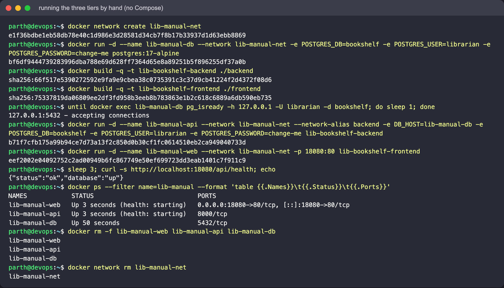

### Compose

`docker compose config` (password lines filtered out of the screenshot):

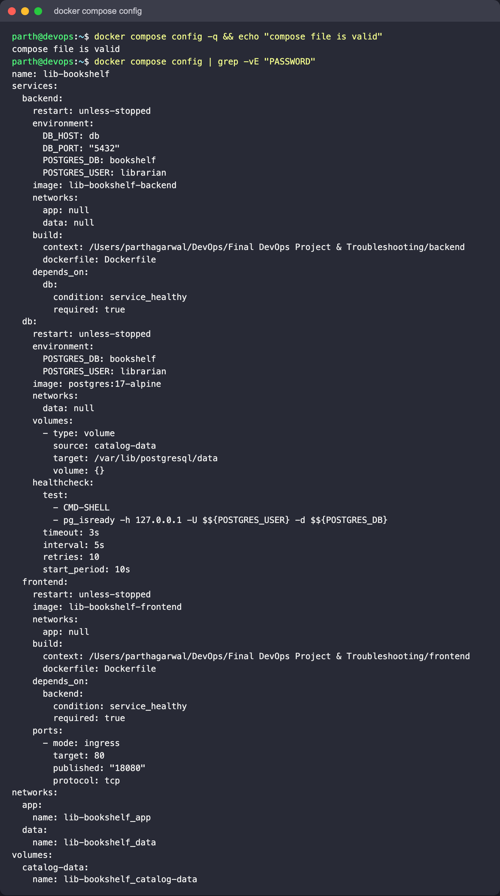

`docker compose up -d --build` - db Waiting -> Healthy, then backend, then frontend:

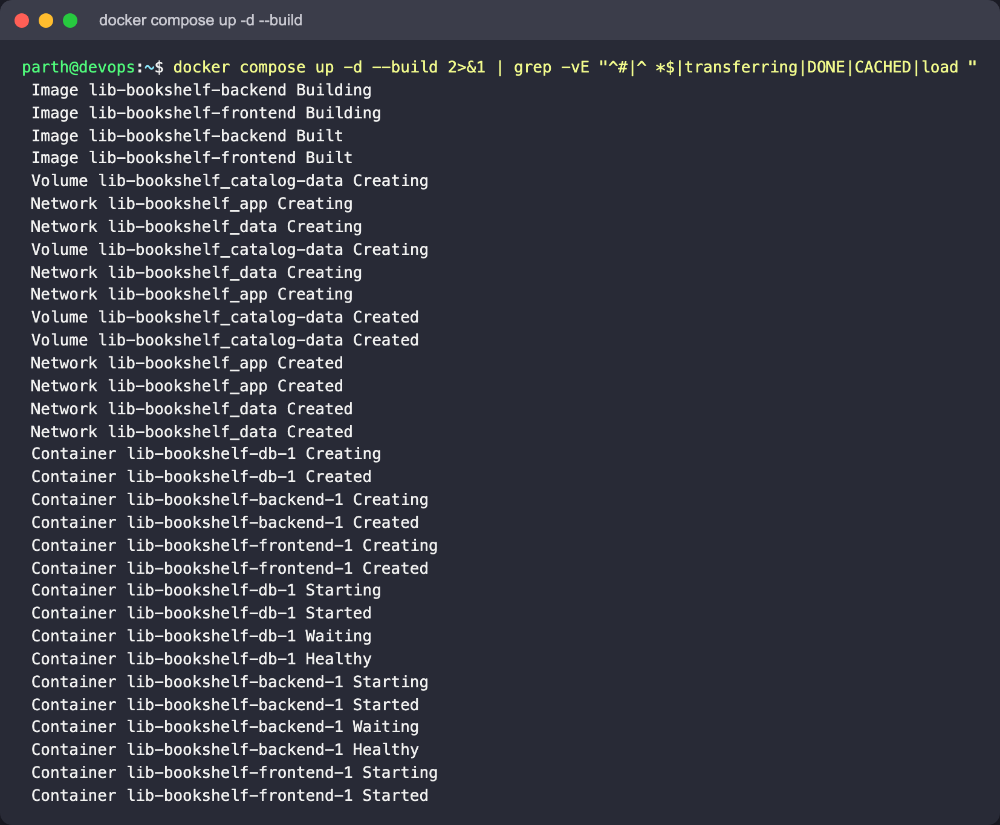

All three services `(healthy)`:

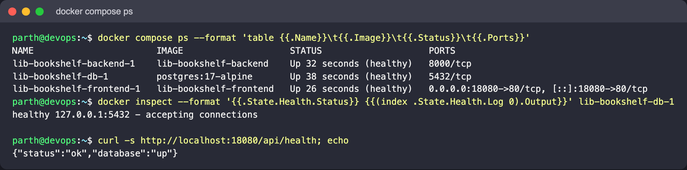

`./test-api.sh`:

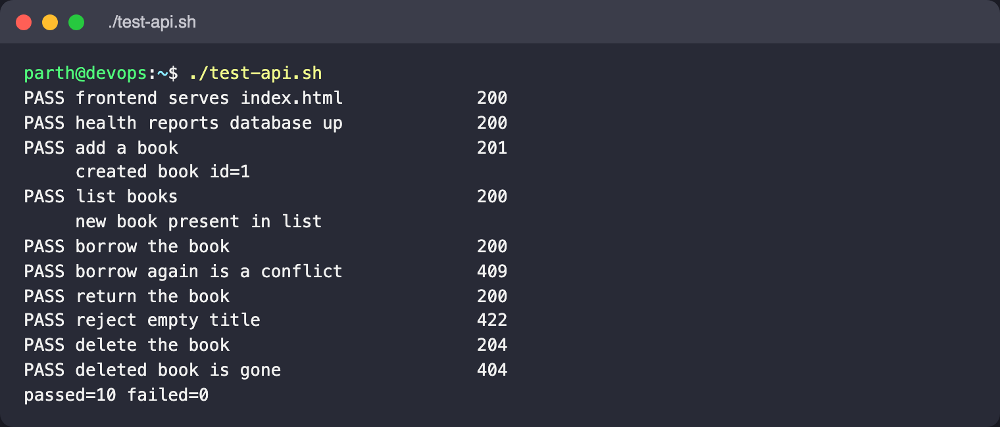

Adding books and borrowing one through the API:

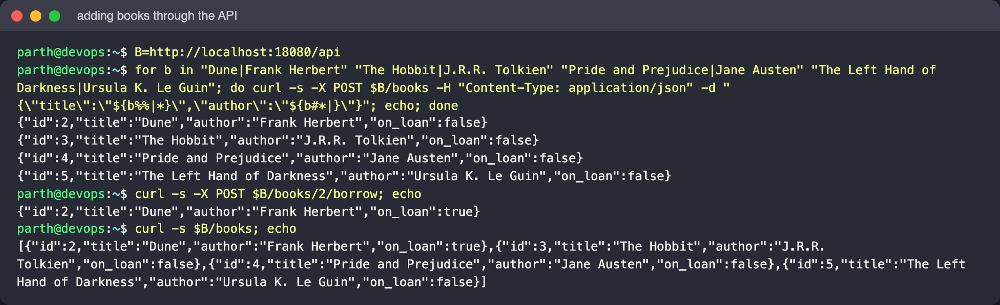

### In the browser

The React frontend at http://localhost:18080 showing the rows from PostgreSQL, one "On loan":

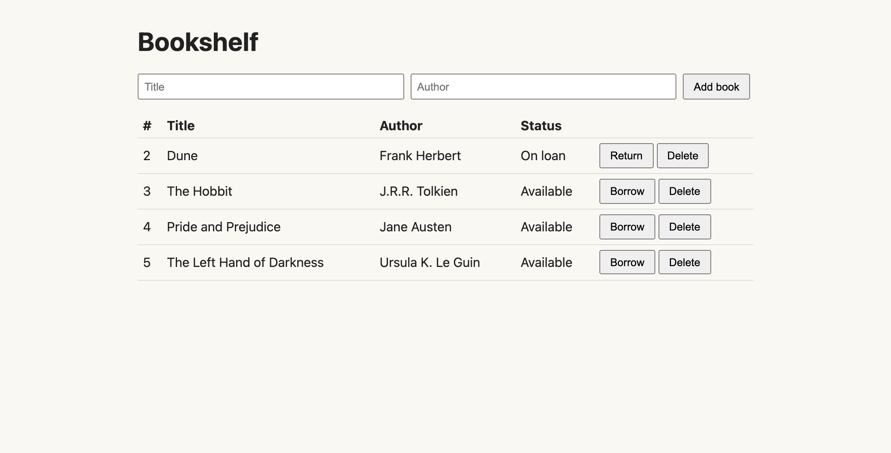

After typing "Kindred / Octavia E. Butler" into the form and clicking "Add book":

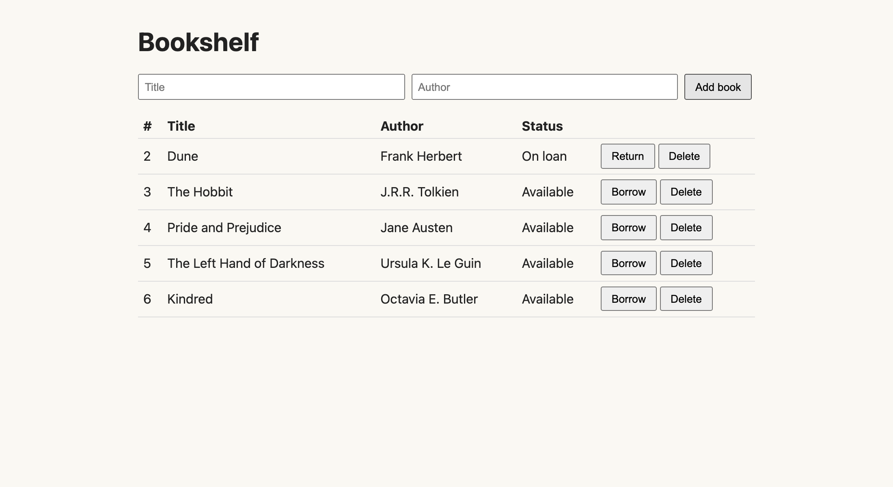

FastAPI's Swagger UI, reached through the nginx proxy at http://localhost:18080/api/docs:

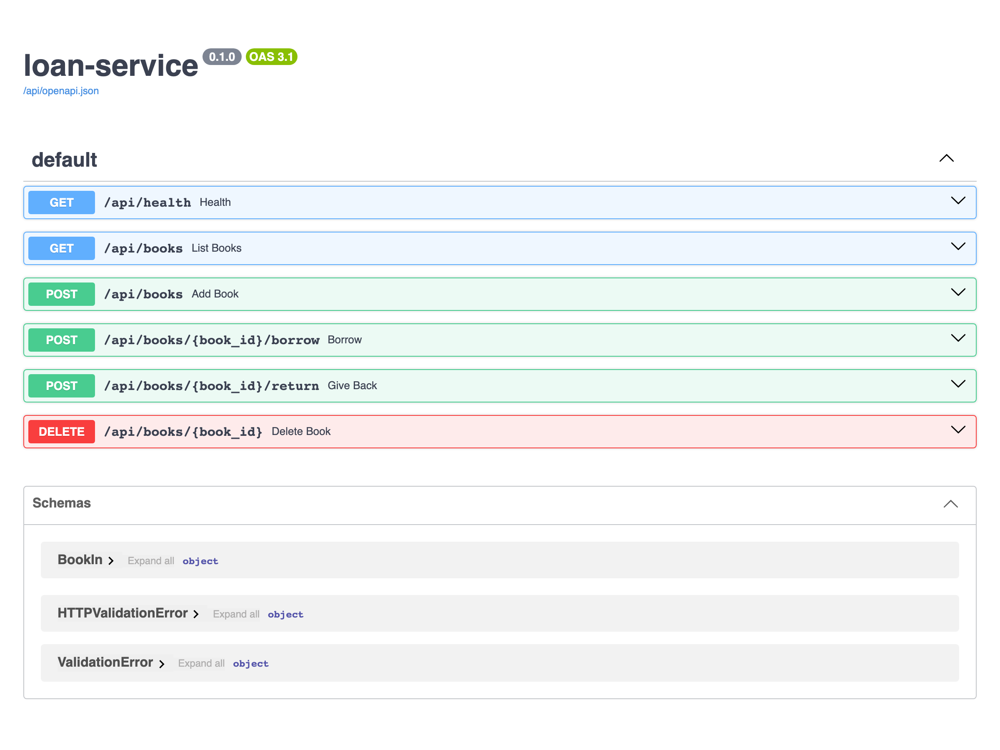

### Database, isolation, persistence, logs

`psql` inside the db container; the frontend cannot resolve `db`, the backend can:

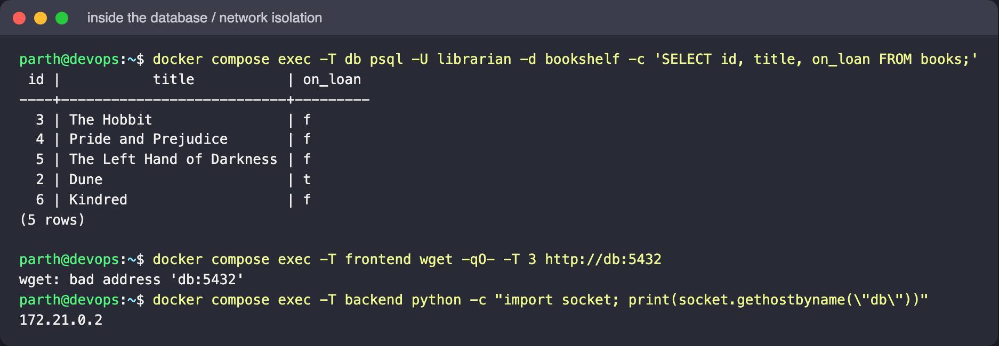

`docker compose down` keeps the volume; after `up` the same books come back:

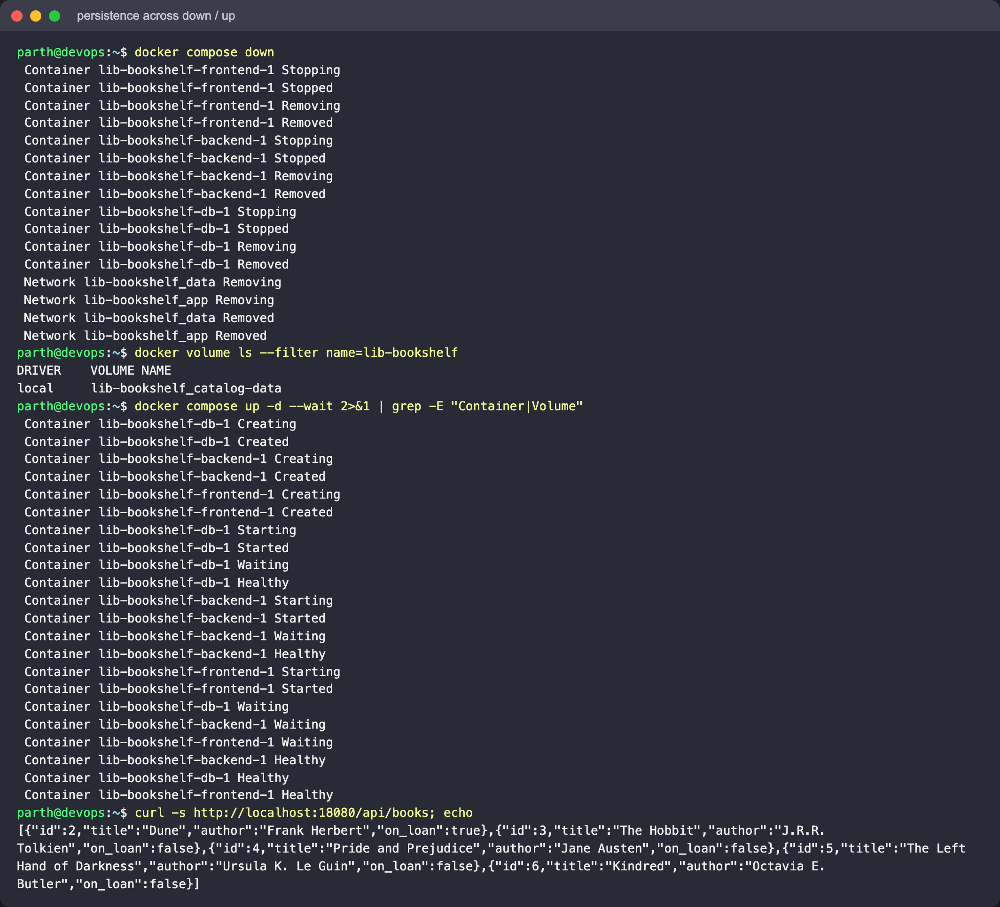

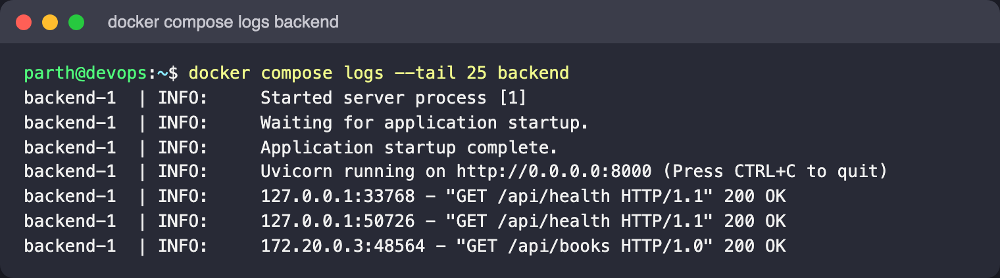

### Troubleshooting scenarios

Each broken file was run for real, then fixed by running the corrected file (`docker-compose.yml`)
under the same project name. Details in [`troubleshooting/README.md`](troubleshooting/README.md).

| Broken | Fixed |
|---|---|
|  |  |
|  |  |
|  |  |

### Teardown

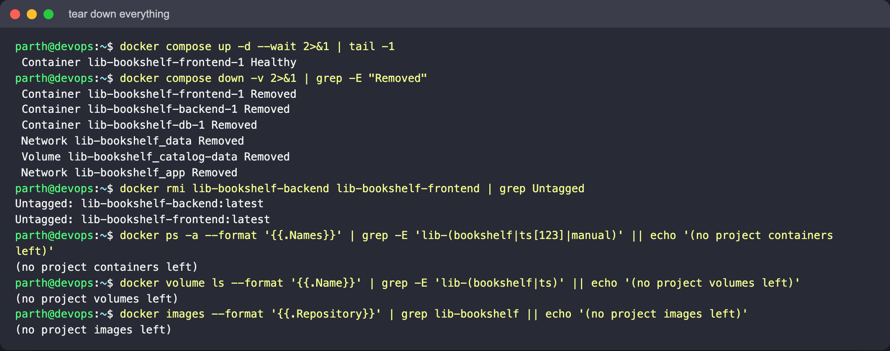
