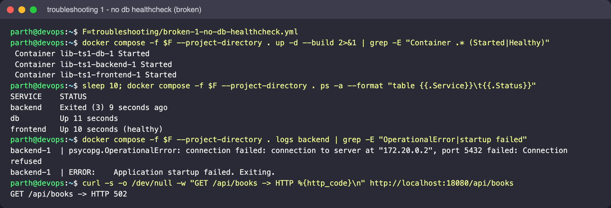
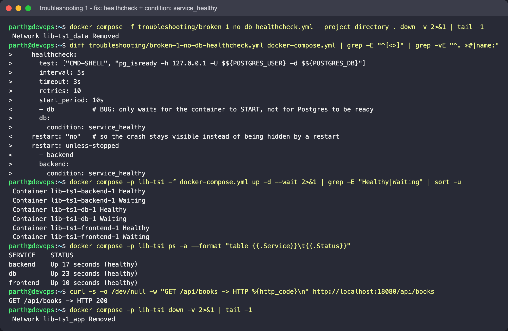
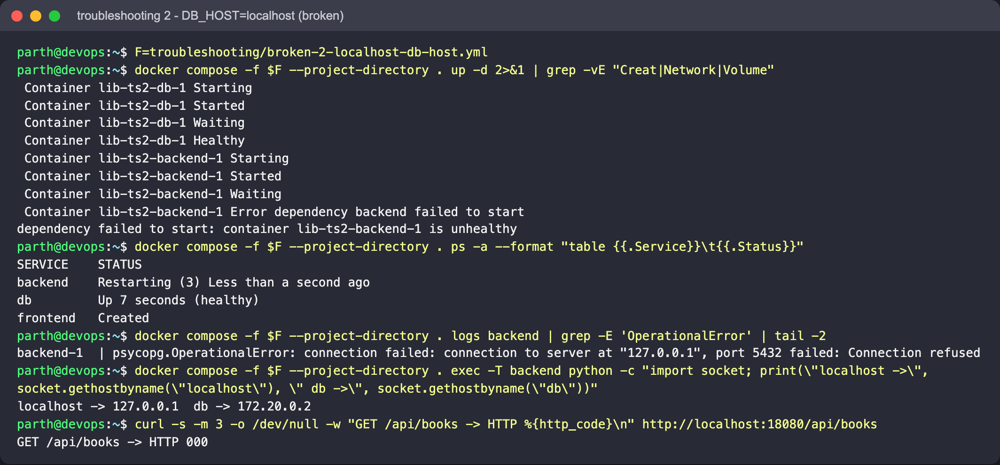
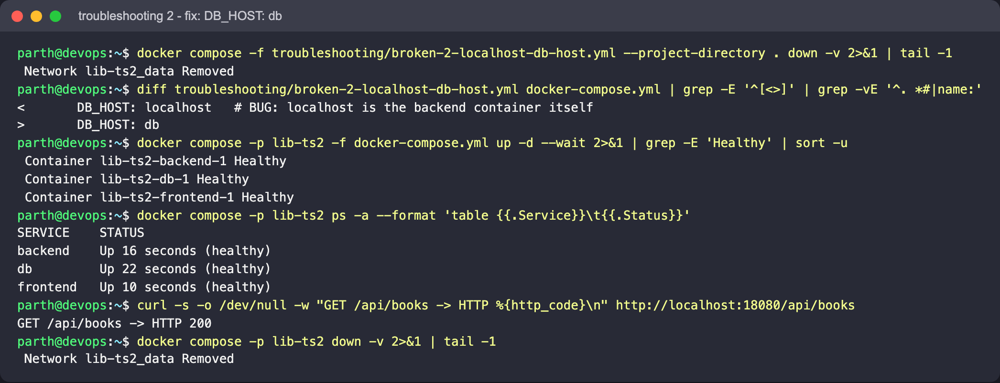
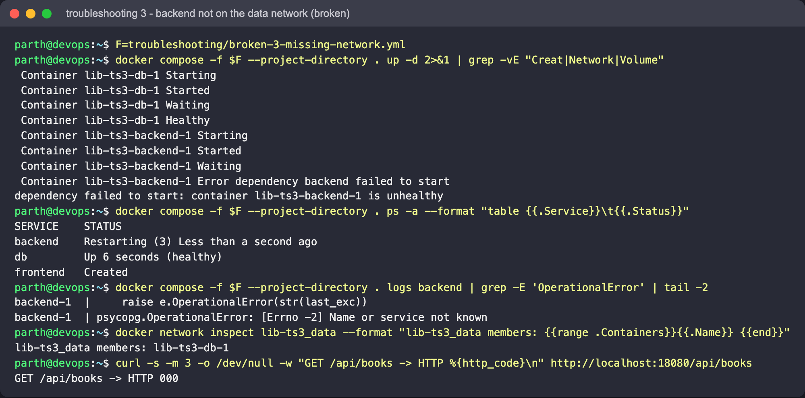
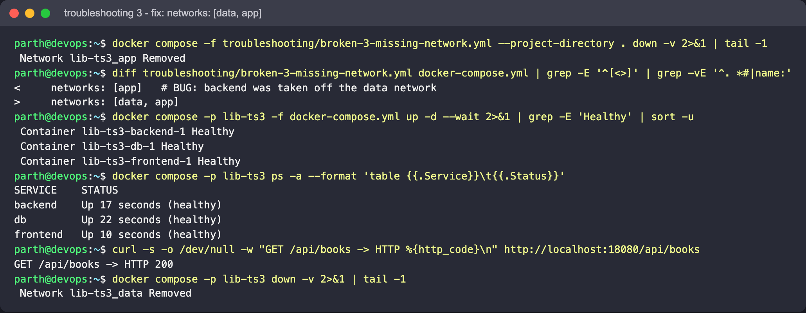

# Troubleshooting scenarios

Each file here is a full copy of `../docker-compose.yml` with one deliberate bug. They use their
own project names (`lib-ts1`, `lib-ts2`, `lib-ts3`) so they never touch the real stack's volume.
Only run one at a time (they all publish port 18080), and make sure `../.env` exists.

Run from the project root (the folder that holds `docker-compose.yml`):

```bash
F=troubleshooting/broken-1-no-db-healthcheck.yml      # or broken-2-..., broken-3-...
docker compose -f $F --project-directory . up -d --build
docker compose -f $F --project-directory . ps -a
docker compose -f $F --project-directory . logs backend
docker compose -f $F --project-directory . down -v
```

`--project-directory .` makes the build contexts (`./backend`, `./frontend`) and `.env` resolve
from the project root rather than from `troubleshooting/`.

To confirm a fix, tear the broken stack down and start the corrected file under the same project
name, e.g. `docker compose -p lib-ts1 -f docker-compose.yml up -d --wait`, then `curl` the API.

A general diagnosis order that works for all three:

1. `docker compose ps -a` - which service is `Exited`, `Restarting` or `unhealthy`?
2. `docker compose logs <service>` - the first error message is usually the real one.
3. `docker inspect --format '{{json .State.Health}}' <container>` - the healthcheck's own output.
4. `docker compose config` - the fully resolved file (env vars substituted, networks listed).
5. `docker network inspect <project>_<network>` - which containers are actually attached.

---

## 1. Backend starts before Postgres is ready (`broken-1-no-db-healthcheck.yml`)

**Change:** the `db` healthcheck is removed and `depends_on` uses the short list form
(`- db`), so Compose only waits for the db container to be *started*. `restart: "no"` keeps the
crash visible.

**Symptom (real output, fresh volume):**

```text
backend   Exited (3) 12 seconds ago
db        Up 13 seconds
frontend  Up 12 seconds (healthy)

psycopg.OperationalError: connection failed: connection to server at "172.20.0.2", port 5432 failed: Connection refused
ERROR:    Application startup failed. Exiting.

curl localhost:18080/api/books  -> HTTP 502
```

The frontend is healthy (nginx is up) but every `/api` call returns 502 Bad Gateway because
there is no backend behind it. On a fresh volume Postgres spends several seconds running
`initdb`; the backend connects during that window and dies.

**Fix:** give `db` a real readiness healthcheck and make dependants wait for it:

```yaml
db:
  healthcheck:
    test: ["CMD-SHELL", "pg_isready -h 127.0.0.1 -U $${POSTGRES_USER} -d $${POSTGRES_DB}"]
    interval: 5s
    retries: 10
backend:
  depends_on:
    db:
      condition: service_healthy
```

Belt and braces: an application-level retry loop on startup (or `restart: unless-stopped`) also
helps, but the healthcheck is what expresses the dependency correctly.

Real run (broken, then fixed):





## 2. `DB_HOST=localhost` (`broken-2-localhost-db-host.yml`)

**Change:** `DB_HOST: localhost` instead of `DB_HOST: db`.

**Symptom (real output):**

```text
dependency failed to start: container lib-ts2-backend-1 is unhealthy
backend   Restarting (3) Less than a second ago        <- crash loop
db        Up 7 seconds (healthy)
frontend  Created                                      <- never started

localhost -> 127.0.0.1  db -> 172.20.0.2                <- resolved inside the backend container

psycopg.OperationalError: connection failed: connection to server at "127.0.0.1", port 5432 failed: Connection refused
```

Inside a container, `localhost` is the container itself. Nothing listens on 5432 in the backend
container, so the connection is refused even though the database is perfectly healthy. Because
the frontend waits for `backend: service_healthy`, it stays in `Created` and port 18080 never
opens.

**Fix:** use the Compose service name, which Docker's embedded DNS resolves on the shared
network: `DB_HOST: db`. Verify with
`docker compose exec backend python -c "import socket; print(socket.gethostbyname('db'))"`.

Real run (broken, then fixed):





## 3. Backend not on the database network (`broken-3-missing-network.yml`)

**Change:** `backend` is attached only to `app`, not to `data`.

**Symptom (real output):**

```text
dependency failed to start: container lib-ts3-backend-1 is unhealthy
backend   Restarting (3) Less than a second ago
db        Up 9 seconds (healthy)
frontend  Created

psycopg.OperationalError: [Errno -2] Name or service not known
```

The error is a DNS failure, not "connection refused": service names only resolve for containers
that share a network. `docker network inspect lib-ts3_data` lists only the db container.

**Fix:** attach the backend to both networks (`networks: [data, app]`). The split itself is
intentional - the frontend should stay off `data` so it can never reach Postgres directly.

Real run (broken, then fixed):





## Cleanup

```bash
for f in troubleshooting/broken-*.yml; do
  docker compose -f "$f" --project-directory . down -v --remove-orphans
done
```
