# Helm Commands

The chart `reading-room/` was generated with `helm create reading-room`. It is the standard
scaffold: an nginx Deployment, a Service, a ServiceAccount, an optional Ingress, HTTPRoute
and HPA, and a `helm test` Pod. Three changes were made after generating it: the chart
description, `appVersion: "1.27-alpine"` (the default image tag comes from it), and explicit
`resources` in `values.yaml`.

Namespace: `helm-cmds`. Run the commands from this folder.

## 1. Create

```bash
helm create reading-room
tree reading-room          # or: find reading-room -type f
```

Look at `values.yaml` and how `templates/deployment.yaml` reads it (`.Values.replicaCount`,
`.Values.image.repository`), and at `_helpers.tpl`, which defines the shared name and label
snippets (`reading-room.fullname`, `reading-room.labels`).

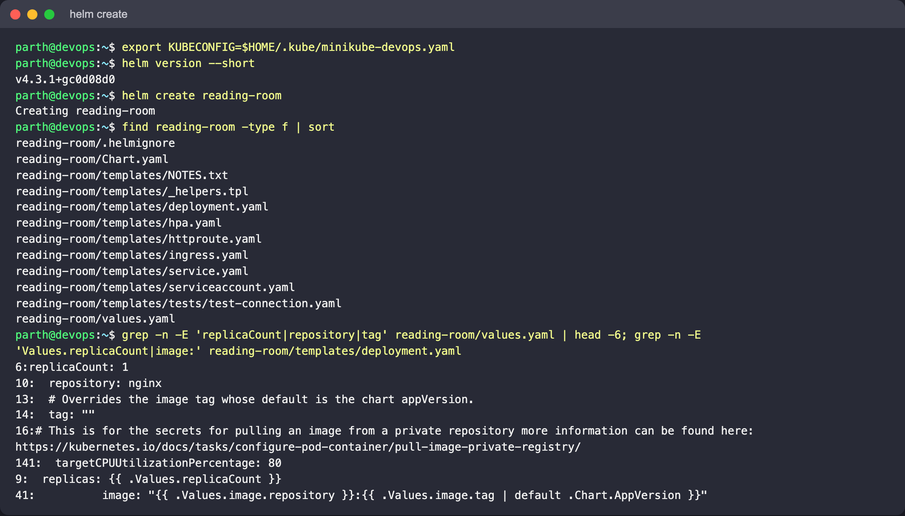

## 2. Lint and render

```bash
helm lint reading-room
helm template rr reading-room | less
helm template rr reading-room --set replicaCount=3 | grep replicas
helm template rr reading-room --set autoscaling.enabled=true | grep -E '^kind:'
```

Expect: lint reports `0 chart(s) failed` (an INFO about a missing icon is fine). Without
any flags the output contains ServiceAccount, Service, Deployment and the test Pod. With
autoscaling enabled, a HorizontalPodAutoscaler appears and the Deployment no longer sets
`replicas`.

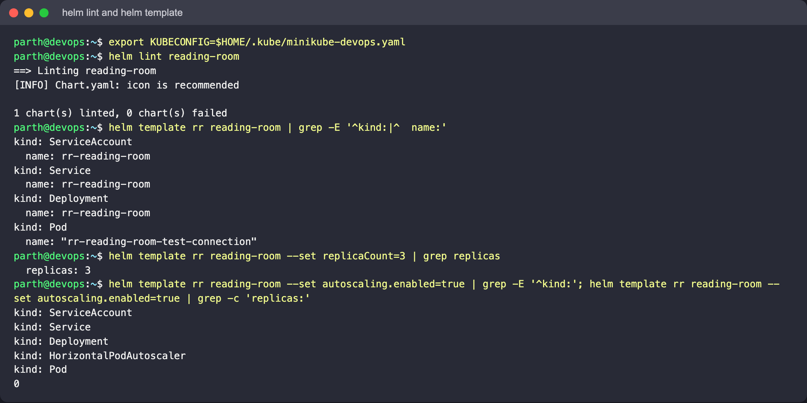

## 3. Install and list

```bash
helm install rr reading-room -n helm-cmds --create-namespace --wait
helm list -n helm-cmds
kubectl -n helm-cmds get all -l app.kubernetes.io/instance=rr
```

Expect: `STATUS deployed` and `REVISION 1`. Every object has the label
`app.kubernetes.io/managed-by=Helm`.

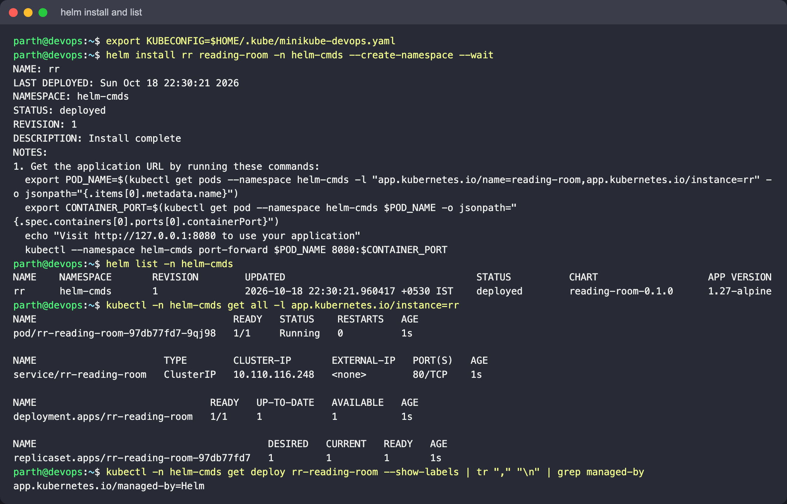

Open it in a browser through a port-forward
(`kubectl -n helm-cmds port-forward svc/rr-reading-room 18080:80`):

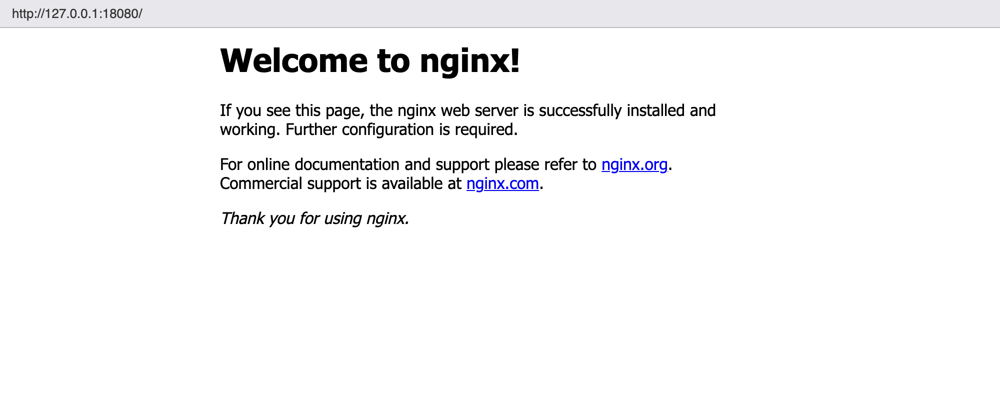

## 4. Status, NOTES and test

```bash
helm status rr -n helm-cmds
helm test rr -n helm-cmds
```

`status` prints the rendered `NOTES.txt` again (with the port-forward instructions).
`helm test` runs `templates/tests/test-connection.yaml`, a busybox Pod that `wget`s the
Service, and should report `Phase: Succeeded`.

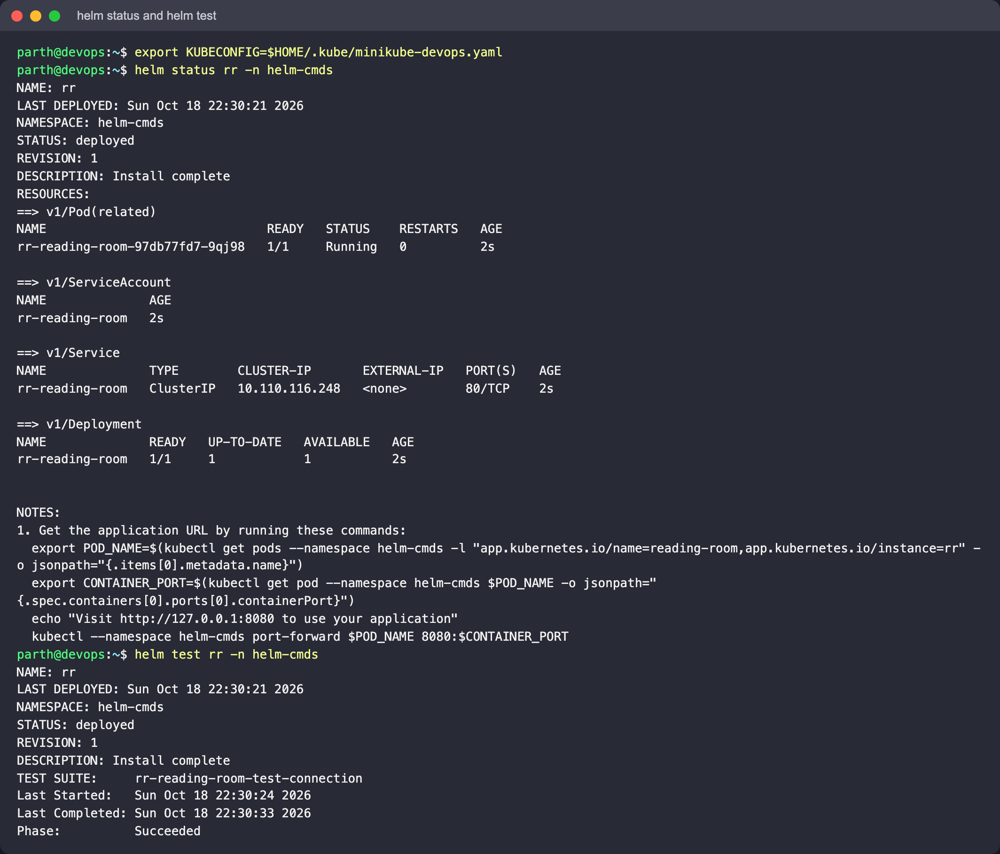

## 5. Get

```bash
helm get values rr -n helm-cmds            # only user-supplied values (none yet)
helm get values rr -n helm-cmds --all      # merged values
helm get manifest rr -n helm-cmds | head -40
helm get notes rr -n helm-cmds
kubectl -n helm-cmds get secrets -l owner=helm
```

Expect: one `sh.helm.release.v1.rr.v1` Secret, which is where Helm keeps the release record.

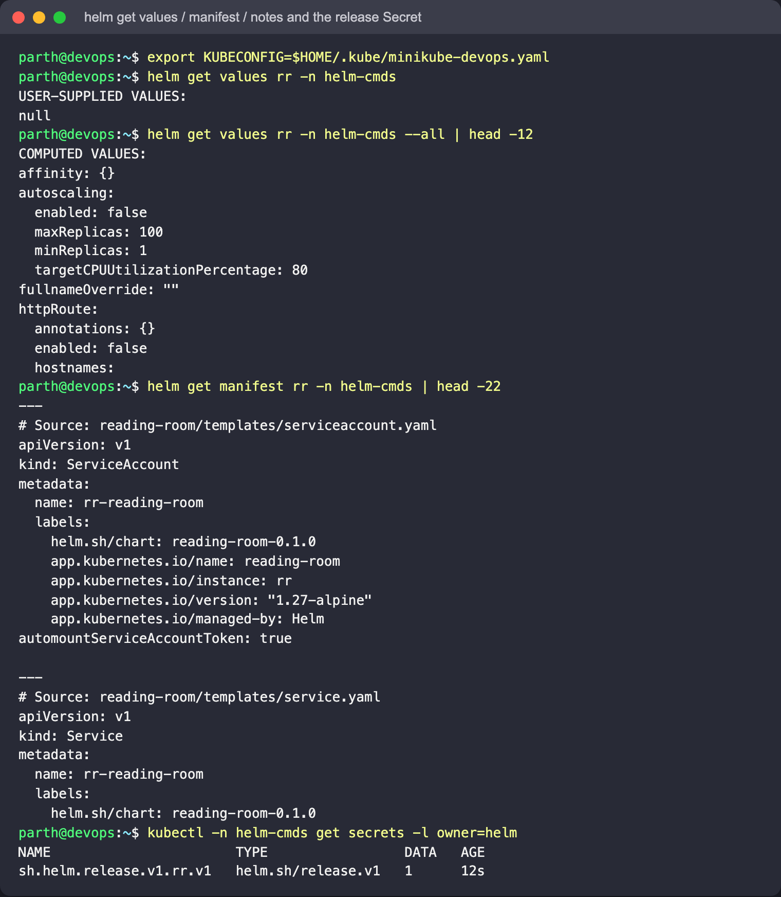

## 6. Upgrade and history

```bash
helm upgrade rr reading-room -n helm-cmds --set replicaCount=2 --set image.tag=1.27.3-alpine --wait
helm history rr -n helm-cmds
kubectl -n helm-cmds get pods -l app.kubernetes.io/instance=rr
```

Expect: revision 2 with two Pods on the new image, and revision 1 marked `superseded`.


## 7. Rollback

```bash
helm rollback rr 1 -n helm-cmds --wait
helm history rr -n helm-cmds
```

Expect: a **new** revision 3 with the description `Rollback to 1`, and one Pod running
the original tag again. A rollback never rewrites history. It adds a new revision that
copies an old one.

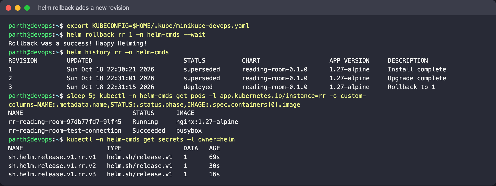

## 8. Dry run and uninstall

```bash
helm install rr-preview reading-room -n helm-cmds --dry-run=server --set replicaCount=5 | head -30
helm list -n helm-cmds                    # rr-preview is not there
helm uninstall rr -n helm-cmds
helm list -n helm-cmds                    # empty
```

Helm 4 note: `helm list` already shows releases in every status, and the Helm 3 flags
`-a/--all` are gone (`Error: unknown flag`). Filter with `--deployed`, `--failed`,
`--uninstalled` and so on instead.

`--dry-run=server` renders the chart and has the API server validate it, but nothing is
created. `uninstall` deletes the objects and the release Secrets. Add `--keep-history` if
you want `helm history` to keep working afterwards.

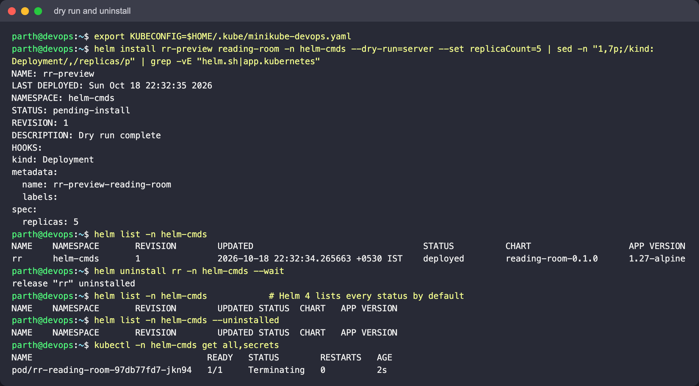

## 9. Repositories, search, show

```bash
helm repo add podinfo https://stefanprodan.github.io/podinfo
helm repo add bitnami https://charts.bitnami.com/bitnami
helm repo list
helm repo update
helm search repo podinfo
helm search repo nginx --versions | head
helm search hub wordpress | head           # Artifact Hub
helm show chart podinfo/podinfo
helm show values podinfo/podinfo | less
```

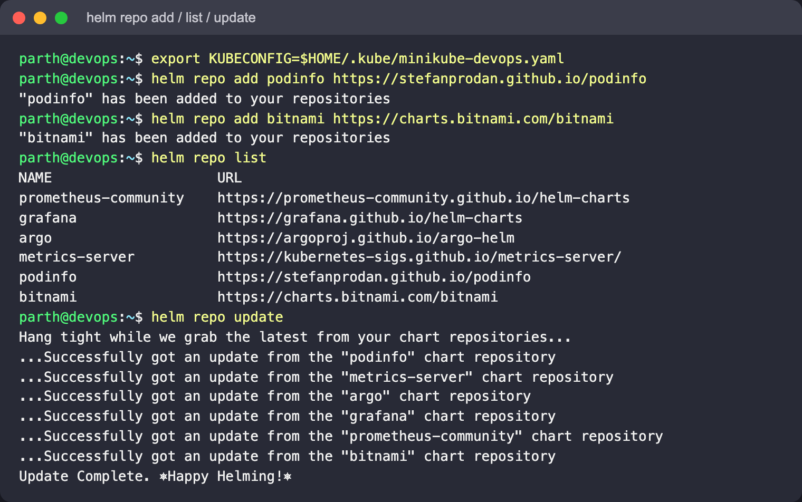

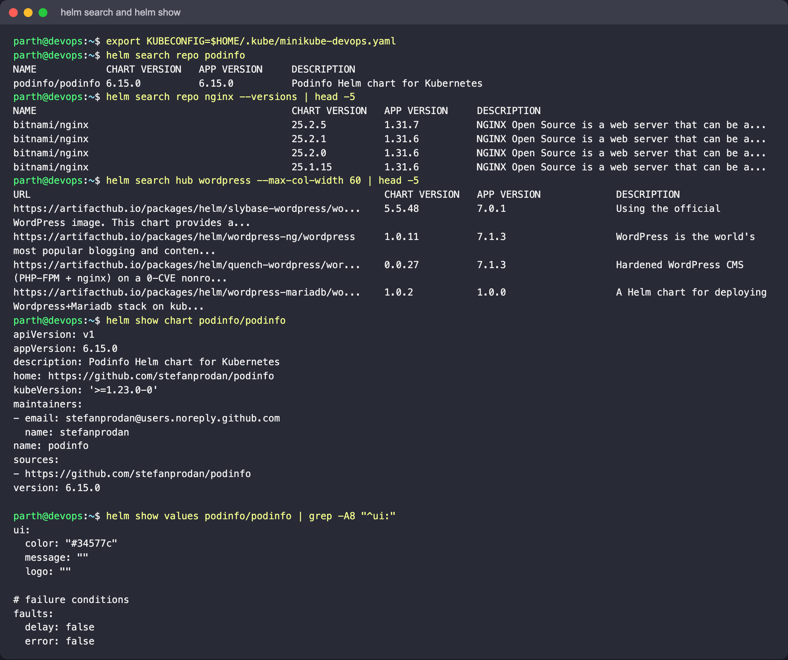

(`helm repo list` also shows repositories that were already configured on this machine.)

## 10. Install a public chart

```bash
helm install catalogue-demo podinfo/podinfo -n helm-cmds --create-namespace \
  --set replicaCount=2 --set ui.message="Library catalogue demo" --wait
kubectl -n helm-cmds port-forward svc/catalogue-demo-podinfo 9898:9898
curl -s localhost:9898 | grep message
helm uninstall catalogue-demo -n helm-cmds
```

Expect: the JSON response includes `"message": "Library catalogue demo"`.

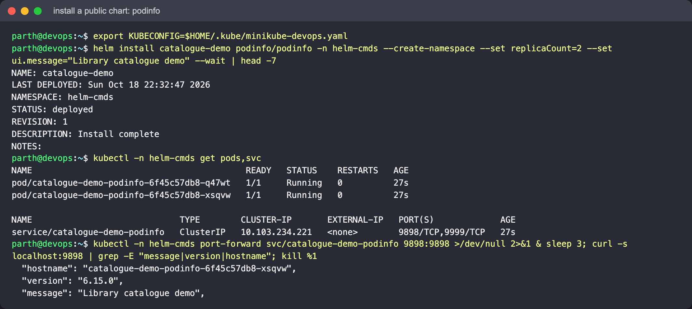

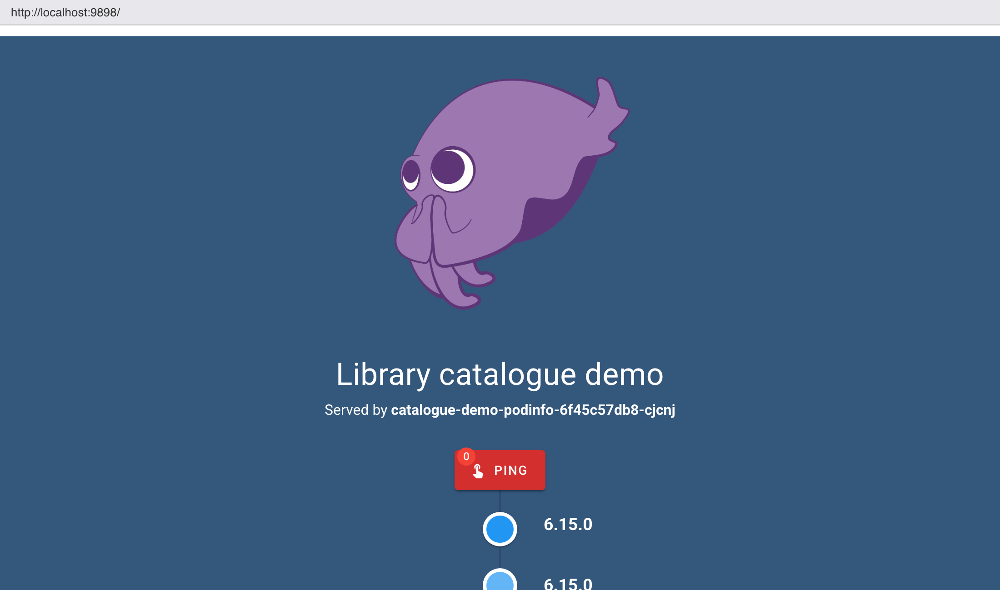

## 11. Package and remove a repo

```bash
helm package reading-room                 # -> reading-room-0.1.0.tgz (from Chart.yaml `version`)
helm show chart reading-room-0.1.0.tgz
helm repo remove bitnami
kubectl delete namespace helm-cmds
```

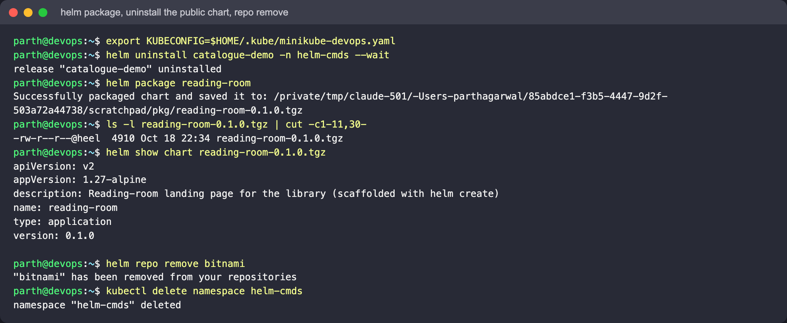

The package was built in a scratch copy of the chart. The `.tgz` is not committed.
