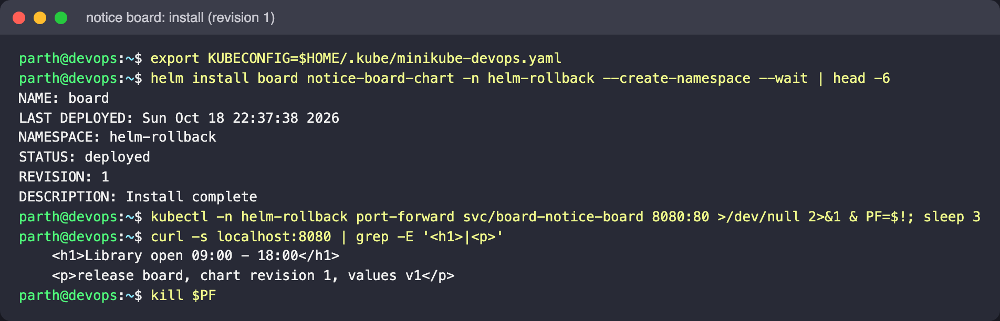
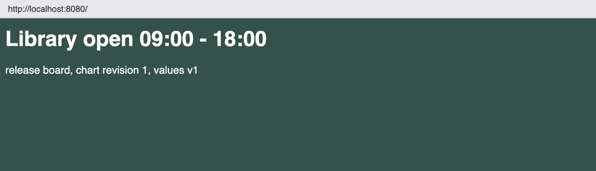
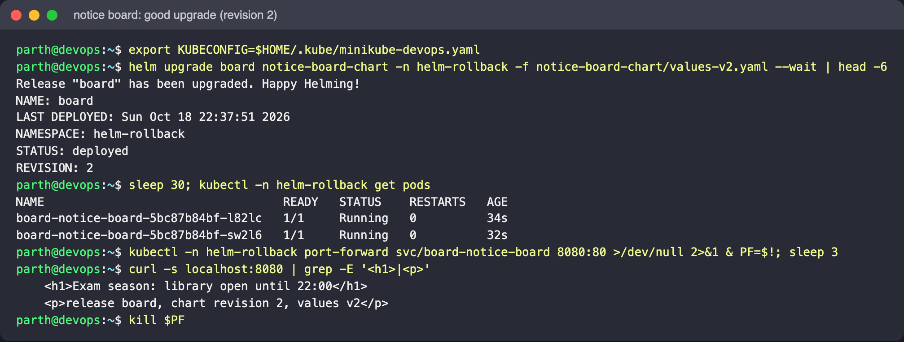
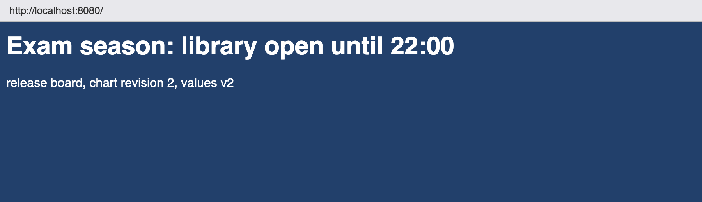
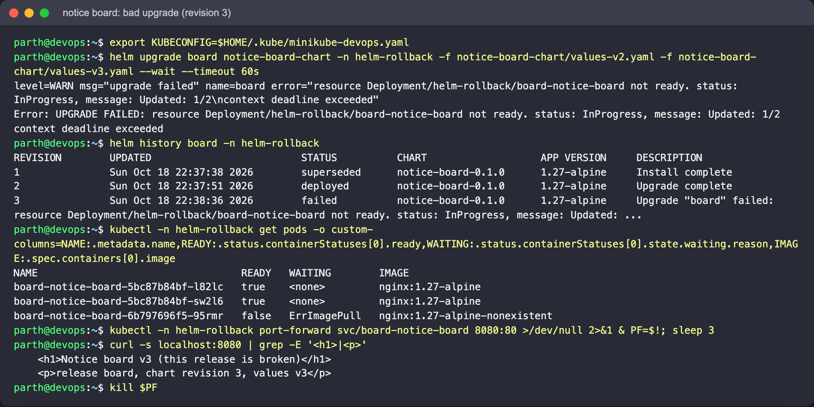
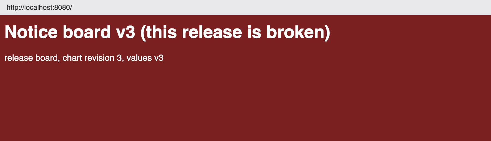
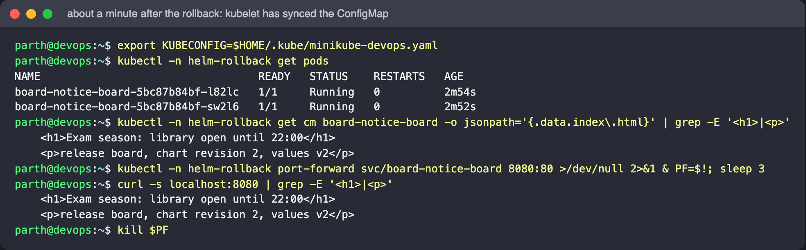

# Helm Rollback Workflow

The chart `notice-board-chart/` serves one HTML page from a ConfigMap. The page shows the
headline, the values version (`v1`/`v2`/`v3`) and `.Release.Revision`, so a single `curl`
tells you which release is live. A `checksum/page` annotation on the Pod template makes
every content change roll the Pods.

| File | Revision | Change |
|---|---|---|
| `values.yaml` | 1 | 1 replica, normal opening hours |
| `values-v2.yaml` | 2 | 2 replicas, exam-season headline (good change) |
| `values-v3.yaml` | 3 | image tag `1.27-alpine-nonexistent` (bad change) |

Namespace: `helm-rollback`. Run the commands from this folder. In a second terminal, keep a
port-forward open so you can check the page (start it again after each rollout, because
it attaches to a single Pod):

```bash
kubectl -n helm-rollback port-forward svc/board-notice-board 8080:80
```

## Step 1: install (revision 1)

```bash
helm install board notice-board-chart -n helm-rollback --create-namespace --wait
curl -s localhost:8080 | grep -E '<h1>|<p>'
```

Expect: "Library open 09:00 - 18:00", `chart revision 1, values v1`.





## Step 2: good upgrade (revision 2)

```bash
helm upgrade board notice-board-chart -n helm-rollback -f notice-board-chart/values-v2.yaml --wait
kubectl -n helm-rollback get pods
curl -s localhost:8080 | grep -E '<h1>|<p>'
```

Expect: two Pods, and the exam-season headline with `revision 2, values v2`.





## Step 3: bad upgrade (revision 3)

Layer v3 on top of v2. `--wait` with a short timeout makes Helm notice that the rollout
never finishes:

```bash
helm upgrade board notice-board-chart -n helm-rollback \
  -f notice-board-chart/values-v2.yaml -f notice-board-chart/values-v3.yaml --wait --timeout 60s
helm history board -n helm-rollback
kubectl -n helm-rollback get pods
```

Expect: the command fails after 60 s with a timeout and revision 3 is marked `failed`. A
new Pod sits in `ErrImagePull`/`ImagePullBackOff`. The old v2 Pods keep running because
the default rolling update never removes old Pods before new ones are Ready, so users still
see v2. Look at the page anyway: the ConfigMap has already been replaced with v3 content,
but the running v2 Pods only pick it up when the kubelet next syncs the projected file.
This shows that config and code can drift apart in a half-finished release.

What actually happened on Minikube (Helm v4.3.1): the upgrade failed after 60 s with
`resource Deployment/helm-rollback/board-notice-board not ready ... context deadline
exceeded`, and revision 3 is `failed`. One new Pod is stuck in `ErrImagePull`, and the
two v2 Pods are still Ready. But the page they serve had **already switched to the v3
content**, because the ConfigMap is shared and the kubelet refreshed the mounted file:





## Step 4: roll back to revision 2

```bash
helm history board -n helm-rollback
helm rollback board 2 -n helm-rollback --wait
helm history board -n helm-rollback
helm get values board -n helm-rollback
kubectl -n helm-rollback get pods
curl -s localhost:8080 | grep -E '<h1>|<p>'
```

Expect: revision 4 with the description `Rollback to 2`. The broken Pod is gone, and two
Pods run `nginx:1.27-alpine`.

Observed: the rollback re-applies the manifest **stored for revision 2**, so the page says
`chart revision 2, values v2`, not 4 (`.Release.Revision` was rendered when revision 2
was created). Because that stored Pod template (and its checksum) is identical to revision
2's, the two v2 Pods are kept rather than replaced. Right after the rollback they were
still serving the v3 page, until the kubelet's next ConfigMap sync about a minute later:





Lesson: a page or config that is read from a mounted ConfigMap can change *before* or
*after* the Pods do. If the content must change at the same time as the rollout, give
each version its own ConfigMap name (for example, with a hash suffix) instead of updating
one in place.

## Takeaways

- A rollback creates a new revision. History only ever grows, and `--history-max` (default
  10) limits how many are kept.
- `helm rollback REL` with no number goes back one revision. With a number, it goes to
  exactly that revision.
- `--wait` together with `--timeout` turns "Pods never became Ready" into a failed release.
  `--rollback-on-failure` (Helm 4; `--atomic` in Helm 3) rolls back automatically.
- After a rollback, `helm get values` shows the restored values. A later `upgrade
  --reuse-values` builds on those, not on the failed revision.

## Cleanup

```bash
helm uninstall board -n helm-rollback
kubectl delete namespace helm-rollback
```
