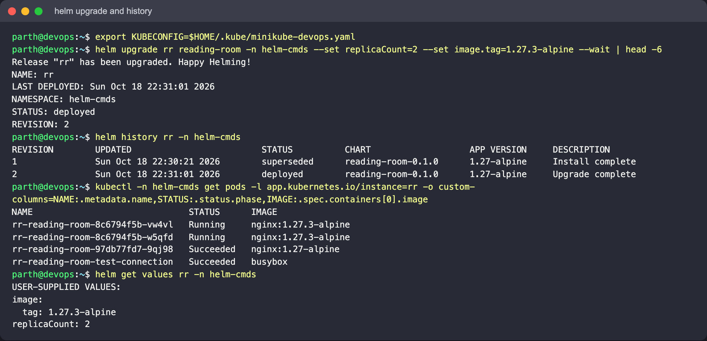
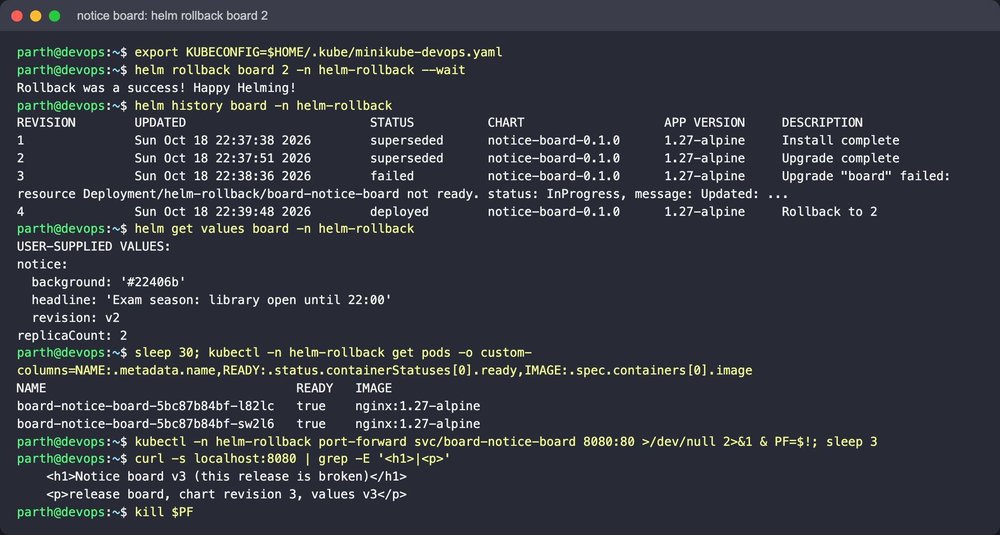

# Helm

Author: Parth Agarwal

Helm packages a set of Kubernetes manifests as a **chart**. You write the YAML once as Go
templates, move everything that changes between environments into **values**, and install,
upgrade and roll back the whole set as one versioned **release**. The examples are part of
the library system: a reading-room page, a notice board and the `loan-service` API.

Target environment: Helm v3/v4 CLI and a Minikube cluster. Each exercise uses its own
`helm-*` namespace. Everything below was run with Helm v4.3.1 against Minikube
(docker driver, Kubernetes v1.37) on Colima, and each exercise README embeds the
screenshots from that run. Web pages were opened through `kubectl port-forward`.

| Term | Meaning |
|---|---|
| Chart | Directory with `Chart.yaml` (name, version, appVersion), `values.yaml` (defaults) and `templates/` |
| Values | Template inputs. Override with `-f file.yaml` (later files win) or `--set key=value` (wins over files) |
| Release | One installed copy of a chart, identified by name + namespace |
| Revision | A number that goes up on every install, upgrade and rollback. Helm stores each revision as a Secret (`sh.helm.release.v1.<name>.v<N>`) |
| Repository | HTTP or OCI location of packaged charts (`helm repo add`, `oci://...`) |
| `version` vs `appVersion` | Chart packaging version (SemVer) vs the version of the app inside it |

```text
Helm/
├── 01-helm-commands/           everyday commands on a chart made with `helm create`
│   └── reading-room/
├── 02-helm-rollback/           v1 → v2 (good) → v3 (broken image) → rollback to v2
│   └── notice-board-chart/
├── mini-project/               hand-written chart with dev and prod values
│   └── loan-service-chart/
└── screenshots/
```

## Exercises

1. [Helm commands](01-helm-commands/README.md): `create`, `lint`, `template`, `install`,
   `list`, `status`, `get`, `upgrade`, `history`, `rollback`, `--dry-run`, `uninstall`,
   `repo`, `search`, `show`, `package`, plus a public chart from a repository.
2. [Rollback workflow](02-helm-rollback/README.md): a page that shows which revision is
   live, so you can see each upgrade and rollback take effect.
3. [Mini project](mini-project/README.md): `loan-service` chart written by hand, with
   helpers, conditionals, `.Files.Get`, a config checksum, an optional HPA and NodePort,
   dev/prod values, a bad upgrade and a rollback.

## Validated locally (no cluster)

The commands below were run while writing this folder. They all passed: lint gave 0 failed
charts, and every rendered resource was valid in kubeconform `-strict`.

```bash
helm lint 01-helm-commands/reading-room
helm lint 02-helm-rollback/notice-board-chart -f 02-helm-rollback/notice-board-chart/values-v2.yaml
helm lint mini-project/loan-service-chart -f mini-project/loan-service-chart/values-prod.yaml
helm template loans mini-project/loan-service-chart -f mini-project/loan-service-chart/values-prod.yaml \
  | docker run --rm -i ghcr.io/yannh/kubeconform:latest -strict -summary -
```

The commands that need a cluster (`install`, `upgrade`, `rollback` and so on) are written
out in each exercise, along with what was actually observed on the cluster.





## Cheat sheet

```bash
helm create NAME                           # scaffold
helm lint DIR [-f values.yaml]             # static checks
helm template REL DIR [-f ...] [--set ...] # render locally
helm install REL DIR -n NS --create-namespace [-f ...] [--wait]
helm upgrade --install REL DIR -n NS -f values-prod.yaml
helm list -n NS | helm status REL -n NS | helm history REL -n NS   # Helm 4: list shows all statuses
helm get values|manifest|notes REL -n NS [--revision N]
helm rollback REL [N] -n NS
helm uninstall REL -n NS
helm repo add NAME URL && helm repo update && helm search repo KEYWORD
helm show values REPO/CHART
helm package DIR
```
