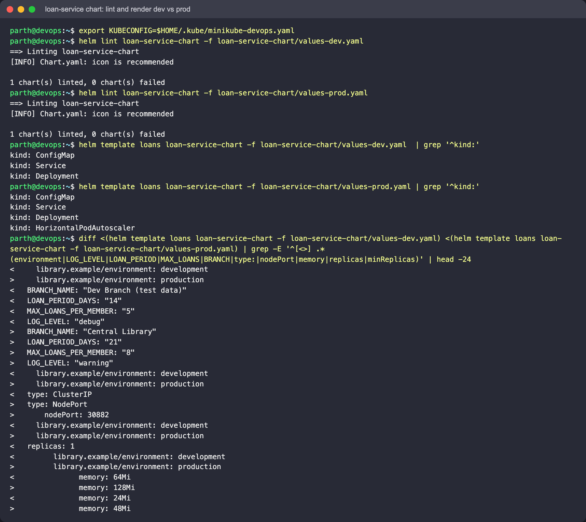
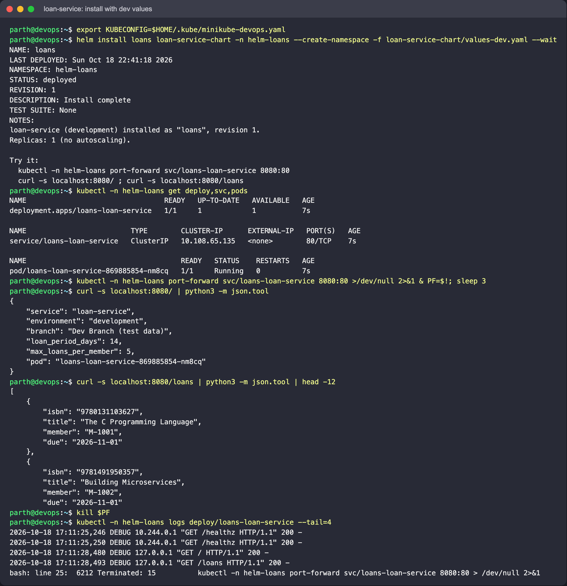
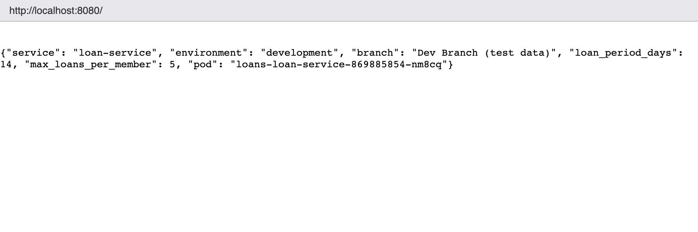
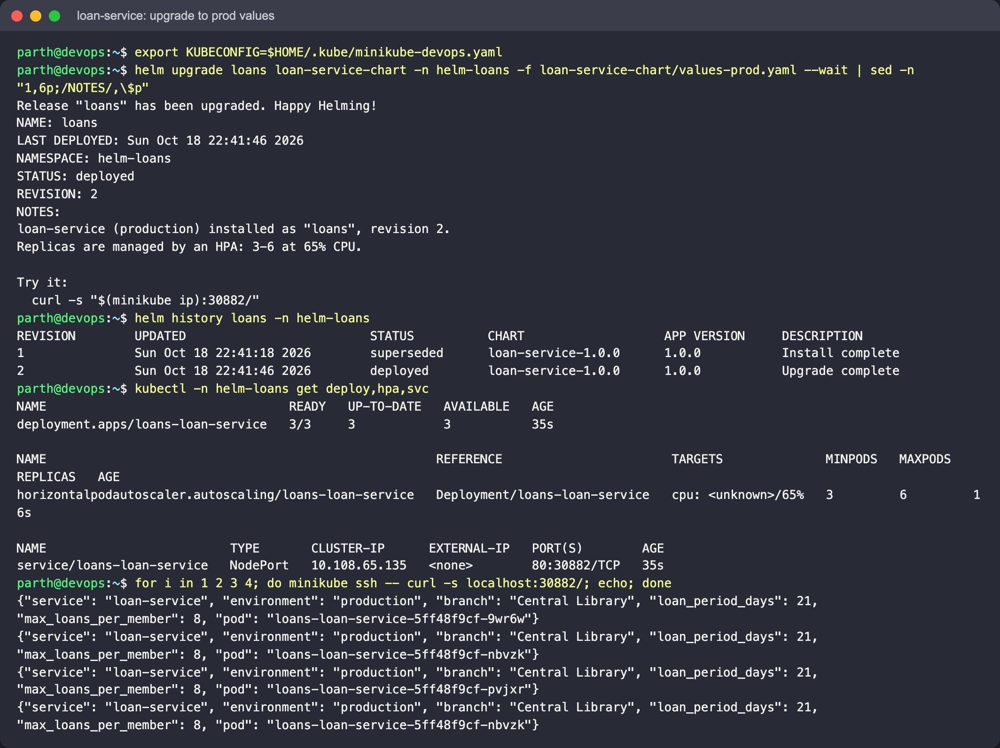
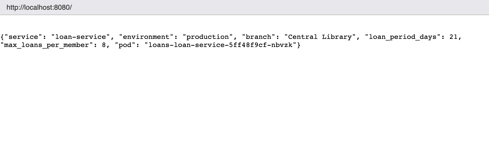
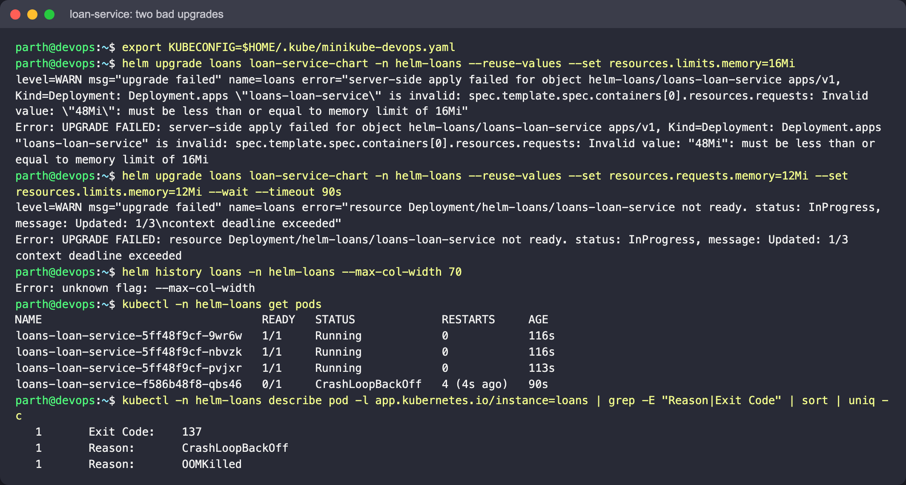
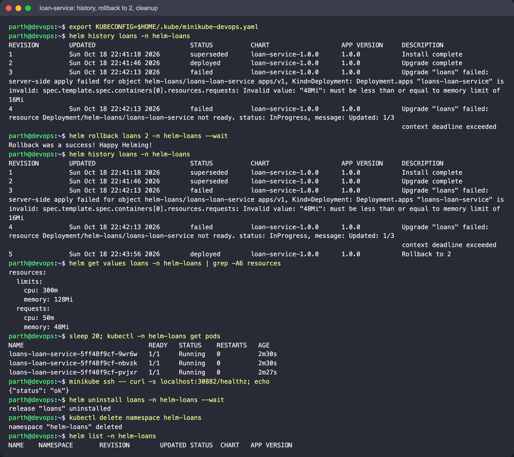

# Mini Project: Packaging `loan-service` with Helm

A chart written from scratch (no `helm create`) for the library's loan API. The app is a
single Python standard-library file (`files/server.py`) that runs on the public
`python:3.12-alpine` image, so no custom image build is needed. Helm puts the code into a
ConfigMap with `.Files.Get` and mounts it at `/app`.

API: `GET /` returns service info (environment, branch, loan rules, Pod name), `GET /loans`
returns sample loans with due dates, and `GET /healthz` is used by the probes.

```text
loan-service-chart/
├── Chart.yaml            version 1.0.0, appVersion 1.0.0
├── values.yaml           defaults
├── values-dev.yaml       1 replica, debug logging, small resources, ClusterIP
├── values-prod.yaml      NodePort 30882, HPA 3-6 @ 65% CPU, larger resources, 21-day loans
├── files/server.py       the application
└── templates/
    ├── _helpers.tpl      fullname, selector labels, common labels (incl. environment)
    ├── configmap.yaml    env settings + server.py
    ├── deployment.yaml   envFrom ConfigMap, checksum/config annotation, optional probes
    ├── service.yaml      nodePort only when type is NodePort
    ├── hpa.yaml          rendered only if autoscaling.enabled
    └── NOTES.txt         how to reach it, differs for NodePort vs ClusterIP
```

Template features used: `include` + `nindent`, `if` / `else`, `and` / `eq`, `toYaml`,
`quote`, `.Files.Get`, `sha256sum` of the rendered ConfigMap (so a config change rolls the
Pods), and `replicas` left out when the HPA owns scaling (otherwise every `helm upgrade`
would undo the HPA's work).

Namespace: `helm-loans`. Run the commands from this folder.

## 1. Lint, render, install (dev)

```bash
helm lint loan-service-chart -f loan-service-chart/values-dev.yaml
helm lint loan-service-chart -f loan-service-chart/values-prod.yaml
helm template loans loan-service-chart -f loan-service-chart/values-dev.yaml  | grep '^kind:'
helm template loans loan-service-chart -f loan-service-chart/values-prod.yaml | grep '^kind:'
helm install loans loan-service-chart -n helm-loans --create-namespace \
  -f loan-service-chart/values-dev.yaml --wait
kubectl -n helm-loans port-forward svc/loans-loan-service 8080:80
curl -s localhost:8080/ ; curl -s localhost:8080/loans
```







Local results while writing this: both lints passed. Dev renders ConfigMap, Service and
Deployment, and prod also renders a HorizontalPodAutoscaler. All of them passed kubeconform
`-strict`. `server.py` was run in a `python:3.12-alpine` container and answered `/`, `/loans`
and `/healthz` with 200, and an unknown path with 404.

Expect on the cluster: `"environment": "development"`, `"branch": "Dev Branch (test data)"`,
`loan_period_days: 14`, and debug request lines in `kubectl logs`.

## 2. Upgrade to production values

```bash
helm upgrade loans loan-service-chart -n helm-loans -f loan-service-chart/values-prod.yaml --wait
helm history loans -n helm-loans
kubectl -n helm-loans get deploy,hpa,svc
curl -s "$(minikube ip):30882/"
# With the docker driver on macOS (Colima here) the node IP is not reachable from the
# host, so call the NodePort from inside the node instead:
minikube ssh -- curl -s localhost:30882/
```

Expect: revision 2. The HPA keeps 3 replicas (its minimum), and the Service becomes
NodePort 30882. The response shows `production`, `loan_period_days: 21` and
`max_loans_per_member: 8`. Calling it several times gives different `pod` names. The Pods
were replaced because the config checksum changed.





## 3. Two bad upgrades

```bash
# A: a limit below the request -> the API server rejects the Deployment, Helm marks the revision failed
helm upgrade loans loan-service-chart -n helm-loans --reuse-values \
  --set resources.limits.memory=16Mi

# B: valid YAML, but 12Mi is too little for the Python interpreter -> OOMKilled, rollout never finishes
helm upgrade loans loan-service-chart -n helm-loans --reuse-values \
  --set resources.requests.memory=12Mi --set resources.limits.memory=12Mi --wait --timeout 90s

helm history loans -n helm-loans
kubectl -n helm-loans get pods
kubectl -n helm-loans describe pod -l app.kubernetes.io/instance=loans | grep -E "Reason|Exit Code"
```

Expect: A fails straight away with an error that the memory request must be less than or
equal to the limit. B times out, and the new Pods show `OOMKilled` / exit 137 and
`CrashLoopBackOff`, while the old prod Pods (`maxUnavailable` defaults to 25 %) keep
serving. Both revisions are `failed` in `helm history`. (The 12 Mi number was checked
locally: `docker run -m 12m --memory-swap 12m python:3.12-alpine python -u /app/server.py`
was OOM-killed with exit 137.)

Observed with Helm 4: upgrade A is rejected during server-side apply (`resources.requests:
Invalid value: "48Mi": must be less than or equal to memory limit of 16Mi`). Upgrade B
times out with `Updated: 1/3`, and its single new Pod is `OOMKilled` / exit 137 →
`CrashLoopBackOff`, while the three prod Pods keep running:



(The `helm history --max-col-width` call in that screenshot is a Helm 3 flag that Helm 4
no longer has. The history is shown in the next screenshot.)

## 4. Roll back and clean up

```bash
helm rollback loans 2 -n helm-loans --wait
helm history loans -n helm-loans
helm get values loans -n helm-loans
minikube ssh -- curl -s localhost:30882/healthz
helm uninstall loans -n helm-loans
kubectl delete namespace helm-loans
```

Expect: a new revision `Rollback to 2` with the prod values (`48Mi` / `128Mi`) restored,
and `/healthz` returns `{"status": "ok"}`. After `uninstall`, `helm list -n helm-loans`
is empty.


