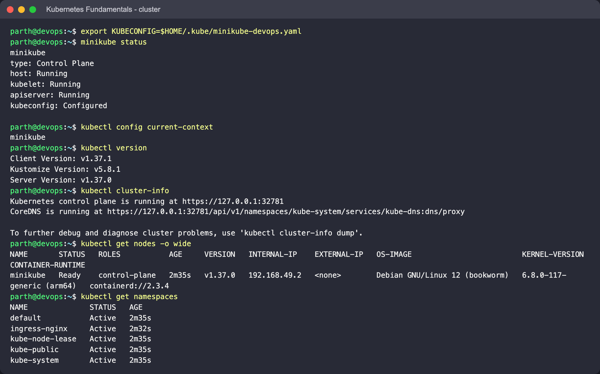
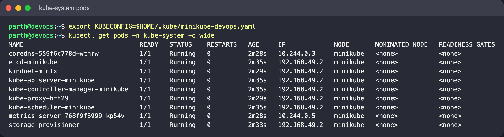
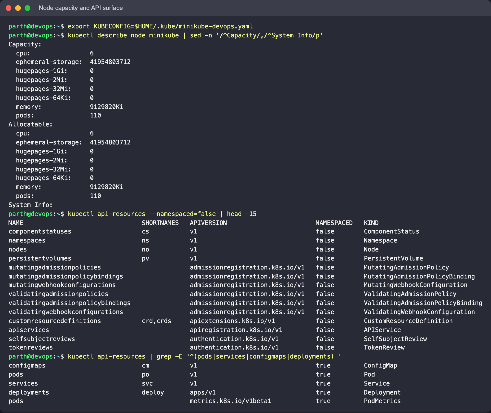
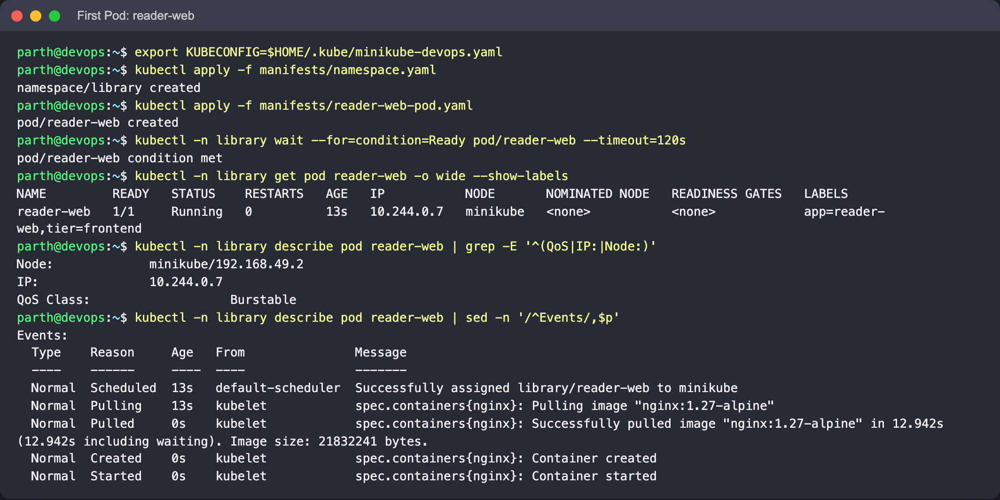
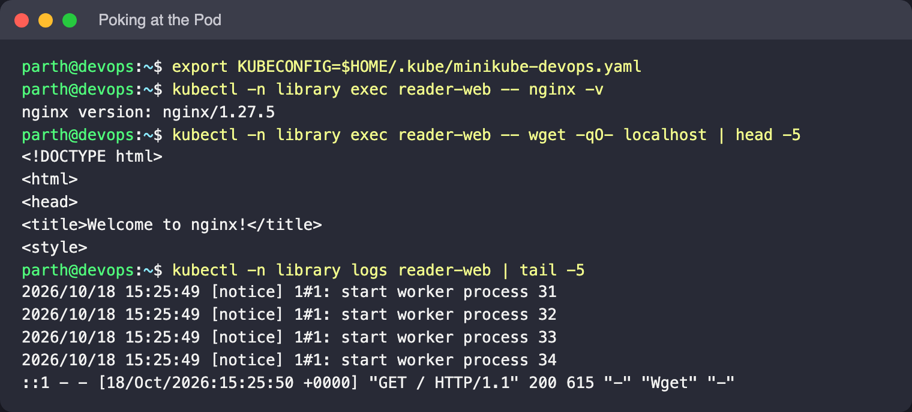
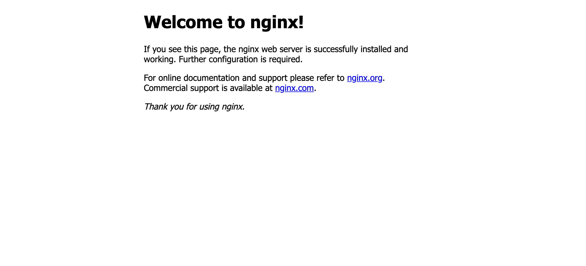
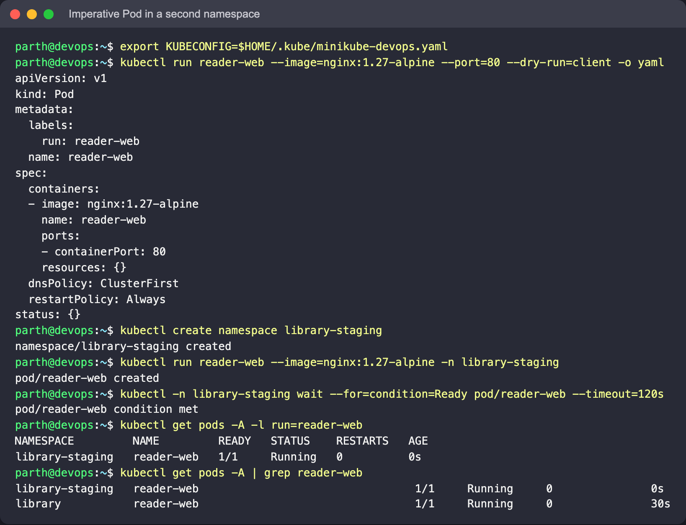
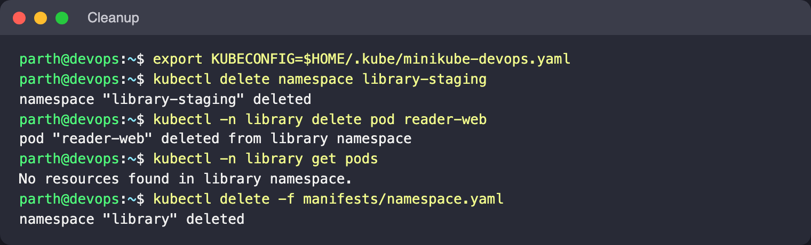

# Kubernetes Fundamentals

**Goal:** get a local cluster running, see what it is made of, and run a first Pod in its own
namespace. Everything uses Minikube with the Docker driver, so the "cluster" is a single
container on the laptop.

Author: Parth Agarwal

## Files

| File | Purpose |
|---|---|
| [`manifests/namespace.yaml`](manifests/namespace.yaml) | The `library` namespace used throughout the Kubernetes exercises |
| [`manifests/reader-web-pod.yaml`](manifests/reader-web-pod.yaml) | A single Nginx Pod (`reader-web`) with requests and limits |

## 1. Concepts in brief

Kubernetes is declarative. You store a description of the state you want in the API server,
and controllers keep comparing that description with reality and fixing any difference.

**Control plane** (on Minikube it shares the one node with the workloads):

| Component | What it does |
|---|---|
| `kube-apiserver` | REST front end for the cluster. `kubectl`, the kubelet and every controller talk only to it |
| `etcd` | Consistent key-value store that holds every object |
| `kube-scheduler` | Assigns each unscheduled Pod to a node, based on resources, affinity and taints |
| `kube-controller-manager` | Runs the built-in control loops (ReplicaSet, Deployment, Node, EndpointSlice, ...) |

**Every node:**

| Component | What it does |
|---|---|
| `kubelet` | Watches for Pods bound to its node and asks the runtime to start their containers |
| container runtime | Pulls images and runs containers (`kubectl get nodes -o wide` shows which one: Docker or containerd, depending on the Minikube version) |
| `kube-proxy` | Programs iptables/IPVS so Service IPs forward to Pod IPs |

**Add-ons:** CoreDNS (cluster DNS), a CNI plugin for Pod networking, and optionally the
ingress controller, metrics-server and so on.

Other words used below: a **Pod** is one or more containers sharing a network namespace and
volumes; a **namespace** scopes names and policies inside one cluster; a **label** is a
key/value tag that selectors use to find objects.

## 2. Start the cluster

```bash
minikube start --driver=docker --cpus=2 --memory=4096
minikube status
kubectl config current-context        # should print: minikube
kubectl version
```

**Expect:** `minikube status` reports host, kubelet and apiserver as `Running`, and the
context is `minikube`. Always check the context before applying anything; it is the easiest
way to avoid running a command against the wrong cluster.



## 3. Look at the cluster

```bash
kubectl cluster-info
kubectl get nodes -o wide
kubectl get namespaces
kubectl get pods -n kube-system -o wide
```

**What to look for:**

- One node called `minikube` with role `control-plane`. It is both the control plane and the
  only worker.
- The default namespaces: `default`, `kube-system`, `kube-public` and `kube-node-lease`.
- In `kube-system`, the control-plane components appear as ordinary Pods: `etcd-minikube`,
  `kube-apiserver-minikube`, `kube-controller-manager-minikube`, `kube-scheduler-minikube`,
  plus `kube-proxy-*`, `coredns-*` and `storage-provisioner`. The first four are *static
  Pods* that the kubelet starts from files on the node, which is how the control plane can
  run on Kubernetes itself.
- The control-plane Pods show the node's IP in the `IP` column (they use host networking),
  while CoreDNS has an address from the Pod CIDR.



On this run the node reported `containerd://2.3.4` as its container runtime (Kubernetes v1.37.0).

## 4. Node capacity and the API surface

```bash
kubectl describe node minikube | sed -n '/^Capacity/,/^System Info/p'
kubectl api-resources --namespaced=false | head -15
kubectl api-resources | grep -E '^(pods|services|configmaps|deployments) '
kubectl explain pod.spec.containers.resources
```

**What to look for:** `Capacity` is the raw CPU, memory and Pod count of the node;
`Allocatable` is what is left for Pods after system reservations, and it is what the
scheduler actually uses. `api-resources` lists each kind with its short name (`po`, `svc`,
`cm`, `deploy`) and whether it is namespaced. Nodes, Namespaces and PersistentVolumes are
cluster-scoped, so `-n` has no effect on them.



## 5. A namespace and a first Pod

Declarative way, from the manifests in this folder:

```bash
kubectl apply -f manifests/namespace.yaml
kubectl apply -f manifests/reader-web-pod.yaml
kubectl -n library wait --for=condition=Ready pod/reader-web --timeout=120s
kubectl -n library get pod reader-web -o wide --show-labels
kubectl -n library describe pod reader-web
```

Poke at it:

```bash
kubectl -n library exec reader-web -- nginx -v
kubectl -n library exec reader-web -- wget -qO- localhost | head -5
kubectl -n library logs reader-web
kubectl -n library port-forward pod/reader-web 8080:80   # then open http://localhost:8080
```

**What to look for:**

- The `Events` section at the bottom of `describe` tells the Pod's life story in order:
  `Scheduled` (scheduler picked `minikube`), `Pulling` / `Pulled` (kubelet fetched the image),
  `Created`, `Started`. When a Pod is stuck, this is the first place to look.
- The Pod IP comes from the Pod network (typically `10.244.x.x` on Minikube). It belongs to
  this Pod only; delete and recreate the Pod and the address changes.
- `QoS Class: Burstable` in `describe`, because requests are lower than limits.
- The `wget` inside the container returns the Nginx welcome page, and the access line for it
  shows up in `kubectl logs`.







## 6. Imperative equivalents and namespace scoping

```bash
# generate YAML instead of writing it from scratch
kubectl run reader-web --image=nginx:1.27-alpine --port=80 --dry-run=client -o yaml

# same Pod name in another namespace is allowed
kubectl create namespace library-staging
kubectl run reader-web --image=nginx:1.27-alpine -n library-staging
kubectl get pods -A -l run=reader-web
kubectl get pods -A | grep reader-web
```

**What to look for:** two Pods called `reader-web` exist side by side, one in `library` and
one in `library-staging`. Names only have to be unique inside a namespace. Note that
`kubectl run` adds the label `run=reader-web`, while the manifest uses `app=reader-web`, so
the `-l run=...` query only finds the imperative one.



## 7. Cleanup

```bash
kubectl delete namespace library-staging
kubectl -n library delete pod reader-web
kubectl -n library get pods          # nothing comes back: no controller recreates a bare Pod
# keep the library namespace for the next exercises, or: kubectl delete -f manifests/namespace.yaml
# minikube stop                      # pause the cluster without losing it
```



## kubectl quick reference

| Command | Use |
|---|---|
| `kubectl get <kind> [-n ns \| -A] [-o wide\|yaml]` | List objects |
| `kubectl describe <kind> <name>` | Full detail plus Events |
| `kubectl logs <pod> [-c container] [-f] [--previous]` | Container output |
| `kubectl exec -it <pod> -- sh` | Shell in a running container |
| `kubectl apply -f <file\|dir>` / `kubectl delete -f ...` | Declarative create/update/delete |
| `kubectl explain <kind.field>` | Built-in API documentation |
| `kubectl config get-contexts` / `use-context` | Which cluster am I talking to |
| `kubectl port-forward <pod\|svc> local:remote` | Reach something in the cluster from the laptop |
