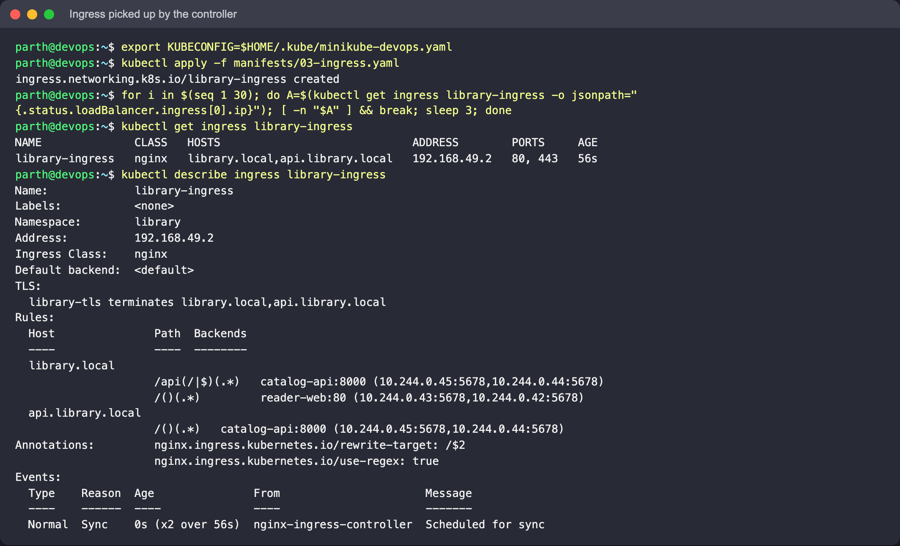
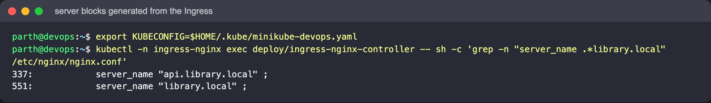

# Ingress vs Ingress Controller

The two names sound like one thing. They are two different things that only work together.

## Ingress: the rules

An `Ingress` (`networking.k8s.io/v1`) is a Kubernetes API object, like a Service or a
ConfigMap. It stores HTTP routing rules:

- which **host** (`library.local`, `api.library.local`),
- which **path** (`/api`, `/`) and how to match it (`Prefix`, `Exact`, `ImplementationSpecific`),
- which **Service and port** to send matching requests to,
- optional **TLS** settings (hosts + the Secret holding the certificate),
- which **class** of controller should handle it (`ingressClassName`).

Creating one does nothing on its own. It is a record in etcd, and no traffic flows because
of it.

## Ingress Controller: the engine

An Ingress controller is a normal workload (a Deployment or DaemonSet plus a Service) that:

1. watches the API server for Ingress objects of its class, and for the Services,
   EndpointSlices and Secrets they reference,
2. turns them into configuration for a real proxy (NGINX, Envoy, HAProxy, ...),
3. receives the actual client traffic and forwards it, usually straight to Pod IPs from the
   EndpointSlices rather than through the Service's ClusterIP,
4. writes its own address back into the Ingress `status`, which is the `ADDRESS` column.

It is not part of core Kubernetes. A fresh cluster has none, and you choose and install one.
An `IngressClass` object links a class name (e.g. `nginx`) to a specific controller.

## Side by side

| | Ingress | Ingress controller |
|---|---|---|
| What it is | API object (YAML) | Running Pods + Service |
| Who creates it | App team, per application | Platform/cluster admin, once per cluster (or per class) |
| Contains | Hosts, paths, backends, TLS refs | Proxy software and its global config |
| Without the other | Accepted by the API, ignored, no ADDRESS | Runs, but every request gets its default 404 |
| How many | Many, across namespaces | Usually one or a few |
| Analogy | The routing table | The router that reads it |

## Why both are needed

The split is the usual Kubernetes pattern: declarative desired state in the API, and a
controller that makes it real. App teams describe routing for their own Services without
touching the proxy, and the platform team can swap or upgrade the proxy without rewriting
every app's rules. One controller behind one LoadBalancer can serve many hosts and paths,
which is much cheaper than one cloud load balancer per Service.

## Common controllers

| Controller | Notes |
|---|---|
| ingress-nginx | Community NGINX-based controller; what `minikube addons enable ingress` installs |
| NGINX Ingress Controller (F5/NGINX) | Separate project with different annotations, easy to confuse with the above |
| Traefik | Default in k3s; auto-discovery, also has its own CRDs |
| HAProxy Ingress | HAProxy-based |
| AWS Load Balancer Controller | Creates an ALB per Ingress (or group) instead of running an in-cluster proxy |
| GKE Ingress | Google Cloud HTTP(S) load balancer |
| Contour / Emissary / Istio | Envoy-based |

The Gateway API (`GatewayClass`, `Gateway`, `HTTPRoute`) is the newer, more expressive
successor with the same rules-vs-implementation split; many of these controllers support it.

## Proof on this cluster

Run after the main README's section 3 setup, starting **without** the ingress addon:

```bash
kubectl get ingressclass                                  # nothing
kubectl apply -f ../manifests/03-ingress.yaml
kubectl get ingress -n library                            # ADDRESS empty
kubectl describe ingress library-ingress -n library       # no Events

minikube addons enable ingress
kubectl get ingressclass                                  # nginx  k8s.io/ingress-nginx
kubectl get ingress -n library -w                         # ADDRESS appears; the Ingress was not touched
kubectl -n ingress-nginx exec deploy/ingress-nginx-controller -- \
  sh -c 'grep -n "server_name .*library.local" /etc/nginx/nginx.conf'
```

**What to look for:** the Ingress object is identical before and after; only the presence of
the controller changes whether it does anything. The last command shows the `server` blocks
the controller generated in its own `nginx.conf` from the Ingress rules.

On the run captured for this repo the ingress addon could not be disabled (shared cluster),
so the "before" half was not re-captured here; troubleshooting scenario 4 shows the same
"accepted but ignored" state for real. The "after" half:




