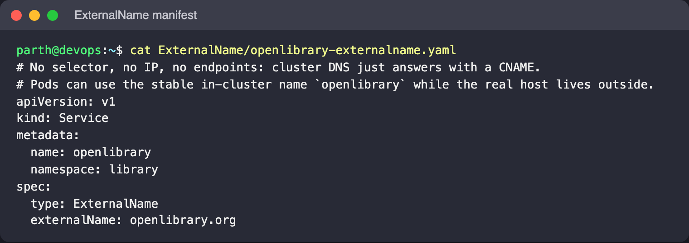
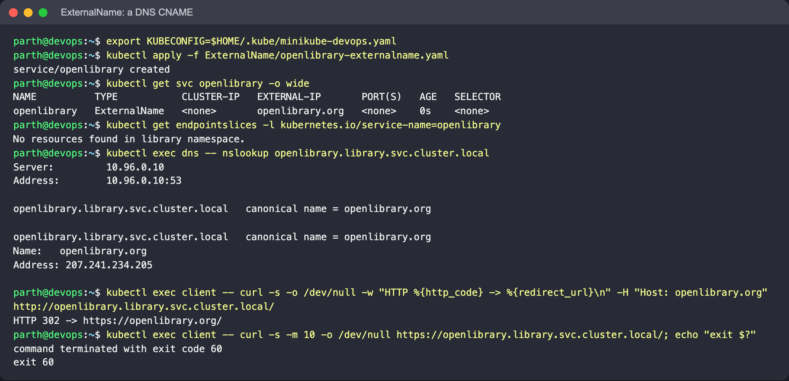

# ExternalName

An ExternalName Service has no selector, no ClusterIP and no endpoints. CoreDNS answers a
lookup of its name with a **CNAME** to the value of `spec.externalName`. It lets Pods use a
stable in-cluster name (`openlibrary`) for something that lives outside the cluster, so the
real hostname can change later (a managed database, a different API host, or a move into
the cluster) without touching the apps.

## Files

- [`openlibrary-externalname.yaml`](openlibrary-externalname.yaml): `openlibrary` →
  `openlibrary.org`, the public Open Library service.

## Manifest



## Commands

```bash
kubectl apply -f ExternalName/openlibrary-externalname.yaml
kubectl get svc openlibrary -o wide
kubectl get endpointslices -l kubernetes.io/service-name=openlibrary

kubectl exec dns -- nslookup openlibrary.library.svc.cluster.local

# HTTP through the alias. TLS and virtual hosting use the Host header / SNI,
# so send the real name as Host or use plain DNS resolution checks only.
kubectl exec client -- curl -s -o /dev/null -w "HTTP %{http_code} -> %{redirect_url}\n" \
  -H "Host: openlibrary.org" http://openlibrary.library.svc.cluster.local/

# HTTPS to the alias name fails certificate validation (curl exit 60)
kubectl exec client -- curl -s -m 10 -o /dev/null https://openlibrary.library.svc.cluster.local/; echo "exit $?"
```

## What to look for

- `TYPE ExternalName`, `CLUSTER-IP` empty (`<none>`), `EXTERNAL-IP openlibrary.org`, and no
  EndpointSlice at all.
- `nslookup` shows `openlibrary.library.svc.cluster.local canonical name = openlibrary.org`
  followed by the public addresses of `openlibrary.org`. The redirect happens purely in DNS.
- The HTTP request is answered by Open Library itself (typically a redirect to HTTPS). This
  shows the main gotcha: the client still talks to the external server, and that server
  sees whatever `Host` header/SNI the client sends, so HTTPS to the alias name fails
  certificate validation. ExternalName is a DNS alias, not a proxy.
- This check needs internet access from the Minikube node.


