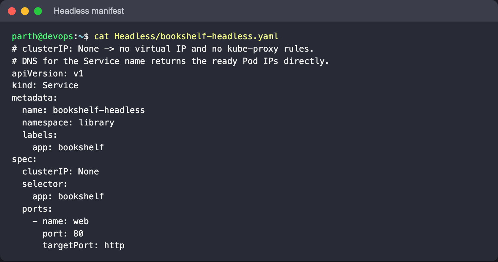
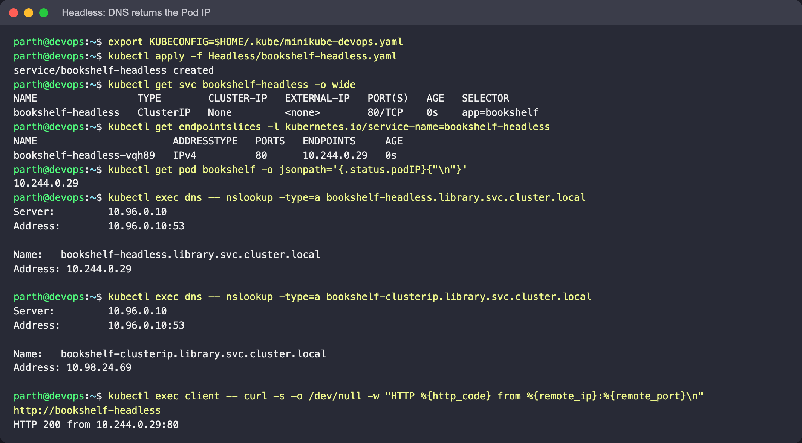
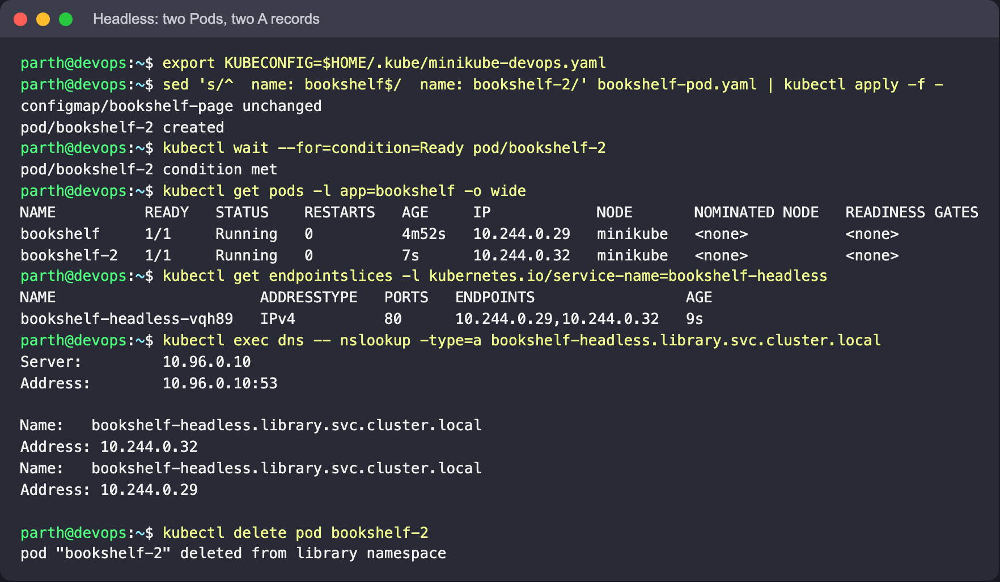

# Headless

A Service with `clusterIP: None`. There is no virtual IP and kube-proxy writes no rules for
it, but the selector and EndpointSlices still work. CoreDNS answers a lookup of the Service
name with one A record **per ready Pod**, so the client connects straight to a Pod and does
its own choosing. StatefulSets rely on this to give each replica a stable name such as
`db-0.db-headless.library.svc.cluster.local`, which matters for databases and clustered
systems where a client must reach one specific member.

## Files

- [`bookshelf-headless.yaml`](bookshelf-headless.yaml): no `type`, `clusterIP: None`,
  selector `app: bookshelf`, port 80.

## Manifest



## Commands

```bash
kubectl apply -f Headless/bookshelf-headless.yaml
kubectl get svc bookshelf-headless -o wide
kubectl get endpointslices -l kubernetes.io/service-name=bookshelf-headless
kubectl get pod bookshelf -o jsonpath='{.status.podIP}{"\n"}'

kubectl exec dns -- nslookup -type=a bookshelf-headless.library.svc.cluster.local
kubectl exec dns -- nslookup -type=a bookshelf-clusterip.library.svc.cluster.local   # compare (ClusterIP folder)
kubectl exec client -- curl -s -o /dev/null -w "HTTP %{http_code} from %{remote_ip}:%{remote_port}\n" http://bookshelf-headless
```

Optional: add a second matching Pod and look again.

```bash
# same Pod spec under a new name (only the Pod's metadata.name line matches the pattern)
sed 's/^  name: bookshelf$/  name: bookshelf-2/' bookshelf-pod.yaml | kubectl apply -f -
kubectl wait --for=condition=Ready pod/bookshelf-2
kubectl exec dns -- nslookup -type=a bookshelf-headless.library.svc.cluster.local
kubectl delete pod bookshelf-2
```

## What to look for

- `CLUSTER-IP None`, yet the EndpointSlice lists the Pod IP on port 80.
- The headless lookup returns the **Pod IP**; the ClusterIP lookup returns the virtual IP.
  Running the two back to back is the clearest way to see the difference.
- With `bookshelf-2` added, the EndpointSlice lists two addresses and the headless lookup
  returns two A records, one per Pod. A Pod only appears once it is Ready, because DNS is
  built from the EndpointSlice.
- curl connects to the Pod IP on port 80 directly. Since nothing proxies the traffic, the
  client must use the container's real port; the Service `port` mainly matters for SRV
  records.
- `-type=a` and the full name keep busybox `nslookup` from also querying AAAA records and
  every search domain, which otherwise buries the answer in NXDOMAIN lines.




