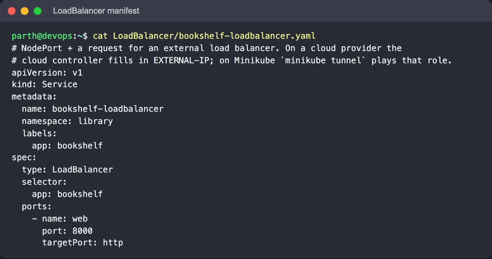
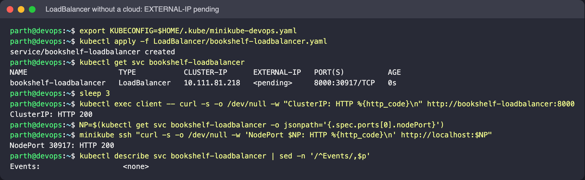
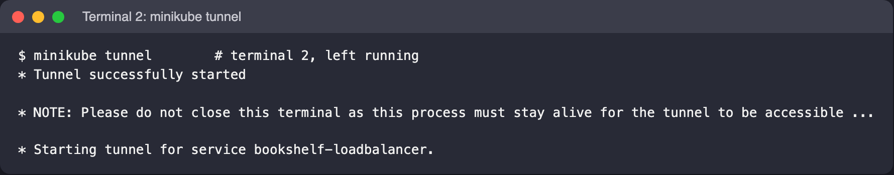
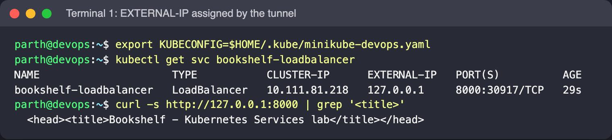
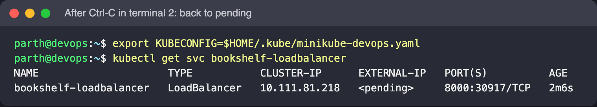

# LoadBalancer

`type: LoadBalancer` asks the cluster's cloud controller manager to provision an external
load balancer (an AWS NLB/ELB, a GCP forwarding rule, ...) whose targets are the node ports
of this Service. Its address is written into `status.loadBalancer.ingress` and shown as
`EXTERNAL-IP`. Minikube has no cloud provider, so the address stays `<pending>` until
`minikube tunnel` is running; the tunnel acts as the "cloud" and assigns one.

## Files

- [`bookshelf-loadbalancer.yaml`](bookshelf-loadbalancer.yaml): port `8000` → `targetPort: http`,
  node port chosen automatically.

## Manifest



## Commands

```bash
kubectl apply -f LoadBalancer/bookshelf-loadbalancer.yaml
kubectl get svc bookshelf-loadbalancer          # EXTERNAL-IP <pending>

# the layers underneath already work
kubectl exec client -- curl -s -o /dev/null -w "ClusterIP: HTTP %{http_code}\n" http://bookshelf-loadbalancer:8000
NP=$(kubectl get svc bookshelf-loadbalancer -o jsonpath='{.spec.ports[0].nodePort}')
minikube ssh "curl -s -o /dev/null -w 'NodePort $NP: HTTP %{http_code}\n' http://localhost:$NP"

# terminal 2: provide an "external" IP and keep it running. It only asks for sudo when a
# LoadBalancer/Ingress needs a privileged port (<1024); for port 8000 it ran without sudo here
minikube tunnel

# terminal 1
kubectl get svc bookshelf-loadbalancer -w       # EXTERNAL-IP becomes 127.0.0.1
curl -s http://127.0.0.1:8000 | grep '<title>'
```

## What to look for

- Before the tunnel: `EXTERNAL-IP <pending>`, but `CLUSTER-IP` is set and `PORT(S)` shows
  `8000:3xxxx/TCP`, so both lower layers are already in place and respond with HTTP 200.
- `kubectl describe svc bookshelf-loadbalancer` Events show no provisioning activity, since
  nothing is acting on the request.
- With `minikube tunnel` running on the Docker driver, `EXTERNAL-IP` becomes `127.0.0.1`
  and `http://127.0.0.1:8000` serves the Bookshelf page in the browser. Stop the tunnel and
  the address goes back to `<pending>`.
- On a real cloud, each LoadBalancer Service costs one cloud load balancer. That is the
  main reason HTTP apps usually share a single Ingress controller instead.

## Real run










Stop the tunnel with **Ctrl-C** (SIGINT). On this run, stopping it with a plain `kill`
(SIGTERM) left `EXTERNAL-IP 127.0.0.1` in the Service status and an orphaned `ssh -L 8000:...`
forwarder process; only an interrupt makes the tunnel clean up after itself.
