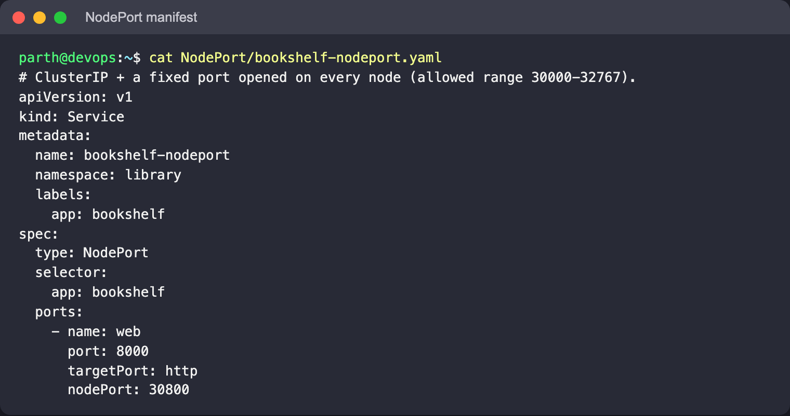
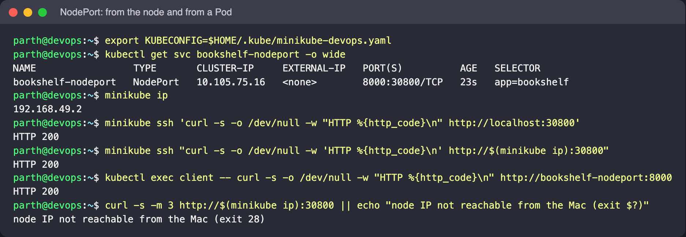
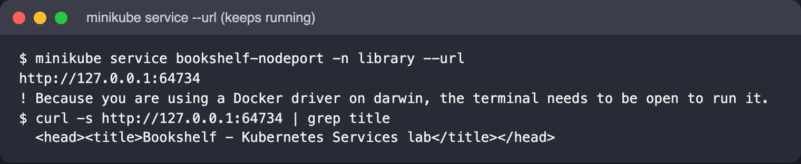

# NodePort

A NodePort Service is a ClusterIP Service plus one port, from the range `30000-32767`,
opened on **every** node. Traffic to `<any-node-ip>:<nodePort>` is forwarded to the Service
and from there to a Pod, even if that Pod runs on a different node. It is the simplest way
to get traffic in from outside, but it exposes high port numbers on node IPs, so in practice
it mostly serves as the building block under LoadBalancer and Ingress.

## Files

- [`bookshelf-nodeport.yaml`](bookshelf-nodeport.yaml): port `8000` → `targetPort: http`, with
  `nodePort: 30800` pinned. Leave `nodePort` out and Kubernetes picks a free one.

## Manifest



## Commands

```bash
kubectl apply -f NodePort/bookshelf-nodeport.yaml
kubectl get svc bookshelf-nodeport -o wide
minikube ip

# 1) from inside the Minikube node itself
# quote the whole remote command: `minikube ssh -- curl ... -w "HTTP ..."` loses the quoting
# on the way to the node, and curl then prints the whole page instead of the status line
minikube ssh 'curl -s -o /dev/null -w "HTTP %{http_code}\n" http://localhost:30800'
minikube ssh "curl -s -o /dev/null -w 'HTTP %{http_code}\n' http://$(minikube ip):30800"

# 2) still works as a ClusterIP from inside the cluster
kubectl exec client -- curl -s -o /dev/null -w "HTTP %{http_code}\n" http://bookshelf-nodeport:8000

# 3) from the laptop: the node IP is not reachable on macOS + Docker driver
curl -s -m 3 http://$(minikube ip):30800 || echo "node IP not reachable from the Mac (exit $?)"
minikube service bookshelf-nodeport -n library --url
```

## What to look for

- `PORT(S)` shows `8000:30800/TCP`: Service port, then node port. The Service still has a
  `CLUSTER-IP`, because NodePort is built on top of ClusterIP.
- The curl from inside the node returns HTTP 200 on port 30800.
- **Docker driver on macOS:** the node IP (usually `192.168.49.2`) lives inside Docker's VM
  network and is not reachable from the Mac directly, so `curl $(minikube ip):30800` from the
  laptop hangs. `minikube service ... --url` opens a tunnel and prints a `http://127.0.0.1:<port>`
  URL; keep that terminal open and open the URL in a browser to see the Bookshelf page. On
  Linux with the Docker driver the node IP is usually reachable directly.






Note: when stopping `minikube service`, use Ctrl-C in its terminal. If the process is killed
some other way, the `ssh -L` forwarder it started can be left behind (check with
`ps aux | grep 'ssh .*-L'`).
