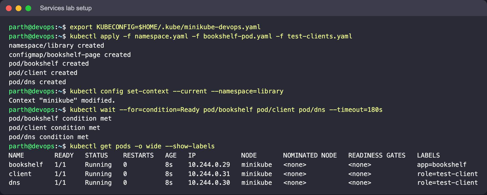
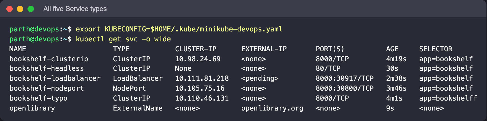
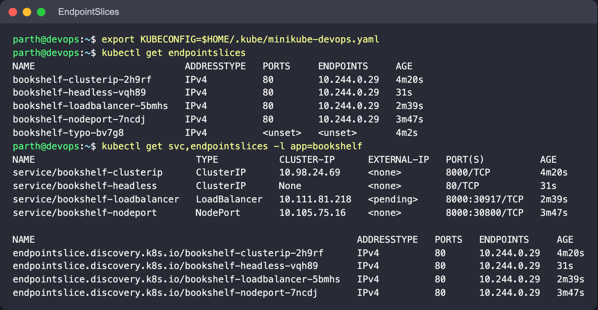
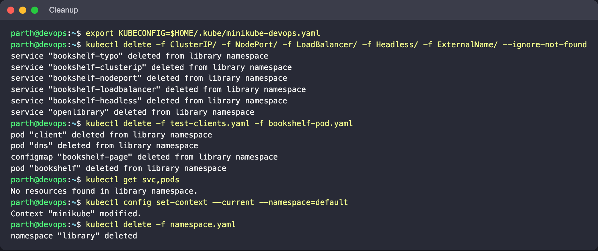

# Kubernetes Services

**Goal:** expose one Pod (`bookshelf`, Nginx serving a small HTML page) through all five
Service types, and test each one from the place it is meant to be reachable from: another
Pod, a node, the laptop, or DNS.

Author: Parth Agarwal · Cluster: Minikube, Docker driver · Namespace: `library`

## Why Services exist

Pod IPs are ephemeral: a rescheduled or replaced Pod gets a new address. A Service gives a
stable name and (usually) a stable virtual IP, and keeps an up-to-date list of the Pods
behind it in **EndpointSlices**, built from its label selector and the Pods' readiness.

## Shared files

| File | Purpose |
|---|---|
| [`namespace.yaml`](namespace.yaml) | `library` namespace |
| [`bookshelf-pod.yaml`](bookshelf-pod.yaml) | ConfigMap with `index.html` + Pod `bookshelf` (label `app: bookshelf`, container port named `http`) |
| [`test-clients.yaml`](test-clients.yaml) | Helper Pods: `client` (curl) and `dns` (busybox nslookup) |

Every selector-based Service uses `selector: app: bookshelf` and `targetPort: http`. Using the
port **name** means the Services keep working if the container port number ever changes.

## Setup

```bash
minikube start --driver=docker
kubectl apply -f namespace.yaml -f bookshelf-pod.yaml -f test-clients.yaml
kubectl config set-context --current --namespace=library
kubectl wait --for=condition=Ready pod/bookshelf pod/client pod/dns --timeout=180s
kubectl get pods -o wide --show-labels
```

**Expect:** three Running Pods. Note the `bookshelf` Pod IP; several Service types below are
compared against it.



## The five types

| Folder | Service | Reachable from | Test |
|---|---|---|---|
| [ClusterIP](ClusterIP/) | `bookshelf-clusterip` (8000 → http) | inside the cluster | curl from `client` Pod; fails from the laptop |
| [NodePort](NodePort/) | `bookshelf-nodeport` (8000, node port 30800) | `<node-ip>:30800` | curl inside the node; `minikube service` tunnel |
| [LoadBalancer](LoadBalancer/) | `bookshelf-loadbalancer` | external IP | `<pending>` until `minikube tunnel` runs |
| [Headless](Headless/) | `bookshelf-headless` (`clusterIP: None`) | DNS → Pod IPs | `nslookup` returns the Pod IP |
| [ExternalName](ExternalName/) | `openlibrary` → `openlibrary.org` | DNS CNAME | `nslookup` returns a CNAME |

Each folder has its manifest, a README with commands and expected behaviour, and a
`screenshots/` folder.

## How they relate

ClusterIP, NodePort and LoadBalancer are layered:

- **ClusterIP**: a virtual IP; kube-proxy rules on each node forward it to a ready endpoint.
- **NodePort** = ClusterIP + the same port opened on every node.
- **LoadBalancer** = NodePort + a cloud load balancer pointed at those node ports.

You can see this with `kubectl get svc`: the LoadBalancer Service also has a `CLUSTER-IP`
and a node port in its `PORT(S)` column.

**Headless** and **ExternalName** do not get a virtual IP and kube-proxy does not handle
them. They are pure DNS: Headless returns Pod IPs (what StatefulSets use for stable
per-replica names), and ExternalName returns a CNAME to a name outside the cluster.

## Overall check after doing all five

```bash
kubectl get svc -o wide
kubectl get endpointslices
kubectl get svc,endpointslices -l app=bookshelf
```

**What to look for:** four selector-based Services, each with an EndpointSlice listing the
`bookshelf` Pod IP on port 80 (the resolved container port, not the Service port).
`bookshelf-typo` has an EndpointSlice with no endpoints, and `openlibrary` has none at all.





## Cleanup

```bash
kubectl delete -f ClusterIP/ -f NodePort/ -f LoadBalancer/ -f Headless/ -f ExternalName/ --ignore-not-found
kubectl delete -f test-clients.yaml -f bookshelf-pod.yaml
kubectl config set-context --current --namespace=default
kubectl delete -f namespace.yaml      # optional
```


