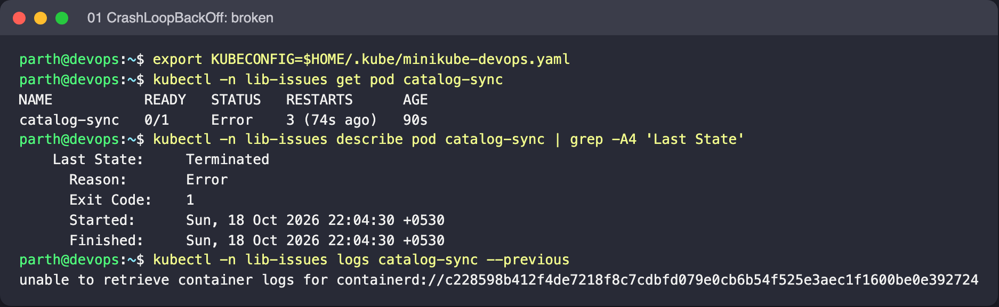
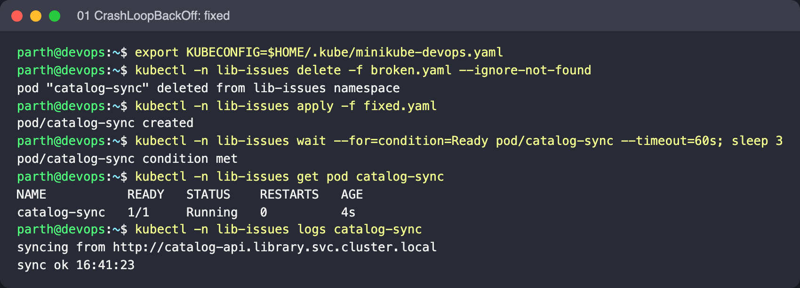

# 01: CrashLoopBackOff

Object: `catalog-sync` in namespace `lib-issues`. Run the commands from this folder.

## What is wrong

The container starts, finds that `CATALOG_URL` is empty, prints a FATAL line and exits with code 1. The kubelet keeps restarting it, waiting longer each time (10 s, 20 s, 40 s and so on, up to 5 min), and that wait is what `CrashLoopBackOff` shows.

## Reproduce

```bash
kubectl create namespace lib-issues --dry-run=client -o yaml | kubectl apply -f -
kubectl -n lib-issues apply -f broken.yaml
```

## Diagnose

```bash
kubectl -n lib-issues get pod catalog-sync
kubectl -n lib-issues describe pod catalog-sync | grep -A4 'Last State'
kubectl -n lib-issues logs catalog-sync --previous
```

What to look for: `logs --previous` shows `FATAL: CATALOG_URL is not set`. `Last State: Terminated, Reason: Error, Exit Code: 1`. An exit code of 1 means the application chose to quit, so the problem is in its configuration, not in Kubernetes.

## Fix

Add the `CATALOG_URL` env var. The Pod spec's `env` can't be changed on a running Pod, so delete and re-apply.

```bash
kubectl -n lib-issues delete -f broken.yaml --ignore-not-found
kubectl -n lib-issues apply -f fixed.yaml
```

Expected after the fix: `Running` with RESTARTS no longer climbing, and `kubectl logs catalog-sync` shows `sync ok` lines.

## Screenshots (real run on Minikube)




