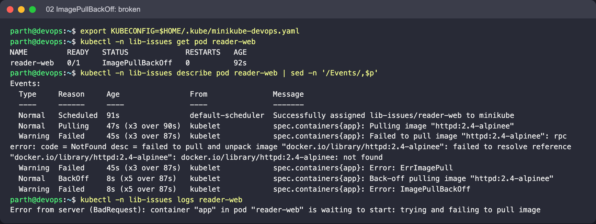
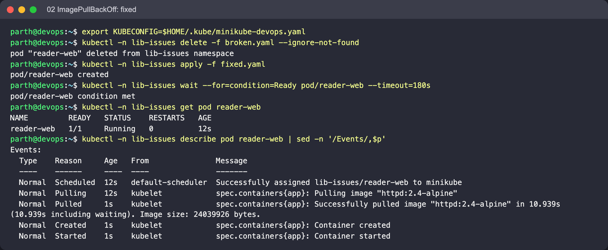

# 02: ImagePullBackOff

Object: `reader-web` in namespace `lib-issues`. Run the commands from this folder.

## What is wrong

The tag `httpd:2.4-alpinee` has a typo. The registry is reachable, but the manifest doesn't exist, so every pull fails and the kubelet waits longer between attempts.

## Reproduce

```bash
kubectl create namespace lib-issues --dry-run=client -o yaml | kubectl apply -f -
kubectl -n lib-issues apply -f broken.yaml
```

## Diagnose

```bash
kubectl -n lib-issues get pod reader-web
kubectl -n lib-issues describe pod reader-web | sed -n '/Events/,$p'
```

What to look for: Events: `Failed to pull image "httpd:2.4-alpinee"` with a *not found* / *manifest unknown* message, then `Back-off pulling image`. `kubectl logs` returns nothing useful, because no container ever started.

## Fix

Correct the tag to `httpd:2.4-alpine`. Image is one of the few Pod fields you can change in place (`kubectl set image`), but re-applying `fixed.yaml` works too.

```bash
kubectl -n lib-issues delete -f broken.yaml --ignore-not-found
kubectl -n lib-issues apply -f fixed.yaml
```

Expected after the fix: Events show `Pulled` then `Started`, and the Pod is `Running`.

## Screenshots (real run on Minikube)




