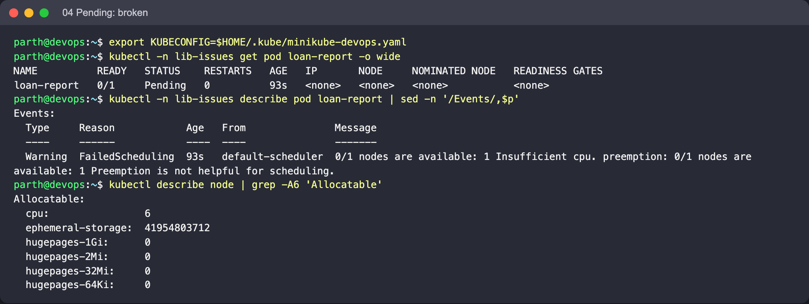
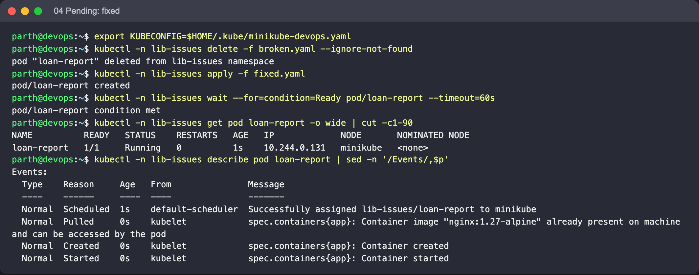

# 04: Pending (insufficient resources)

Object: `loan-report` in namespace `lib-issues`. Run the commands from this folder.

## What is wrong

The Pod requests 64 CPUs. The scheduler places Pods by **requests**, and no node has 64 allocatable CPUs, so the Pod is never assigned a node.

## Reproduce

```bash
kubectl create namespace lib-issues --dry-run=client -o yaml | kubectl apply -f -
kubectl -n lib-issues apply -f broken.yaml
```

## Diagnose

```bash
kubectl -n lib-issues get pod loan-report -o wide
kubectl -n lib-issues describe pod loan-report | sed -n '/Events/,$p'
kubectl describe node | grep -A6 'Allocatable'
```

What to look for: `NODE` is `<none>`. The event is `FailedScheduling ... 0/1 nodes are available: 1 Insufficient cpu`. Other common Pending causes produce different messages: an unbound PVC, a `nodeSelector` or affinity mismatch, and taints without tolerations.

## Fix

Request what the app actually needs (`50m`).

```bash
kubectl -n lib-issues delete -f broken.yaml --ignore-not-found
kubectl -n lib-issues apply -f fixed.yaml
```

Expected after the fix: The Pod gets a node and starts.

## Screenshots (real run on Minikube)




