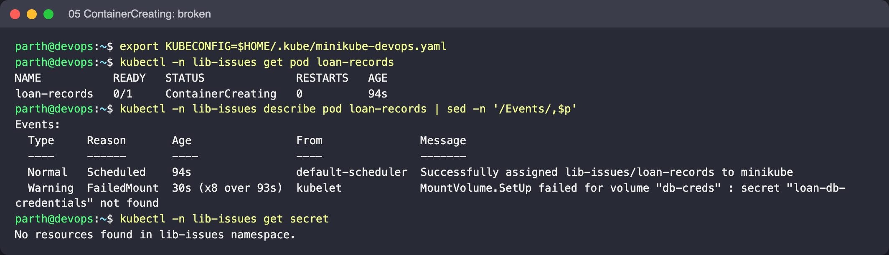
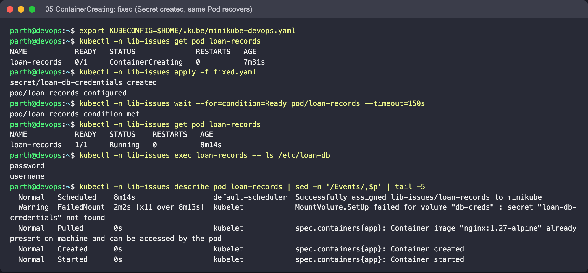

# 05: Stuck in ContainerCreating

Object: `loan-records` in namespace `lib-issues`. Run the commands from this folder.

## What is wrong

The Pod mounts Secret `loan-db-credentials`, which doesn't exist. The Pod is scheduled, but the kubelet can't build its volumes, so the container is never created.

## Reproduce

```bash
kubectl create namespace lib-issues --dry-run=client -o yaml | kubectl apply -f -
kubectl -n lib-issues apply -f broken.yaml
```

## Diagnose

```bash
kubectl -n lib-issues get pod loan-records
kubectl -n lib-issues describe pod loan-records | sed -n '/Events/,$p'
kubectl -n lib-issues get secret
```

What to look for: `FailedMount ... secret "loan-db-credentials" not found`. A missing ConfigMap, an unbound PVC or a CNI failure also leave a Pod in `ContainerCreating`, and the events say which one it is.

## Fix

Create the Secret (the values in `fixed.yaml` are lab placeholders). The kubelet retries the mount on its own, so the existing Pod recovers without being deleted. Applying `fixed.yaml` over the stuck Pod is enough:

```bash
kubectl -n lib-issues apply -f fixed.yaml
```

Expected after the fix: Within about a minute the Pod is `Running`, and `kubectl exec loan-records -- ls /etc/loan-db` lists `username` and `password`.

(The Pod is called `loan-records`, not `loan-service`, so that it doesn't clash with the `loan-service` Pod of issue 08 when every issue is applied into the same namespace.)

## Screenshots (real run on Minikube)




