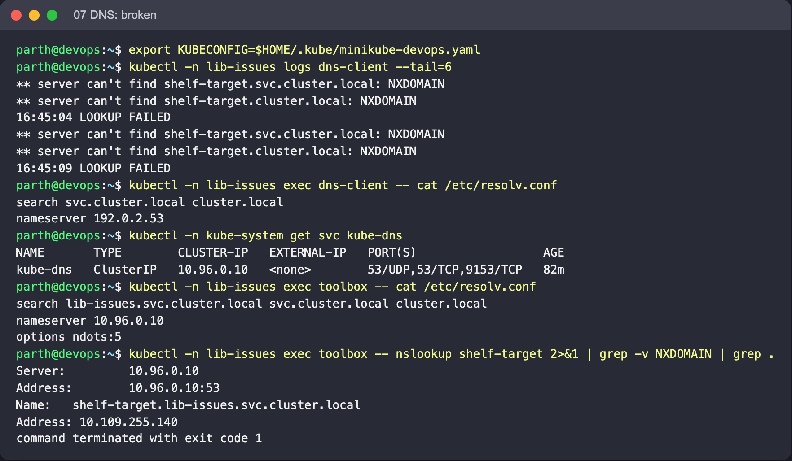
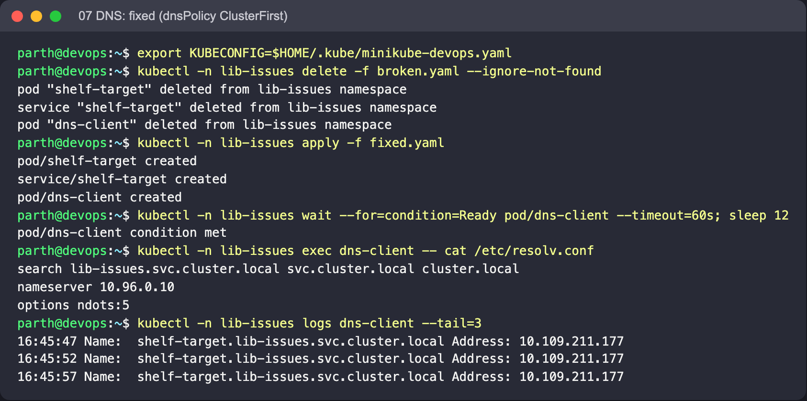

# 07: DNS resolution failure

Object: `dns-client` in namespace `lib-issues`. Run the commands from this folder.

## What is wrong

`dns-client` uses `dnsPolicy: None` with the nameserver `192.0.2.53` (a documentation address with nothing behind it), so it never asks CoreDNS.

## Reproduce

```bash
kubectl create namespace lib-issues --dry-run=client -o yaml | kubectl apply -f -
kubectl -n lib-issues apply -f broken.yaml
```

## Diagnose

```bash
kubectl -n lib-issues logs dns-client --tail=5
kubectl -n lib-issues exec dns-client -- cat /etc/resolv.conf
kubectl -n kube-system get svc kube-dns
kubectl -n lib-issues run dnscheck --rm -it --image=busybox:1.36 --restart=Never -- nslookup shelf-target
```

What to look for: The logs show failed lookups and `LOOKUP FAILED`. `resolv.conf` lists `192.0.2.53` rather than the `kube-dns` ClusterIP. A throwaway Pod with default settings resolves `shelf-target` without trouble, which proves CoreDNS is healthy and the client Pod is misconfigured.

## Fix

Go back to `dnsPolicy: ClusterFirst`. DNS settings can't be changed in place, so delete and re-create `dns-client`.

```bash
kubectl -n lib-issues delete -f broken.yaml --ignore-not-found
kubectl -n lib-issues apply -f fixed.yaml
```

Expected after the fix: `nslookup` returns `shelf-target.lib-issues.svc.cluster.local` with the Service IP.

Observed on Minikube running on Colima: the lookups did **not** time out. `192.0.2.53` answered with `NXDOMAIN`, because the VM's network layer intercepts outbound DNS (UDP 53) and answers for any destination address. On a cluster without that interception the same Pod shows `connection timed out; no servers could be reached`. Either way `resolv.conf` is the giveaway: it lists `192.0.2.53` instead of the `kube-dns` ClusterIP and has no `lib-issues.svc.cluster.local` search domain.

Note: busybox `nslookup` exits 1 if *any* search-domain candidate returns NXDOMAIN, even when the name resolved. That's why the client loop checks for a `Name:` line rather than the exit code.

## Screenshots (real run on Minikube)




