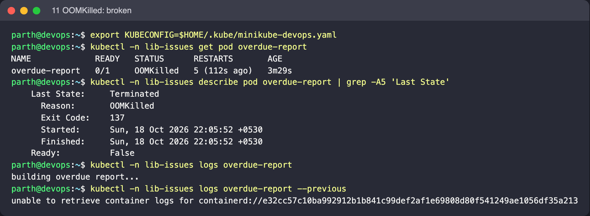
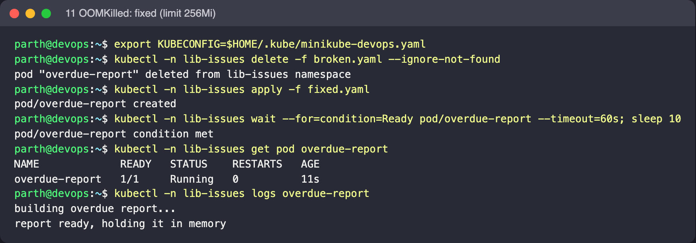

# 11: OOMKilled

Object: `overdue-report` in namespace `lib-issues`. Run the commands from this folder.

## What is wrong

The script allocates about 150 MiB, and the memory limit is 64 Mi. When the cgroup goes over the limit, the kernel kills the process.

## Reproduce

```bash
kubectl create namespace lib-issues --dry-run=client -o yaml | kubectl apply -f -
kubectl -n lib-issues apply -f broken.yaml
```

## Diagnose

```bash
kubectl -n lib-issues get pod overdue-report -w
kubectl -n lib-issues describe pod overdue-report | grep -A5 'Last State'
kubectl -n lib-issues logs overdue-report --previous
```

What to look for: `Last State: Terminated, Reason: OOMKilled, Exit Code: 137` (128 + SIGKILL 9). This container dies within a second of starting, so during the back-off the most recent dead container is still the "current" one. Plain `kubectl logs overdue-report` shows its output, while `--previous` (the one before that) may already be garbage-collected (`unable to retrieve container logs`). The log stops after `building overdue report...` and never reaches `report ready`. CPU limits only throttle a container, but memory limits kill it.

## Fix

Raise the limit to fit the real working set (256 Mi), or make the job use less memory (stream rows instead of holding them all).

```bash
kubectl -n lib-issues delete -f broken.yaml --ignore-not-found
kubectl -n lib-issues apply -f fixed.yaml
```

Expected after the fix: The log shows `report ready, holding it in memory` and the Pod stays `Running`.

## Screenshots (real run on Minikube)




