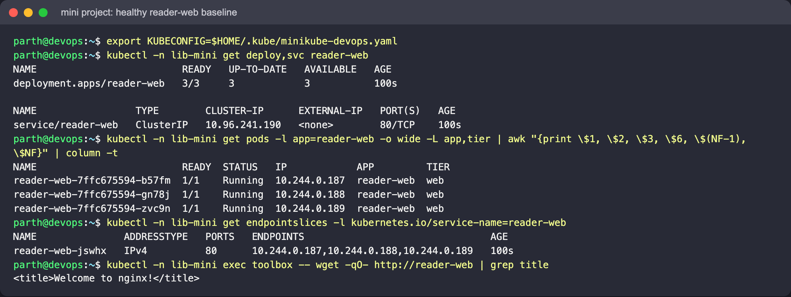
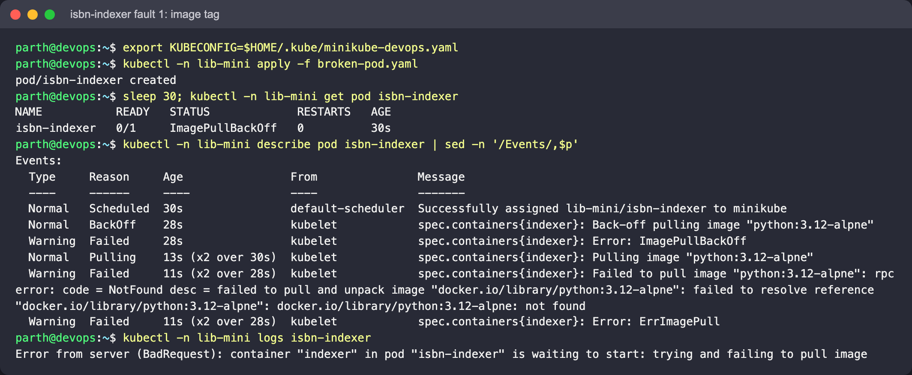
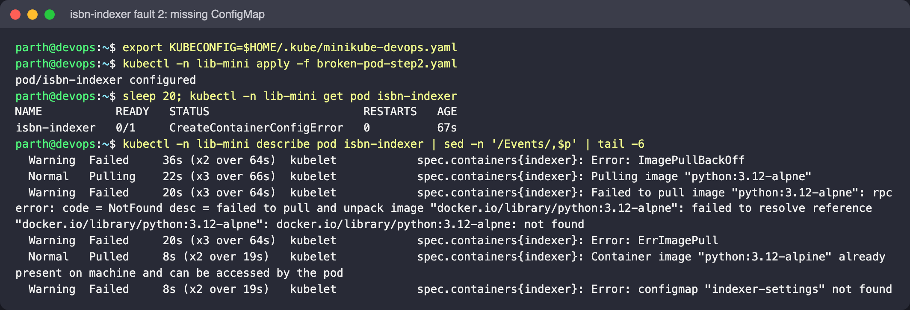
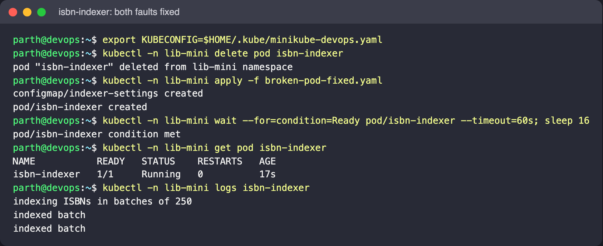
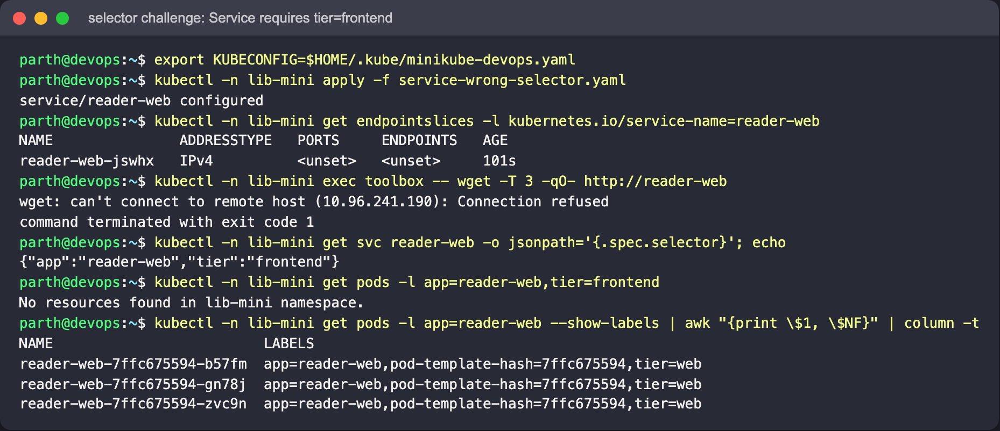
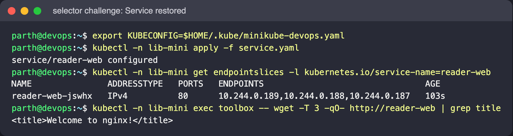

# Mini Project: Library Troubleshooting Challenge

Namespace: `lib-mini`. A healthy `reader-web` app is the baseline. On top of it are two
planted problems: a Pod with two faults stacked one on the other, and a Service whose
selector stops matching.

| File | Purpose |
|---|---|
| `deployment.yaml` | `reader-web`: 3 × nginx, labels `app=reader-web, tier=web`, probes, requests/limits |
| `service.yaml` | ClusterIP Service selecting `app=reader-web` |
| `broken-pod.yaml` | `isbn-indexer`: wrong image tag **and** a missing ConfigMap |
| `broken-pod-step2.yaml` | image fixed, ConfigMap still missing (exposes fault 2) |
| `broken-pod-fixed.yaml` | both faults fixed |
| `service-wrong-selector.yaml` | selector also requires `tier=frontend`, which no Pod has |

Run every command from this folder.

## 1. Baseline

```bash
kubectl create namespace lib-mini
kubectl -n lib-mini apply -f deployment.yaml -f service.yaml
kubectl -n lib-mini rollout status deploy/reader-web
kubectl -n lib-mini get pods -o wide --show-labels
kubectl -n lib-mini get endpointslices -l kubernetes.io/service-name=reader-web
kubectl -n lib-mini run curl --rm -it --image=busybox:1.36 --restart=Never -- wget -qO- http://reader-web
```

Expect: three Ready Pods, all three Pod IPs in the EndpointSlice, and the nginx welcome
page from the Service. Note these down to compare against later.



(The screenshots run `wget` through `kubectl exec` in a long-lived `busybox` Pod named
`toolbox`, because `run --rm -it` needs an interactive terminal.)

## 2. The Pod with two faults

### Fault 1: image

```bash
kubectl -n lib-mini apply -f broken-pod.yaml
kubectl -n lib-mini get pod isbn-indexer
kubectl -n lib-mini describe pod isbn-indexer | sed -n '/Events/,$p'
```

Expect: `ErrImagePull` / `ImagePullBackOff`. The event says the manifest for
`python:3.12-alpne` was not found. `kubectl logs` gives nothing, because no container exists.



### Fault 2: configuration

`image` is one of the few Pod fields that can be changed in place, so apply the step-2 file
over the existing Pod:

```bash
kubectl -n lib-mini apply -f broken-pod-step2.yaml
kubectl -n lib-mini get pod isbn-indexer
kubectl -n lib-mini describe pod isbn-indexer | sed -n '/Events/,$p'
```

Expect: the pull now succeeds, but the status becomes `CreateContainerConfigError` with
`configmap "indexer-settings" not found`. Fixing one layer exposed the next, which is why
you should check again after every change.



### Fix

```bash
kubectl -n lib-mini delete pod isbn-indexer
kubectl -n lib-mini apply -f broken-pod-fixed.yaml
kubectl -n lib-mini logs -f isbn-indexer
```

Expect: `indexing ISBNs in batches of 250` followed by `indexed batch` every 15 s.



## 3. Selector challenge

```bash
kubectl -n lib-mini apply -f service-wrong-selector.yaml
kubectl -n lib-mini get endpointslices -l kubernetes.io/service-name=reader-web
kubectl -n lib-mini run curl --rm -it --image=busybox:1.36 --restart=Never -- wget -T 3 -qO- http://reader-web
kubectl -n lib-mini get svc reader-web -o jsonpath='{.spec.selector}'; echo
kubectl -n lib-mini get pods -l app=reader-web,tier=frontend          # No resources found
```

Expect: the Pods are still healthy, but the EndpointSlice has no endpoints and the request
fails. Comparing the Service selector with `--show-labels` shows the `tier` mismatch.
With no endpoints at all, kube-proxy rejects the connection, so on this cluster it shows up
as `Connection refused` rather than a timeout.


Restore the Service:

```bash
kubectl -n lib-mini apply -f service.yaml
kubectl -n lib-mini get endpointslices -l kubernetes.io/service-name=reader-web   # 3 endpoints again
```



## Cleanup

```bash
kubectl delete namespace lib-mini
```
