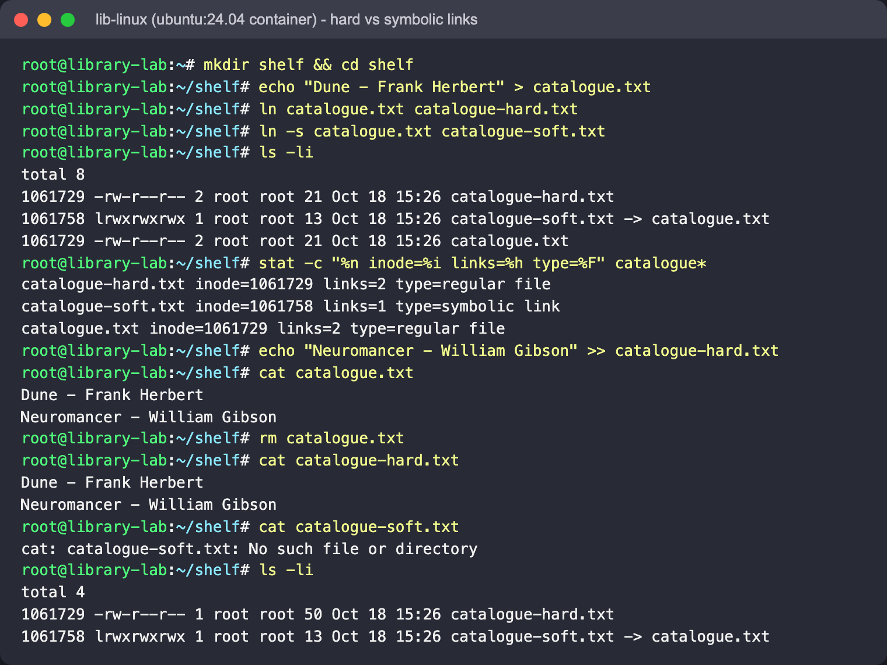
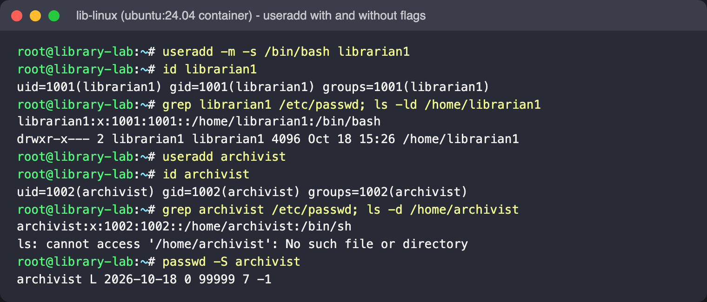
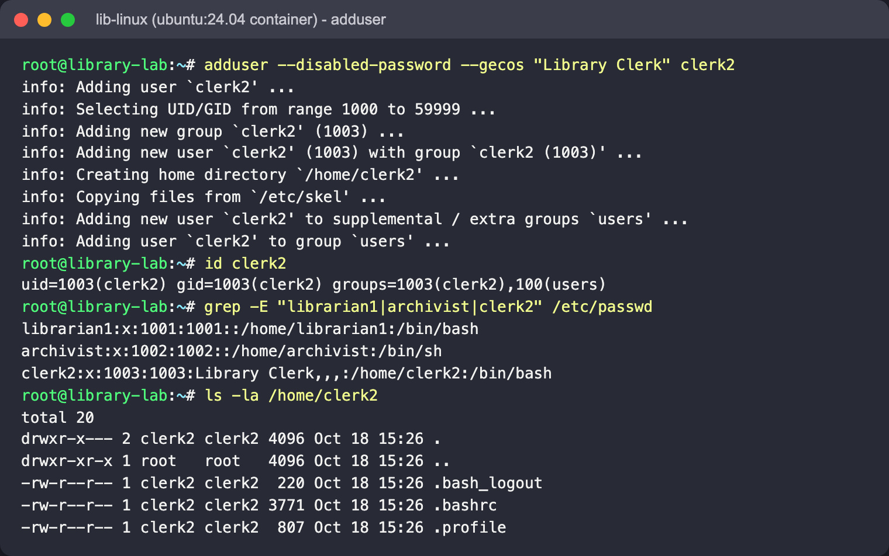
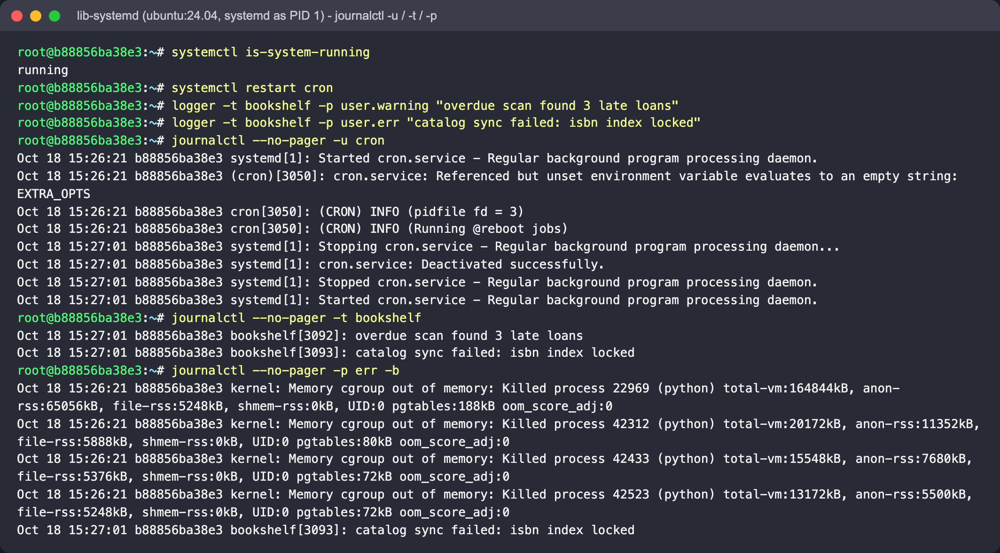
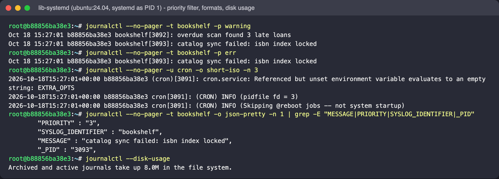
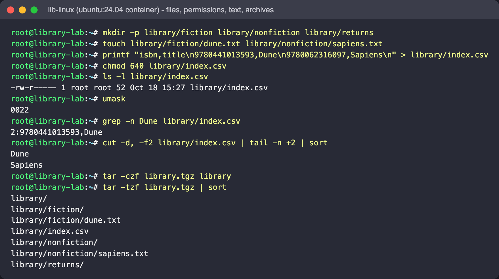
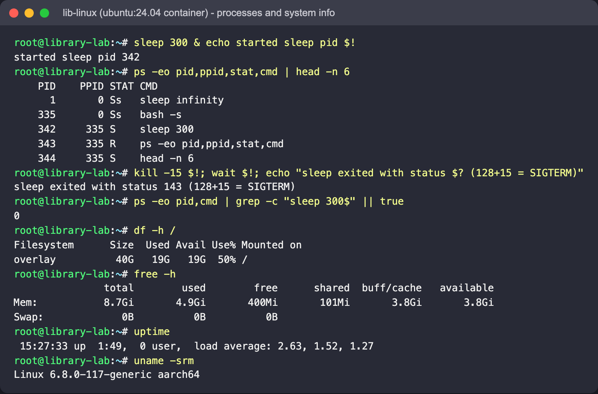

# Linux Fundamentals

**Author:** Parth Agarwal

## Goal

Get comfortable with the parts of Linux a DevOps engineer touches every day, using a small
"library catalogue" box as the playground:

1. Hard links vs symbolic links (and what an inode is)
2. `useradd` vs `adduser`
3. Reading service logs with `journalctl`
4. A personal cheat sheet of everyday commands

## Environment

Everything was run in throwaway `ubuntu:24.04` containers from my Mac (Colima Docker engine, arm64).
Parts 1, 2 and 4 use a plain container; Part 3 needs `systemd` as PID 1, so it uses a
privileged container (see below).

```bash
docker run --rm -it -h library-lab ubuntu:24.04 bash
```

The outputs pasted below are real, trimmed only where marked. Inode numbers, PIDs and
timestamps will differ on your machine.

---

## Part 1 - Hard links vs symbolic links

### Concept

A filename is only a directory entry that points to an **inode**; the inode holds the
permissions, owner, size and the location of the data blocks.

- A **hard link** is one more directory entry for the *same* inode. All names are equal;
  the data is freed only when the inode's link count reaches 0.
- A **symbolic (soft) link** is a tiny separate file (its own inode) whose content is a *path*.
  If the path stops existing the link "dangles".

| | Hard link | Symbolic link |
|---|---|---|
| Points to | the inode | a path (text) |
| Own inode | no | yes |
| Original deleted | data still reachable | link breaks |
| Across filesystems / partitions | not allowed | allowed |
| To a directory | not allowed | allowed |
| In `ls -l` | looks like a normal file, link count > 1 | `l` type and `-> target` |

### Commands

```bash
mkdir shelf && cd shelf
echo "Dune - Frank Herbert" > catalogue.txt
ln catalogue.txt catalogue-hard.txt          # hard link
ln -s catalogue.txt catalogue-soft.txt       # symbolic link
ls -li                                        # -i prints inode numbers
stat -c "%n inode=%i links=%h type=%F" catalogue*
echo "Neuromancer - William Gibson" >> catalogue-hard.txt
cat catalogue.txt
rm catalogue.txt
cat catalogue-hard.txt
cat catalogue-soft.txt
```

### Real output



Captured in the `lib-linux` `ubuntu:24.04` container (hostname `library-lab`).

### What it shows

- `catalogue.txt` and `catalogue-hard.txt` share inode `1061729` and have link count 2;
  the symlink has its own inode (`1061758`) and link count 1.
- Writing through the hard link changed the "original" - there is only one copy of the data.
- After `rm catalogue.txt` the hard link still has both lines (the final `ls -li` shows link count 1, size 50).
- The symlink still exists (`ls -li` lists it, `-> catalogue.txt`) but it points at a path that is gone.

---

## Part 2 - `useradd` vs `adduser`

### Concept

- **`useradd`** is the low-level tool from the `passwd`/shadow package. It does only what
  you ask: no `-m` means no home directory, no `-s` means the default shell (`/bin/sh`),
  and no password is set.
- **`adduser`** is Debian/Ubuntu's friendly wrapper (Perl). It picks the next free UID,
  creates a matching group, creates the home directory, copies `/etc/skel`, sets `/bin/bash`,
  adds the user to the `users` group and (interactively) asks for a password and full name.

**Rule of thumb on Ubuntu:** `adduser` when a human is creating an account by hand;
`useradd` with explicit flags in scripts, Dockerfiles and config management, where you want
no prompts and every option visible.

### Commands

```bash
useradd -m -s /bin/bash librarian1     # explicit: home + bash
useradd archivist                      # bare: see what you do NOT get
apt-get update && apt-get install -y adduser   # not in the minimal ubuntu image
adduser --disabled-password --gecos "Library Clerk" clerk2
id librarian1; id clerk2
grep -E 'librarian1|archivist|clerk2' /etc/passwd
ls -la /home/clerk2
```

`--disabled-password --gecos ...` only make `adduser` non-interactive for the demo.

### Real output





`adduser` had been installed beforehand with `apt-get install -y adduser` (the minimal image
does not include it). `passwd -S archivist` shows `L` - the bare `useradd` account is locked
because no password was ever set.

### What it shows

- Bare `useradd archivist` registered the account in `/etc/passwd` with shell `/bin/sh`
  and a home path that **does not exist** - an account you cannot comfortably log in to.
- `useradd -m -s /bin/bash` gets you there, but only because every flag was spelled out.
- `adduser` narrated each step it took on its own, filled the GECOS field, used `/bin/bash`
  and added the extra `users` group.

---

## Part 3 - `journalctl`

### Concept

`systemd-journald` collects logs from every service, the kernel and `syslog()` callers into
a structured binary journal. `journalctl` reads it and lets you filter by *fields* instead of
grepping text files under `/var/log`.

| Command | What it filters |
|---|---|
| `journalctl -b` | current boot only (`-b -1` = previous boot) |
| `journalctl -u cron` | one systemd unit |
| `journalctl -t bookshelf` | one syslog identifier (tag) |
| `journalctl -p err` | priority `err` and more severe (`emerg`..`err`) |
| `journalctl --since "10 min ago" --until now` | time window |
| `journalctl -n 20` / `-f` | last 20 lines / follow live |
| `journalctl -o short-iso` / `-o json-pretty` | output format |
| `journalctl --disk-usage` / `--vacuum-time=7d` | journal size / cleanup |

### Running systemd in a container

A normal container has no init system, so `journalctl` has nothing to read. I started one
with systemd as PID 1:

```bash
docker run -d --name library-systemd --privileged --cgroupns=host \
  -v /sys/fs/cgroup:/sys/fs/cgroup:rw ubuntu:24.04 \
  bash -c "apt-get update && DEBIAN_FRONTEND=noninteractive apt-get install -y systemd cron \
           && exec /usr/lib/systemd/systemd"
docker exec library-systemd systemctl is-system-running   # wait for "running"
docker exec -it library-systemd bash
```

Inside it I restarted `cron` and wrote two log lines as a fake `bookshelf` app using `logger`:

```bash
systemctl restart cron
logger -t bookshelf -p user.warning "overdue scan found 3 late loans"
logger -t bookshelf -p user.err     "catalog sync failed: isbn index locked"
journalctl --no-pager -u cron
journalctl --no-pager -t bookshelf
journalctl --no-pager -p err -b
journalctl --no-pager --since "5 minutes ago" -n 5
journalctl --no-pager -u cron -o short-iso -n 3
journalctl --disk-usage
```

Clean up with `docker rm -f library-systemd`.

### Real output





These were run with `docker exec` in the privileged `lib-systemd` container (hostname is the
container ID).

### What it shows

- `-u cron` shows the whole life of the unit: first start at boot (with `@reboot` jobs),
  then the stop/start pair caused by my restart (new PID 3050 -> 3091; `-n 5`/`short-iso` show the
  second start logging "Skipping @reboot jobs -- not system startup"). The `EXTRA_OPTS` line is a
  harmless notice from Ubuntu's cron unit file, which references an unset variable.
- `-t bookshelf` isolates my app's messages from everything else.
- `-p err -b` dropped my `warning` line but also returned **kernel** OOM-killer messages. On
  Colima every container shares the VM's kernel, and a privileged container can read the
  kernel log, so those lines came from other workloads on the same VM - a real-world reminder that
  `-p` filters by severity across *all* sources.
- `-t bookshelf -p warning` shows both app lines; `-t bookshelf -p err` shows only the error.
  Combining field filters is how you isolate one app's errors.
- `-o json-pretty` reveals the structured fields behind each line (`PRIORITY` 3 = `err`,
  `SYSLOG_IDENTIFIER`, `_PID`), which is what the filters match on.

---

## Part 4 - Everyday command cheat sheet

**Navigate and find**

| Command | Use |
|---|---|
| `pwd`, `cd -`, `cd ~` | where am I / previous dir / home |
| `ls -lah` | long list, hidden files, human sizes |
| `find /var/log -name "*.log" -mtime -1` | files changed in the last day |
| `du -sh * \| sort -h` | what is taking space here |
| `which nginx`, `type ll` | where a command comes from |

**Files and text**

| Command | Use |
|---|---|
| `mkdir -p a/b/c`, `touch f` | nested dirs, empty file |
| `cp -a src dst`, `mv a b`, `rm -r d` | copy (keep perms), move/rename, delete |
| `cat`, `less`, `head -n 20`, `tail -f` | read / page / start / follow |
| `grep -rin "isbn" .` | case-insensitive recursive search with line numbers |
| `wc -l`, `sort`, `uniq -c`, `cut -d, -f2` | count, sort, count duplicates, pick CSV column |
| `awk -F, '{print $2}'`, `sed -i 's/old/new/g' f` | column processing, in-place replace |
| `tar -czf x.tgz dir`, `tar -xzf x.tgz` | create / extract archive |

**Permissions and users**

| Command | Use |
|---|---|
| `chmod 640 f`, `chmod u+x s.sh` | numeric / symbolic modes |
| `chown -R app:app /srv/app` | change owner and group recursively |
| `umask` | default mask for new files (0022 -> files 644, dirs 755) |
| `id`, `whoami`, `groups user` | identity and group membership |
| `sudo -i`, `su - user` | root shell / switch user |
| `passwd user`, `usermod -aG docker user` | set password / add to a group |

**Processes and system**

| Command | Use |
|---|---|
| `ps -ef`, `ps aux --sort=-%mem \| head` | list processes, top memory users |
| `top`, `htop` | live view |
| `kill -15 PID`, `kill -9 PID`, `pkill name` | graceful stop, force kill, by name |
| `jobs`, `bg`, `fg`, `nohup cmd &` | job control |
| `df -h`, `free -h`, `uptime`, `uname -a` | disk, memory, load, kernel |
| `lsblk`, `mount` | block devices and mounts |

**Services, packages, network**

| Command | Use |
|---|---|
| `systemctl status/start/stop/restart/enable --now unit` | manage services |
| `journalctl -u unit -f` | follow a service log |
| `apt update && apt install -y pkg`, `apt remove pkg` | packages |
| `ip a`, `ip route`, `ss -tulpn` | addresses, routes, listening ports |
| `curl -I url`, `ping -c 3 host` | HTTP check, reachability |

### Short practice session (real output)





`kill -15` sent SIGTERM, and `wait` reported exit status 143 (= 128 + 15). PID 1 is
`sleep infinity` because that is what the lab container was started with
(`docker run -d --name lib-linux -h library-lab ubuntu:24.04 sleep infinity`, then
`docker exec -i lib-linux bash`). `df`/`free`/`uptime` describe the Colima VM.

## Screenshots

All screenshots are in [`screenshots/`](screenshots/) and are embedded above, next to the part they belong to:

| File | Shows |
|---|---|
| `01-hard-vs-soft-link.png` | `ls -li` with matching inodes, `stat`, and `cat` on both links after `rm catalogue.txt` |
| `02-useradd.png` | `useradd -m -s` vs bare `useradd` (no home dir, `/bin/sh`, locked) |
| `03-adduser.png` | `adduser` output, `id`, and the three `/etc/passwd` lines |
| `04-journalctl-unit-tag-priority.png` | `journalctl -u cron` restart pair, `-t bookshelf`, `-p err -b` |
| `05-journalctl-filters-formats.png` | `-t ... -p`, `-o short-iso`, `-o json-pretty` fields, `--disk-usage` |
| `06-basic-commands-files.png` | practice session: files, permissions, text, archives |
| `07-basic-commands-processes.png` | practice session: processes and system info |
