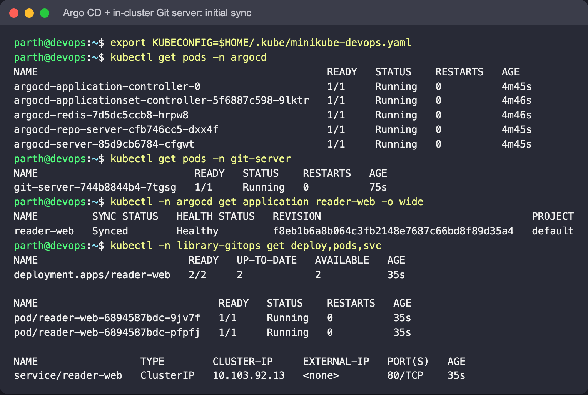
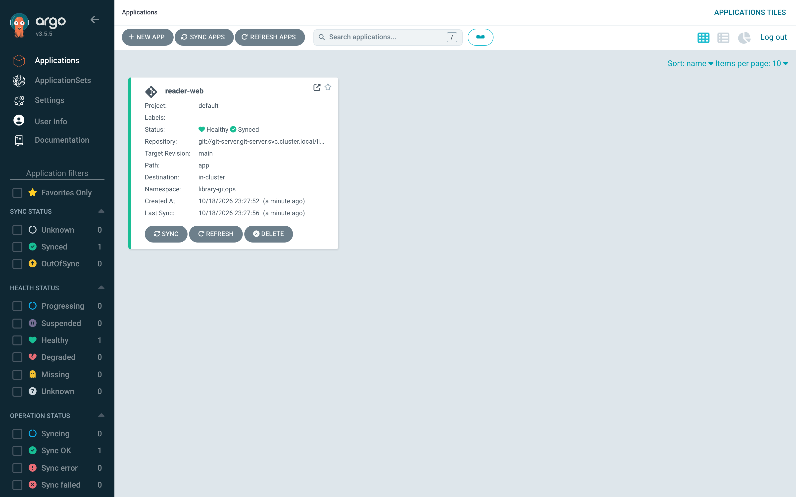
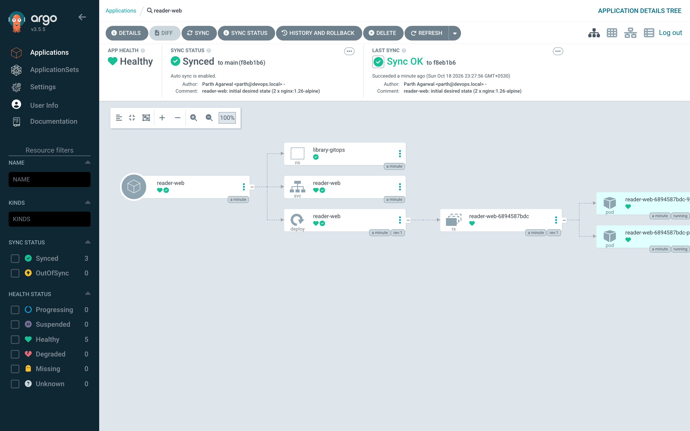
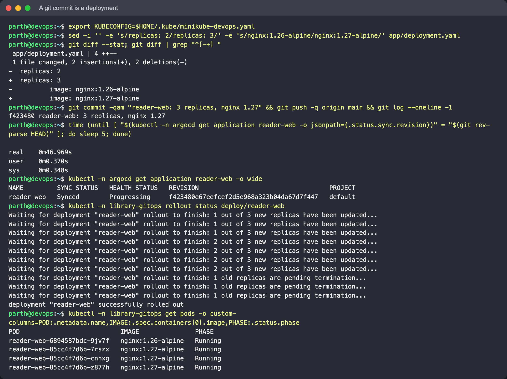
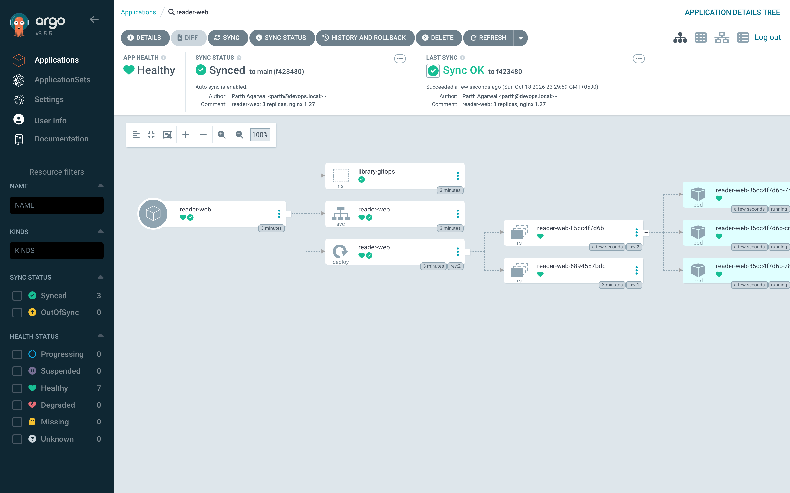
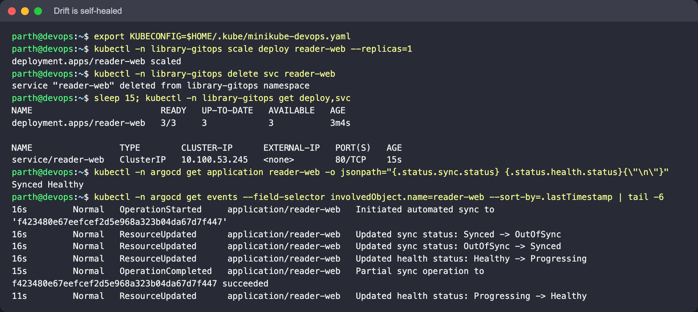
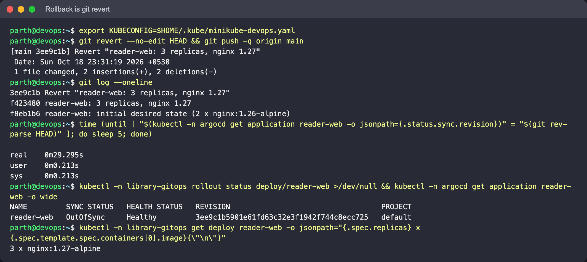
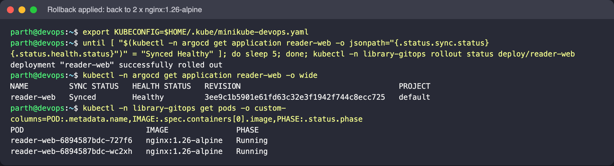
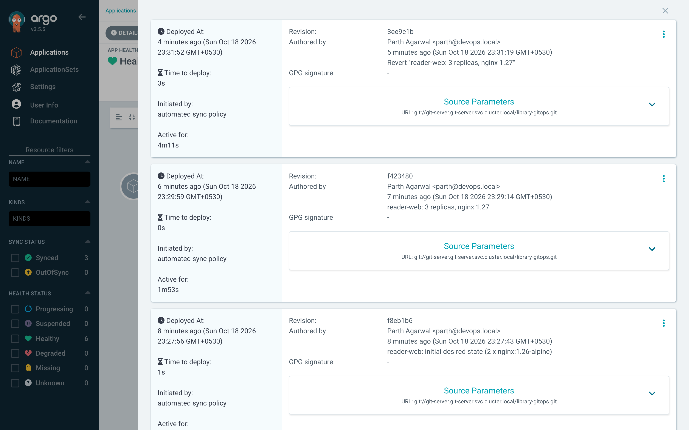
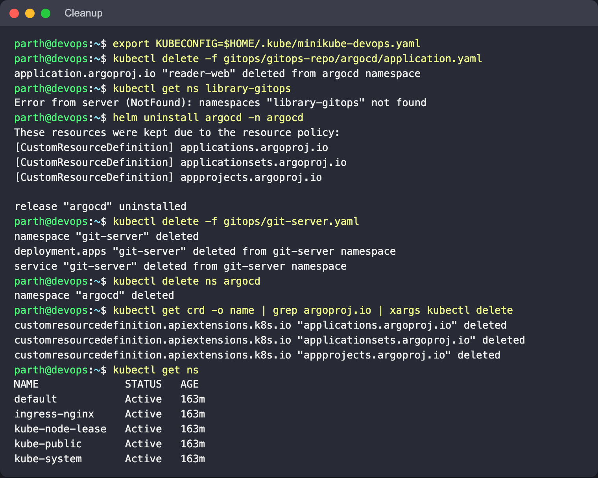

# GitOps with Argo CD

## What GitOps is

GitOps means running deployments from Git. The desired state of the cluster is kept as
declarative files in a Git repository, and an agent inside the cluster keeps making the
live state match those files. Nobody runs `kubectl apply` against production. You change
the repository, and the agent rolls the change out.

Four principles (OpenGitOps):

1. **Declarative**: the whole system is described as data (YAML manifests, Helm values,
   Kustomize overlays), not as a list of commands.
2. **Versioned and immutable**: that description lives in Git, so every change has an
   author, a review (pull request), a timestamp and can be reverted.
3. **Pulled automatically**: an agent in the cluster fetches the desired state. CI never
   needs cluster credentials.
4. **Continuously reconciled**: the agent keeps comparing desired and live state and
   fixes any difference (*drift*).

## Push vs pull deployment

| | Push (classic CI/CD) | Pull (GitOps) |
|---|---|---|
| Who applies | CI job runs `kubectl`/`helm` | agent in the cluster (Argo CD, Flux) |
| Credentials | CI holds cluster admin credentials | cluster only needs read access to Git |
| Drift | manual changes stay until the next deploy | detected and (optionally) reverted within minutes |
| Audit / rollback | spread across CI logs | `git log` / `git revert` |
| Multi-cluster | CI must reach every cluster | each cluster pulls on its own |

CI still has a job in GitOps: it tests, builds and pushes the image, then commits the new
tag to the config repo (or opens a PR). It just never talks to the cluster.

## Workflow

```text
developer ── PR ──► Git (app/ manifests) ◄── polls every 60s ── Argo CD (in cluster)
                         │                                         │
                    review + merge                        diff desired vs live
                                                                   │
                                                     sync: apply / prune / self-heal
                                                                   ▼
                                                     namespace library-gitops
```

Argo CD statuses: **Sync** (`Synced` / `OutOfSync`: does live match Git?) and **Health**
(`Healthy` / `Progressing` / `Degraded`: are the resources actually working?).

## Files

| File | Purpose |
|---|---|
| `argocd-values.yaml` | small, non-HA Argo CD (no Dex, no notifications, plain HTTP behind port-forward, 60 s polling) |
| `git-server.yaml` | tiny in-cluster Git server (`git daemon` on Alpine, namespace `git-server`, port 9418, push enabled, no auth, emptyDir storage), lab only |
| `gitops-repo/app/` | the desired state: Namespace, `reader-web` Deployment (2 × `nginx:1.26-alpine`), Service |
| `gitops-repo/argocd/application.yaml` | Application: watches `app/` on branch `main` of `git://git-server.git-server.svc.cluster.local/library-gitops.git`, automated sync with `prune` + `selfHeal`, `CreateNamespace=true` |

**Why an in-cluster Git server?** The DevOps repository that holds this lab is private, and
Argo CD would need credentials to read it. To keep the lab self-contained, `git-server.yaml`
runs a plain `git daemon` inside the cluster. You copy `gitops-repo/app/` into a small local
repo, push it to that server through `kubectl port-forward`, and Argo CD pulls from the
server's cluster DNS name. Everything else, such as commits, polling, sync, self-heal and
revert, works exactly as it would with GitHub.

To use GitHub (or GitLab) instead, put the `app/` folder in a repository, set `repoURL`,
`targetRevision` and `path` in `application.yaml`, and, for a private repo, register
credentials with `argocd repo add` or a repository Secret.

## Hands-on (Minikube, run as shown)

### 0. Install Argo CD and the Git server, push the app, register the Application

```bash
helm repo add argo https://argoproj.github.io/argo-helm && helm repo update
helm install argocd argo/argo-cd -n argocd --create-namespace -f gitops/argocd-values.yaml --wait

kubectl apply -f gitops/git-server.yaml
kubectl -n git-server rollout status deploy/git-server
kubectl -n git-server port-forward svc/git-server 9418:9418 &       # push from the laptop

# a small working repo whose app/ folder is the desired state
mkdir library-gitops && cp -R gitops/gitops-repo/app library-gitops/
cd library-gitops
git init -b main && git add . && git commit -m "reader-web: initial desired state (2 x nginx:1.26-alpine)"
git remote add origin git://localhost:9418/library-gitops.git
git push -u origin main
cd -

kubectl apply -f gitops/gitops-repo/argocd/application.yaml

kubectl -n argocd get secret argocd-initial-admin-secret -o jsonpath='{.data.password}' | base64 -d; echo
kubectl -n argocd port-forward svc/argocd-server 8080:80 &          # UI at http://localhost:8080, user admin
```

`alpine/git` does not include `git daemon` (Alpine packages it separately as `git-daemon`).
For that reason the server runs `alpine:3.20` and installs `git git-daemon` at startup.

### 1. Initial sync

```bash
kubectl -n argocd get application reader-web -o wide
kubectl -n library-gitops get deploy,pods,svc
```

The app is `Synced` / `Healthy` at the first commit. The namespace, Deployment and Service
exist even though nobody ran `kubectl apply` on them.







### 2. A commit is a deployment

In the working repo, change `app/deployment.yaml` to `replicas: 3` and `image: nginx:1.27-alpine`:

```bash
sed -i '' -e 's/replicas: 2/replicas: 3/' -e 's/nginx:1.26-alpine/nginx:1.27-alpine/' app/deployment.yaml
git commit -am "reader-web: 3 replicas, nginx 1.27" && git push
until [ "$(kubectl -n argocd get application reader-web -o jsonpath={.status.sync.revision})" = "$(git rev-parse HEAD)" ]; do sleep 5; done
kubectl -n library-gitops rollout status deploy/reader-web
```

Argo CD picked up the push within about **47 s** (one polling interval, 60 s), synced the
new commit and rolled out three Pods running the new image. Click **Refresh** in the UI to
skip the wait.





### 3. Drift is self-healed

```bash
kubectl -n library-gitops scale deploy reader-web --replicas=1
kubectl -n library-gitops delete svc reader-web
sleep 15; kubectl -n library-gitops get deploy,svc
```

Within a second Argo CD noticed the drift (`Synced -> OutOfSync`), started an automated sync
and put back 3 replicas and a new Service (new ClusterIP, age 15 s). To make a change stick,
you have to commit it.



### 4. Rollback is `git revert`

```bash
git revert --no-edit HEAD && git push
kubectl -n argocd get application reader-web -o wide
kubectl -n library-gitops get pods
```

The status changes in two steps. First, Argo CD sees the new commit: `sync.revision` moves to
the revert commit while the app is briefly `OutOfSync`. Then the automated sync applies it.
The first screenshot was taken between the two steps. The second one shows the result
after the sync: back to 2 × `nginx:1.26-alpine`. The rollback is a new commit, so the
history shows who rolled back and when. (`kubectl rollout undo` would be reverted by
self-heal, because Git still says otherwise.)





The UI's *History and Rollback* view lists every synced commit with its author and
message. All three were started by the automated sync policy:



### Cleanup

```bash
kubectl delete -f gitops/gitops-repo/argocd/application.yaml   # finalizer removes library-gitops objects
helm uninstall argocd -n argocd
kubectl delete -f gitops/git-server.yaml
kubectl delete ns argocd
kubectl get crd -o name | grep argoproj.io | xargs kubectl delete   # the chart keeps its CRDs
# stop the two port-forwards; the local library-gitops working repo can be deleted
```



## Argo CD vs Flux (short)

Both are CNCF-graduated pull-based GitOps controllers. Argo CD has a rich web UI, an
`Application` CRD and app-of-apps / ApplicationSet for many apps or clusters. Flux is a set
of smaller controllers (`GitRepository`, `Kustomization`, `HelmRelease`), driven mostly from
the CLI, with built-in image-update automation.
