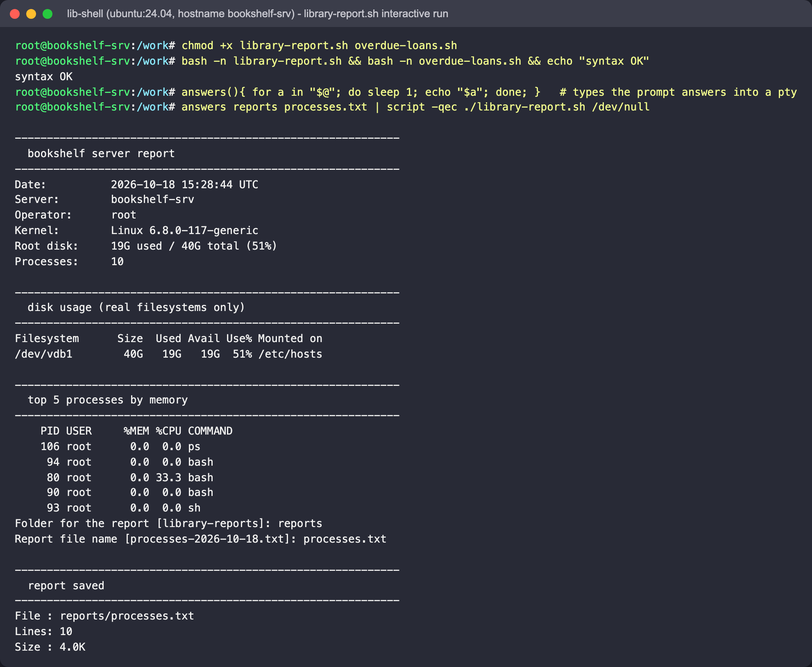
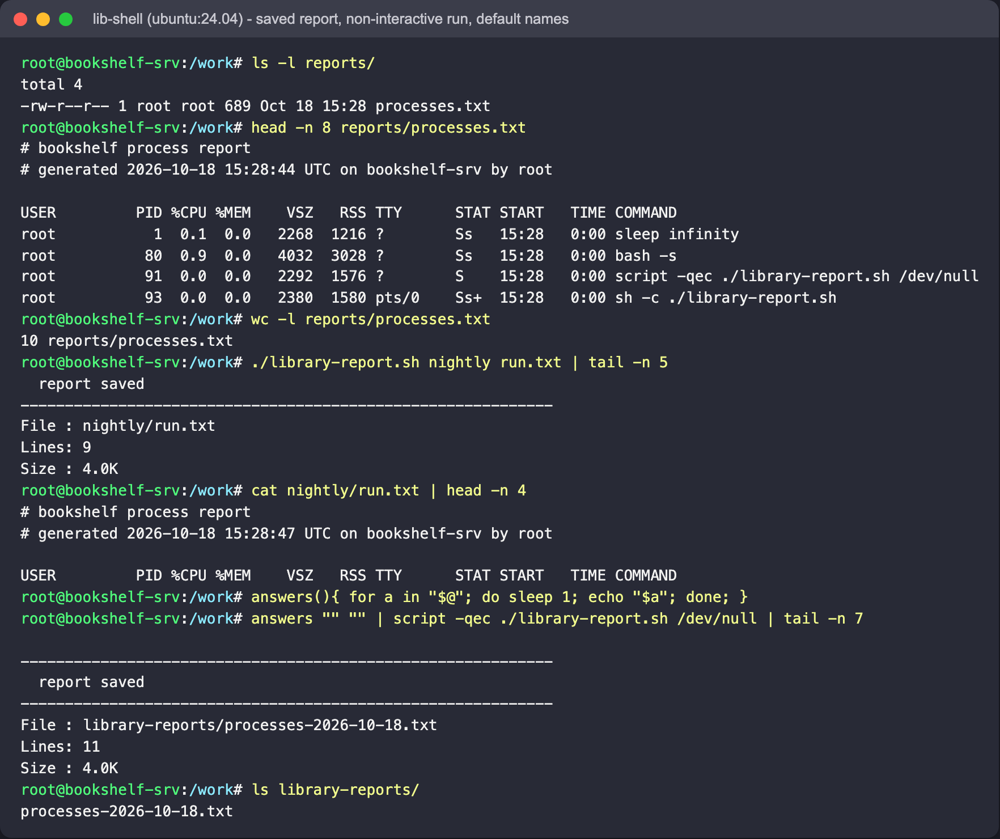
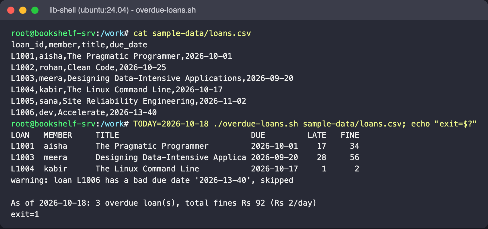
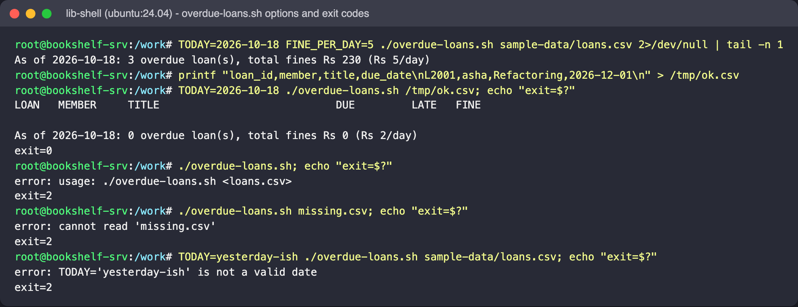

# Session 3: Shell Scripting

**Author:** Parth Agarwal

## Goal

Write a Bash script that reports on the server hosting the `bookshelf` library catalogue:
print date, host and user, show disk usage and running processes, read input from the user,
create a directory and file, and redirect command output into that file.

A second, smaller script (`overdue-loans.sh`) practises loops, functions, arithmetic,
conditionals and exit codes on a CSV of book loans.

## Files

| File | Purpose |
|---|---|
| `library-report.sh` | main assignment script (system summary + saved process report) |
| `overdue-loans.sh` | extra: lists overdue loans and fines from a CSV |
| `sample-data/loans.csv` | test data for `overdue-loans.sh` (one row has a deliberately invalid date) |

## Requirements -> where they are in `library-report.sh`

| Requirement | Implementation |
|---|---|
| Variables | `run_date`, `server`, `operator`, `kernel`, `root_disk`, `process_total`, `report_dir`, `report_name`, `report_path` |
| Command substitution | `$(date ...)`, `$(hostname)`, `$(whoami)`, `$(df -h / \| awk ...)` |
| Date, hostname, user | printed in the summary block with `printf` for aligned columns |
| Disk usage | `df -h` (skipping tmpfs/overlay noise) and a one-line root summary via `awk` |
| Running processes | process count + top 5 by memory with `ps -eo ... --sort=-%mem` |
| User input | two `read -r -p` prompts, with defaults via `${var:-default}` |
| Create directory | `mkdir -p "$report_dir"` (safe to re-run) |
| Create file | `touch "$report_path"` |
| Output redirection | `{ ... } > file` writes a header (truncate), then `ps aux >> file` appends |
| Function | `section()` prints the boxed headings |

Design choices:

- Every expansion is double-quoted, so folder names with spaces work.
- `set -u` makes a typo in a variable name fail loudly instead of expanding to empty.
- If two arguments are given the prompts are skipped (`./library-report.sh nightly run.txt`),
  so the same script can run from cron or CI.
- `>` vs `>>`: the header uses `>` so each run starts a clean file; the process table is appended
  with `>>` underneath it.

## `overdue-loans.sh` in short

- Reads `loan_id,member,title,due_date` rows with `while IFS=, read -r ...`, skipping the header
  with `tail -n +2`.
- Converts dates to "days since epoch" with GNU `date -d` inside a function and compares them
  with `$(( ))` arithmetic.
- Bad rows go to stderr as warnings and are skipped; usage errors exit `2`.
- Exit status is `1` if anything is overdue, `0` otherwise - so it can gate a cron job or a CI step.
- `TODAY` and `FINE_PER_DAY` can be overridden through the environment for repeatable runs.

GNU `date -d` is Linux-specific; on macOS run it in a container (below) or install `coreutils`.

## How to run

```bash
cd "Session 03 - Shell Scripting"
chmod +x library-report.sh overdue-loans.sh
bash -n library-report.sh && bash -n overdue-loans.sh     # syntax check only

./library-report.sh                    # answer the two prompts, e.g. reports / processes.txt
ls -l reports/ && head -n 8 reports/processes.txt && wc -l reports/processes.txt

./library-report.sh nightly run.txt    # non-interactive form

TODAY=2026-10-18 ./overdue-loans.sh sample-data/loans.csv; echo "exit=$?"
```

Run both inside Ubuntu without installing anything locally:

```bash
docker run --rm -it -h bookshelf-srv -v "$PWD":/work -w /work ubuntu:24.04 bash
```

## Tested output

Both scripts were run for real in an `ubuntu:24.04` container (`docker run -h bookshelf-srv`,
scripts copied to `/work`). `read -p` only prints its prompt when stdin is a terminal, so to
show the prompts in a non-interactive capture the two answers were typed into a pseudo-terminal
with `script`: `answers reports processes.txt | script -qec ./library-report.sh /dev/null`
(`answers` just echoes each argument after a 1-second pause). Typing them by hand gives the same result.



A container only has a handful of processes, so the top-5 list is tiny; on a real VM it is
much longer. In a container the root filesystem is `overlay`, which the disk section excludes,
so the only "real" filesystem left is the host disk bind-mounted at `/etc/hosts`. On a VM you
see `/`, `/boot` and so on.



- The file starts with the two `#` header lines written with `>`, then the `ps aux` table
  appended with `>>`.
- `./library-report.sh nightly run.txt` skipped the prompts and wrote `nightly/run.txt`.
- Pressing Enter at both prompts created `library-reports/processes-2026-10-18.txt` (the defaults).





The warning goes to stderr, so in a terminal it can appear before the summary line (stderr is
unbuffered). Redirecting `2>/dev/null` hides it, as in the `FINE_PER_DAY=5` run.

Generated report folders (`reports/`, `library-reports/`, ...) are run-time output - do not commit them.

## Screenshots

Embedded above; files in [`screenshots/`](screenshots/):

| File | Shows |
|---|---|
| `01-report-run.png` | syntax check and the interactive `./library-report.sh` run with both prompts |
| `02-report-file.png` | `ls -l`, `head`, `wc -l` on the saved report, non-interactive form, default names |
| `03-overdue-loans.png` | `overdue-loans.sh` table, warning line and `exit=1` |
| `04-overdue-loans-exit-codes.png` | `FINE_PER_DAY`, exit `0` when nothing is overdue, exit `2` on usage/input errors |
