# Session 4: Networking

**Author:** Parth Agarwal

## Goal

Learn the nine commands I reach for when "the catalogue site is down": check reachability,
look at addresses and routes, see which ports are listening, talk HTTP, download files,
resolve names, trace the path, and identify the host.

| # | Command | Question it answers |
|---|---|---|
| 1 | `ping` | Can I reach the host, and how fast? |
| 2 | `ip a` | Which interfaces and IP addresses do I have? |
| 3 | `ip route` | Where will my packets be sent? |
| 4 | `ss` | What is listening on which port, and which process owns it? |
| 5 | `curl` | Does the web service answer, and with what? |
| 6 | `wget` | Download a file to disk |
| 7 | `nslookup` / `dig` | What IP does this name resolve to, and who answered? |
| 8 | `traceroute` | Which hops does traffic pass through? |
| 9 | `hostname` | What is this machine called / what is its IP? |

## Environment

All commands were run in an `ubuntu:24.04` container on my Mac (Colima Docker engine):

```bash
docker run --rm -it -h library-net ubuntu:24.04 bash
apt-get update && apt-get install -y iproute2 iputils-ping curl wget dnsutils traceroute python3
```

> **Note on the container:** Colima runs containers inside a small VM whose network
> stack NATs traffic for them. Because of that, `ping` round-trip times below are unrealistically
> low (the VM answers the ICMP itself) and `traceroute` cannot see past the first hop. For
> screenshots with realistic numbers, run `ping` and `traceroute` on the host or a real VM.

---

## 1. `ping`

```bash
ping -c 4 github.com
```

Real output:

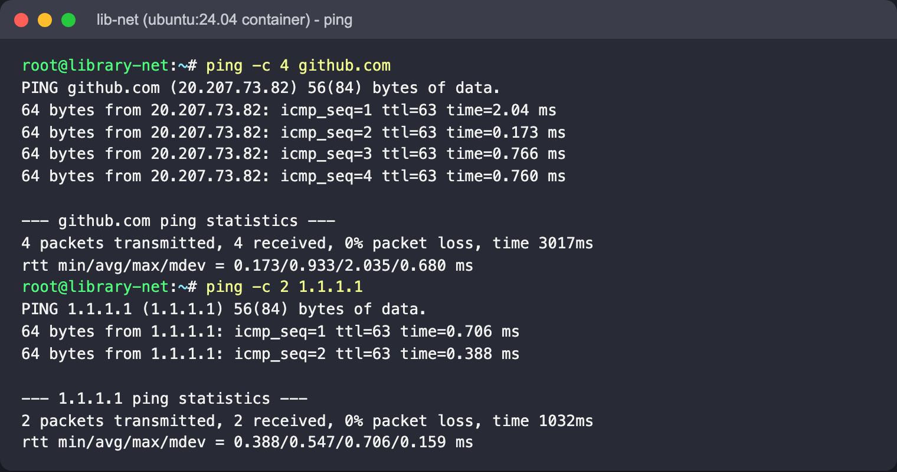

Same command on the macOS host, over the real network (macOS `ping` numbers from `icmp_seq=0` and prints `stddev`):

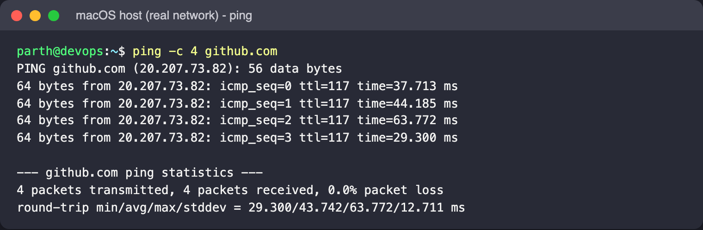

Read: the name is resolved first, then one ICMP echo per line. Inside the container the times are
under 1 ms (the Docker VM answers); from the host they are a realistic 30-90 ms with TTL 117. The summary gives packet loss
and min/avg/max/mdev latency. `-c` limits the count (Linux pings forever otherwise).
A failed ping is not proof the host is down - many firewalls drop ICMP.

## 2. `ip a`

```bash
ip -br a          # brief, one line per interface
ip a show eth0    # full detail for one interface
```

Real output:

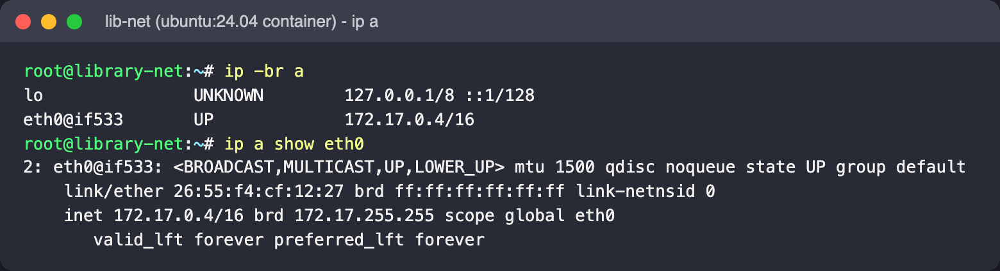

Read: `lo` is loopback; `eth0` is the container's end of a veth pair on the default Docker
bridge, address `172.17.0.4` in a `/16` network (65,534 usable hosts). `UP,LOWER_UP` means the
link is administratively up and has carrier. `link/ether` is the MAC address. `ip` replaces
the deprecated `ifconfig`.

## 3. `ip route`

```bash
ip route
ip route get 1.1.1.1
ip route get 172.17.0.1     # on-link: no 'via', delivered directly
```

Real output:

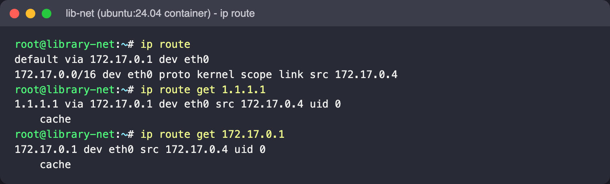

Read: anything in `172.17.0.0/16` is delivered directly on `eth0`; everything else goes to the
default gateway `172.17.0.1` (the Docker bridge). `ip route get` shows the exact decision the
kernel makes for one destination - handy when a box has several interfaces or VPN routes.

## 4. `ss`

To have something listening, I served a one-line `reader-web` page with Python:

```bash
mkdir -p /srv/reader-web && echo '<h1>reader-web: 42 books on loan</h1>' > /srv/reader-web/index.html
cd /srv/reader-web && python3 -m http.server 8080 &
ss -tlnp
ss -s
```

Real output:

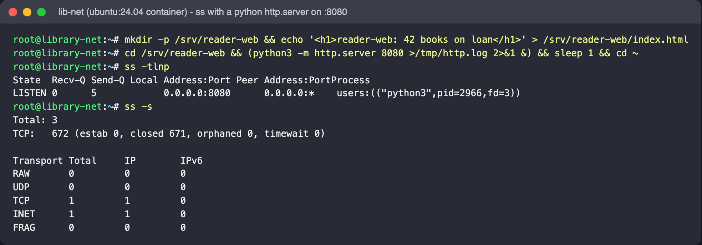

Read: flags are `-t` TCP, `-l` listening, `-n` numeric (no name lookups), `-p` owning process
(add `-u` for UDP). `0.0.0.0:8080` means all interfaces; `127.0.0.1:8080` would be local-only,
a classic reason a service "works on the box but not from outside". `ss -s` prints totals per
protocol. `ss` replaces `netstat`.

## 5. `curl`

```bash
curl -s http://localhost:8080/                 # body
curl -sI http://localhost:8080/                # headers only (HEAD)
curl -sI https://github.com | head -n 8
curl -s -o /dev/null -w 'code=%{http_code} dns=%{time_namelookup}s connect=%{time_connect}s total=%{time_total}s\n' https://example.com/
```

Real output:

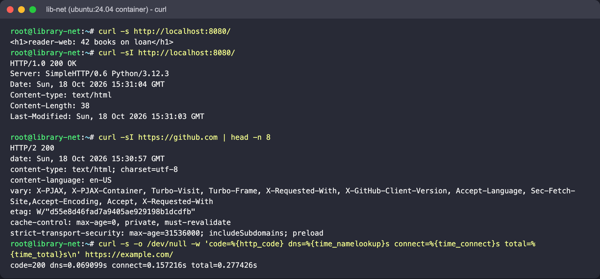

Read: the status line is the first thing to check. `-w` with timing variables splits a slow
request into DNS, TCP connect and total time - very useful for "the site is slow" tickets.
Other everyday flags: `-v` (show request/response and TLS), `-L` (follow redirects),
`-X POST -H 'Content-Type: application/json' -d '{...}'` (call an API).

## 6. `wget`

```bash
wget https://example.com/
wget -q -O page.html https://example.com/
ls -l index.html page.html
wget -q -O - http://localhost:8080/     # '-O -' = print to stdout like curl
```

Real output:

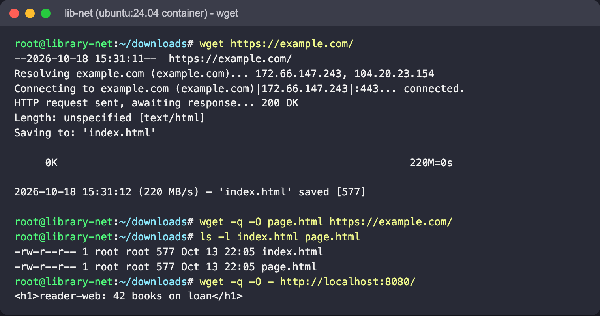

Read: `wget` narrates resolve -> connect -> response -> save. It writes to a file by default
(named after the URL), where `curl` writes to stdout. `-O` sets the name, `-q` silences it,
`-c` resumes a partial download, `-r` mirrors recursively. The file date comes from the
server's `Last-Modified` header, not the download time.

## 7. `nslookup` and `dig`

```bash
nslookup github.com
dig +short github.com
dig +noall +answer openlibrary.org
dig +noall +answer +stats example.com MX   # other record types; +stats shows the server and time
cat /etc/resolv.conf
```

Real output:

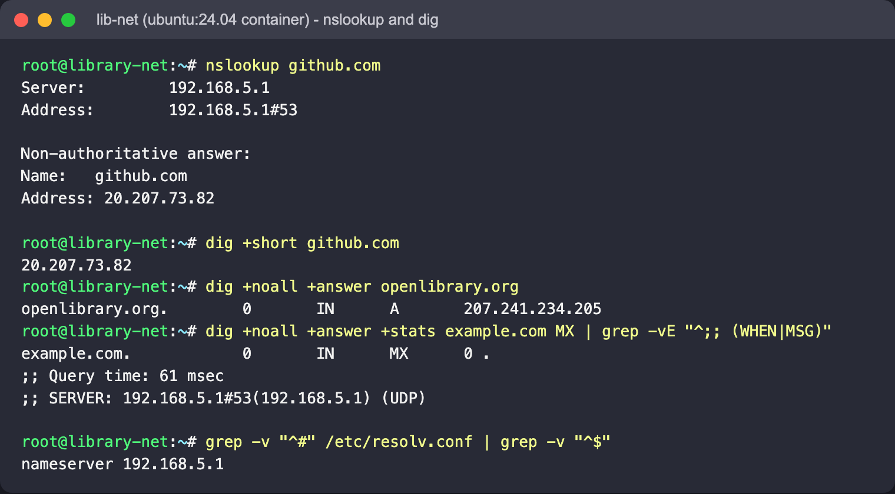

Read: `Server` is the resolver that answered - here Docker's VM resolver from
`/etc/resolv.conf`. "Non-authoritative" means it came from a cache, not the domain's own name
server. `dig +short` gives just the answer (good for scripts); `+noall +answer` adds the record
type and TTL. If `ping 1.1.1.1` works but `ping github.com` does not, suspect DNS.

## 8. `traceroute`

```bash
traceroute -m 12 -w 2 -q 1 github.com
```

Real output:

From the macOS host (real network, macOS `traceroute`):

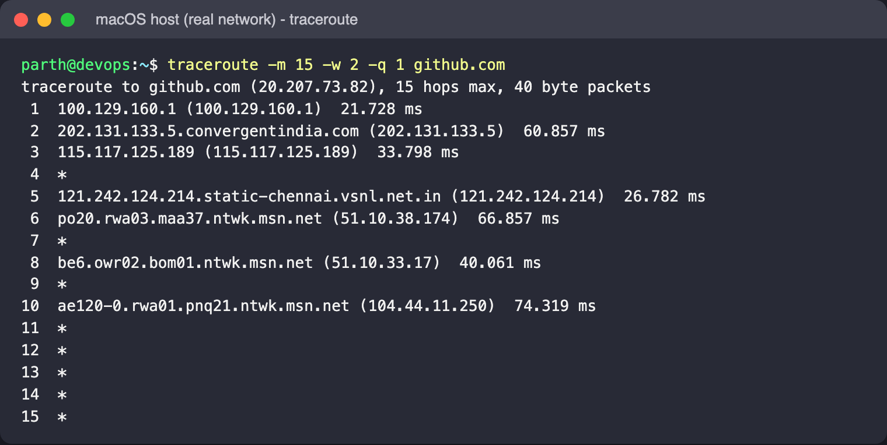

From inside the container:

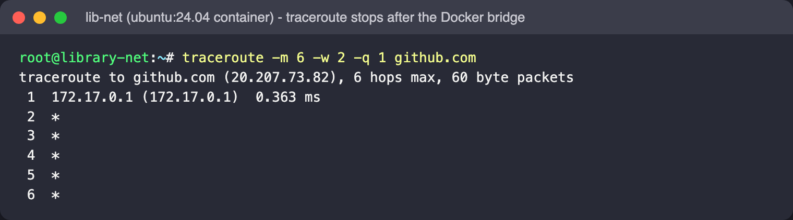

Read: traceroute sends probes with TTL 1, 2, 3, ... so each router on the way returns
"time exceeded" and reveals itself. `*` means no reply within `-w` seconds. In the container only the
Docker bridge (hop 1) answered, because the desktop VM's NAT does not pass those replies
back - see the note at the top. From the Mac you see the real path: the first-hop gateway,
the ISP (`convergentindia.com`, `vsnl.net.in`), then Microsoft's network (`ntwk.msn.net`, which
hosts GitHub in India) until the remaining hops stop answering probes. `-m` caps hops, `-q 1` sends one probe per hop.

## 9. `hostname`

```bash
hostname
hostname -I
hostname -f
cat /etc/hostname; grep library-net /etc/hosts
```

Real output:

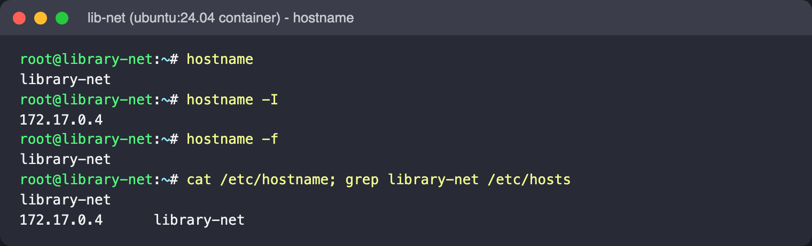

Read: the short name (set with `docker run -h`), all IPv4 addresses on one line, and the
fully-qualified name (no domain configured, so it is the same). On a real server,
`hostnamectl` shows and sets it permanently.

## Troubleshooting order I use

1. `ip a` / `ip route` - do I have an address and a default route?
2. `ping <gateway>` then `ping 1.1.1.1` - local network, then internet.
3. `dig <name>` - is DNS working?
4. `ss -tlnp` on the server - is the service listening, and on which address?
5. `curl -v` - what does the application actually return?
6. `traceroute` - where along the path does it break or slow down?

## Screenshots

All embedded above; files in [`screenshots/`](screenshots/). Everything ran in the `lib-net`
`ubuntu:24.04` container (hostname `library-net`) except `02-ping-macos-host.png` and
`09-traceroute-macos-host.png`, which were run on the macOS host to show real latency and hops.

| File | Shows |
|---|---|
| `01-ping-container.png` / `02-ping-macos-host.png` | `ping` from the container and from the host |
| `03-ip-a.png` | `ip -br a`, `ip a show eth0` |
| `04-ip-route.png` | `ip route`, `ip route get` |
| `05-ss.png` | `ss -tlnp`, `ss -s` with the reader-web server running |
| `06-curl.png` | body, `-I` headers, `-w` timing |
| `07-wget.png` | download, `-O`, `-O -` |
| `08-nslookup-dig.png` | `nslookup`, `dig` variants, `/etc/resolv.conf` |
| `09-traceroute-macos-host.png` / `10-traceroute-container.png` | real hops from the host vs container stopping at the bridge |
| `11-hostname.png` | `hostname`, `-I`, `-f` |
