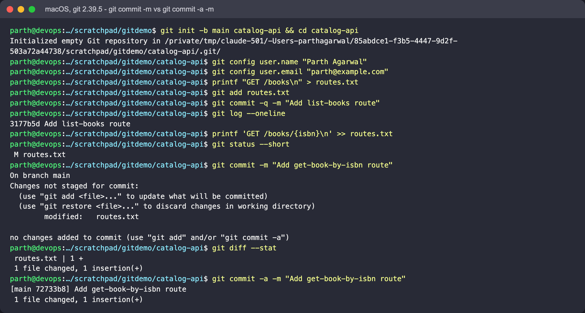
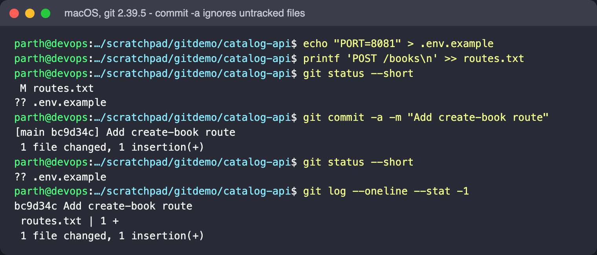
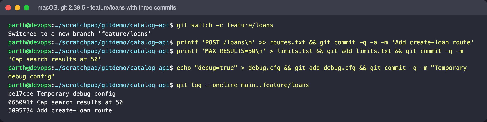
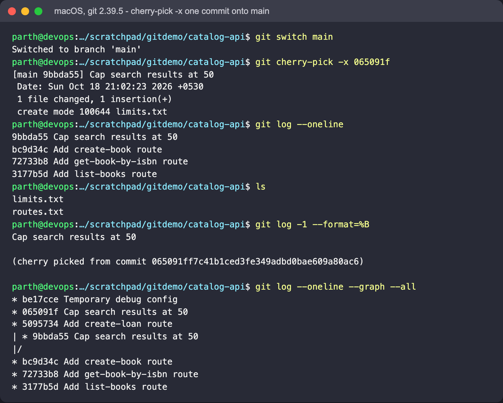
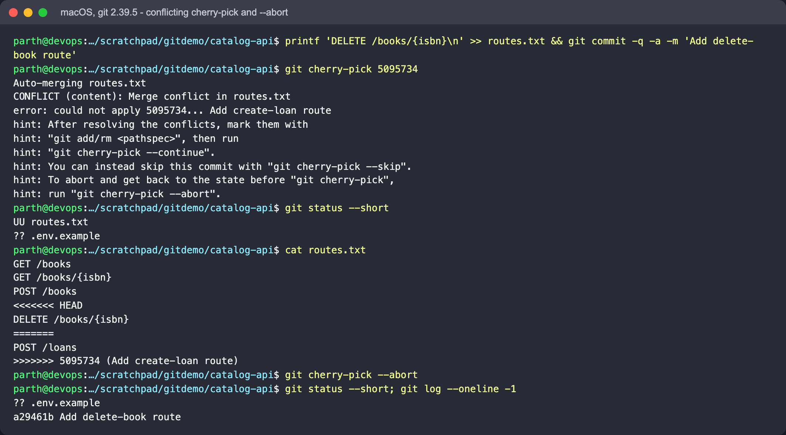
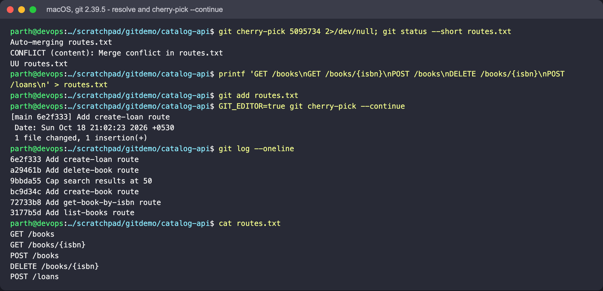

# Session 5: Git and GitHub

**Author:** Parth Agarwal

## Goal

Two experiments in a throwaway repository for a small `catalog-api` project:

1. The difference between `git commit -m` and `git commit -a -m`.
2. Using `git cherry-pick` to copy one commit from a feature branch to `main`,
   including what happens when the pick conflicts.

The "API" is just a `routes.txt` file so the focus stays on Git, not code.

## Setup

```bash
mkdir catalog-api && cd catalog-api
git init -b main .
git config user.name  "Parth Agarwal"
git config user.email "<your email>"
```

Output below is real (Git 2.39.5 on macOS, run in a throwaway repo), trimmed only where marked;
the screenshots under each block are from that same run. Your commit hashes and
dates will be different.

---

## Experiment 1 - `git commit -m` vs `git commit -a -m`

### Concept

Git has three places a change can live: the **working tree** (your files), the **index /
staging area** (what the next commit will contain) and the **repository** (commits).

- `git commit -m "msg"` commits **only what is staged**. Edits you did not `git add` are left out.
- `git commit -a -m "msg"` first stages every **tracked** file that was modified or deleted,
  then commits. It is a shortcut for `git add -u && git commit -m`.
- Neither one adds **untracked** (new) files. Those always need `git add`.

### Session

```text
$ printf 'GET /books\n' > routes.txt
$ git add routes.txt
$ git commit -q -m "Add list-books route"
$ git log --oneline
3177b5d Add list-books route

$ printf 'GET /books/{isbn}\n' >> routes.txt
$ git status --short
 M routes.txt
$ git commit -m "Add get-book-by-isbn route"
On branch main
Changes not staged for commit:
  (use "git add <file>..." to update what will be committed)
  (use "git restore <file>..." to discard changes in working directory)
	modified:   routes.txt

no changes added to commit (use "git add" and/or "git commit -a")

$ git diff --stat
 routes.txt | 1 +
 1 file changed, 1 insertion(+)
$ git commit -a -m "Add get-book-by-isbn route"
[main 72733b8] Add get-book-by-isbn route
 1 file changed, 1 insertion(+)

$ echo "PORT=8081" > .env.example
$ printf 'POST /books\n' >> routes.txt
$ git status --short
 M routes.txt
?? .env.example
$ git commit -a -m "Add create-book route"
[main bc9d34c] Add create-book route
 1 file changed, 1 insertion(+)
$ git status --short
?? .env.example
```





### What it shows

1. `git commit -m` refused to create a commit: the edit (` M`, right-hand column = unstaged)
   was only in the working tree. Git even suggests `git commit -a`.
2. `git commit -a -m` staged and committed the same edit in one step.
3. With one modified tracked file and one new file, `-a` committed **only** `routes.txt`
   ("1 file changed"); `.env.example` is still `??` (untracked) afterwards.

**When to use which:** `-a` is fine for quick, single-purpose edits. Prefer explicit
`git add <file>` (or `git add -p`) when the working tree has unrelated changes, so each
commit stays small and reviewable.

---

## Experiment 2 - `git cherry-pick`

### Concept

`git cherry-pick <commit>` takes the **diff** introduced by one commit and re-applies it on
top of the current branch as a **new** commit (new hash, because the parent is different).
The original commit stays on its branch. Typical uses: backporting a fix to a release branch,
or rescuing one good commit from a branch that is not ready to merge.

### Setup: a `feature/loans` branch with three commits

```text
$ git switch -c feature/loans
Switched to a new branch 'feature/loans'
$ printf 'POST /loans\n' >> routes.txt && git commit -q -a -m 'Add create-loan route'
$ printf 'MAX_RESULTS=50\n' > limits.txt && git add limits.txt && git commit -q -m 'Cap search results at 50'
$ echo "debug=true" > debug.cfg && git add debug.cfg && git commit -q -m "Temporary debug config"
$ git log --oneline main..feature/loans
be17cce Temporary debug config
065091f Cap search results at 50
5095734 Add create-loan route
```



`main` needs the search limit **now**; the loans route is unfinished and the debug config
must never reach `main`.

### Pick one commit

```text
$ git switch main
Switched to branch 'main'
$ git cherry-pick -x 065091f
[main 9bbda55] Cap search results at 50
 Date: Sun Oct 18 21:02:23 2026 +0530
 1 file changed, 1 insertion(+)
 create mode 100644 limits.txt
$ git log --oneline
9bbda55 Cap search results at 50
bc9d34c Add create-book route
72733b8 Add get-book-by-isbn route
3177b5d Add list-books route
$ ls
limits.txt
routes.txt
$ git log -1 --format=%B
Cap search results at 50

(cherry picked from commit 065091ff7c41b1ced3fe349adbd0bae609a80ac6)
```



What it shows:

- Only `limits.txt` arrived on `main`; `debug.cfg` and the `/loans` route did not.
- Same message and diff, **new hash** (`9bbda55` vs `065091f`). The original author date is kept.
- `-x` appended a "cherry picked from" line, so reviewers can trace where it came from.

### When a cherry-pick conflicts

Meanwhile `main` added its own route at the end of `routes.txt`, the same place the loans
commit changes:

```text
$ printf 'DELETE /books/{isbn}\n' >> routes.txt && git commit -q -a -m 'Add delete-book route'
$ git cherry-pick 5095734
Auto-merging routes.txt
CONFLICT (content): Merge conflict in routes.txt
error: could not apply 5095734... Add create-loan route
hint: After resolving the conflicts, mark them with
hint: "git add/rm <pathspec>", then run
hint: "git cherry-pick --continue".
hint: You can instead skip this commit with "git cherry-pick --skip".
hint: To abort and get back to the state before "git cherry-pick",
hint: run "git cherry-pick --abort".
$ git status --short
UU routes.txt
?? .env.example
$ cat routes.txt
GET /books
GET /books/{isbn}
POST /books
<<<<<<< HEAD
DELETE /books/{isbn}
=======
POST /loans
>>>>>>> 5095734 (Add create-loan route)
$ git cherry-pick --abort
$ git log --oneline -1
a29461b Add delete-book route
```



`--abort` put the branch back exactly as it was. Running the pick again and resolving it
(keeping both routes):

```text
$ git status --short routes.txt
UU routes.txt
$ printf 'GET /books\nGET /books/{isbn}\nPOST /books\nDELETE /books/{isbn}\nPOST /loans\n' > routes.txt
$ git add routes.txt
$ git cherry-pick --continue
[main 6e2f333] Add create-loan route
 Date: Sun Oct 18 21:02:23 2026 +0530
 1 file changed, 1 insertion(+)
$ git log --oneline
6e2f333 Add create-loan route
a29461b Add delete-book route
9bbda55 Cap search results at 50
bc9d34c Add create-book route
72733b8 Add get-book-by-isbn route
3177b5d Add list-books route
```



`--continue` opens your editor to confirm the commit message; in the scripted capture it was run as
`GIT_EDITOR=true git cherry-pick --continue` to accept the message unchanged.

### Cherry-pick cheat sheet

| Command | Effect |
|---|---|
| `git cherry-pick <sha>` | apply one commit as a new commit |
| `git cherry-pick -x <sha>` | same, and record the source hash in the message |
| `git cherry-pick A^..B` | apply a range, A through B inclusive |
| `git cherry-pick -n <sha>` | apply changes to the index without committing |
| `git cherry-pick --continue` / `--skip` / `--abort` | after a conflict: finish / drop this commit / undo everything |

Caution: cherry-picking a commit and later merging its branch can produce duplicate-looking
history. Prefer merging when you want the whole branch; cherry-pick for isolated fixes.

## Reproduce it

```bash
# run in an empty scratch folder
git init -b main catalog-api && cd catalog-api
# ... then follow the commands in the two sessions above, in order
```

## Screenshots

Embedded above; files in [`screenshots/`](screenshots/):

| File | Shows |
|---|---|
| `01-commit-m-refused-vs-commit-a.png` | the refused `git commit -m` and the successful `git commit -a -m` |
| `02-commit-a-skips-untracked.png` | `-a` commits `routes.txt` only; `.env.example` stays `??` |
| `03-feature-branch.png` | three commits on `feature/loans`, `git log main..feature/loans` |
| `04-cherry-pick.png` | `cherry-pick -x`, new `git log --oneline` on main, `-x` trailer, graph |
| `05-cherry-pick-conflict.png` | `CONFLICT` message, markers in `routes.txt`, `--abort` |
| `06-cherry-pick-continue.png` | resolving, `git add`, `--continue`, final history |
