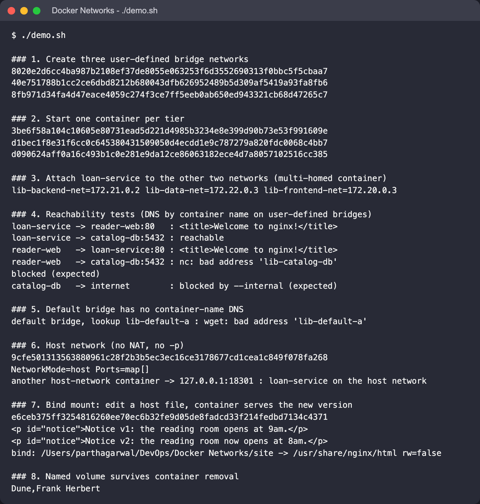
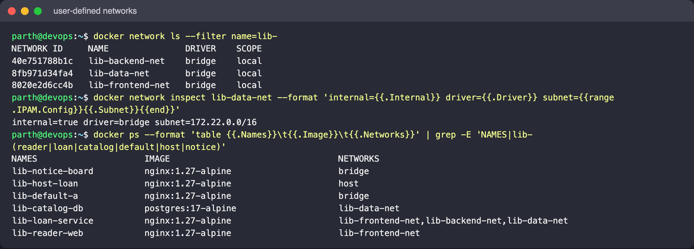
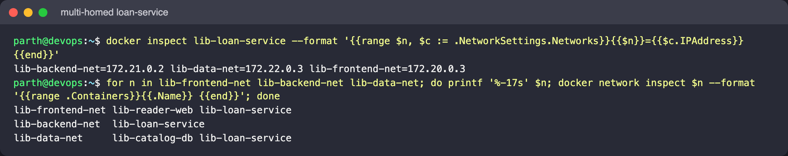
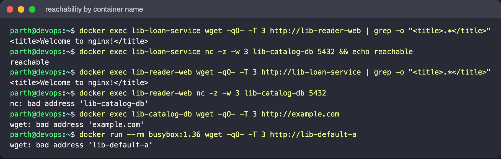
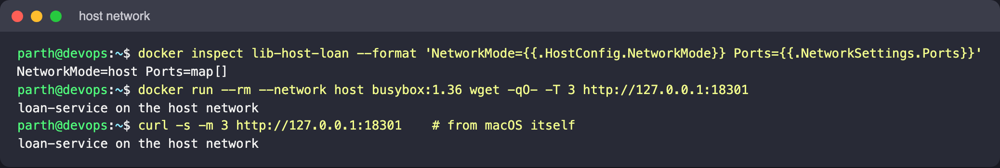
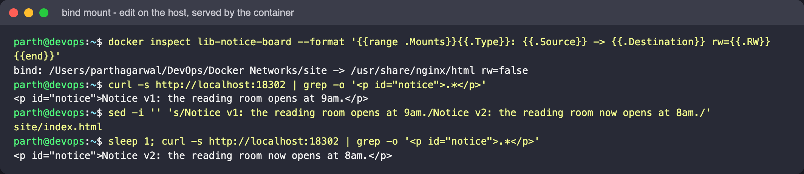
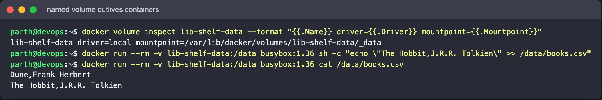
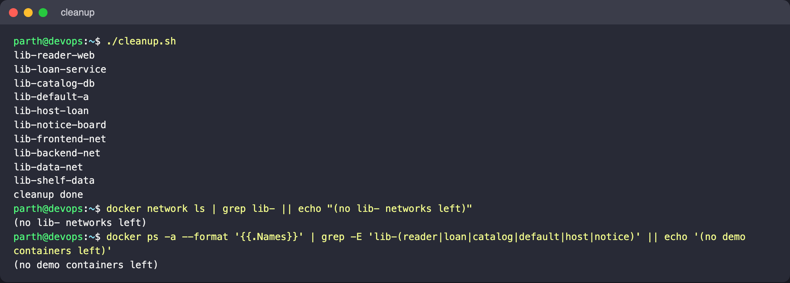

# Session 8: Docker Networking

Author: Parth Agarwal

## Goal

Isolate the tiers of a small library system (`reader-web`, `loan-service`, `catalog-db`) on
separate user-defined bridge networks, let only the middle tier talk to both sides, and then look
at host networking, bind mounts, named volumes and (on paper) overlay networks.

## Concepts in brief

| Driver / feature | What it does | When to use |
|---|---|---|
| default `bridge` | NAT'd private network on one host; containers reach each other only by IP | Quick one-off containers |
| user-defined bridge | Same, plus built-in DNS (container name -> IP) and isolation from other bridges | Almost always, on a single host |
| `--internal` bridge | Bridge with no outbound route | Databases that never need the internet |
| `host` | Container shares the host's network stack; no NAT, `-p` is ignored | Max network performance, or tools that must see host interfaces |
| `none` | Only loopback | Batch jobs that need no network |
| `overlay` | VXLAN network spanning several Docker hosts (Swarm) | Multi-host services |
| bind mount | A host path mounted into the container | Live-editing config/content during development |
| named volume | Docker-managed storage that outlives containers | Database data |

A container can be attached to several networks at once (`docker network connect`); it then gets
one interface and IP per network. That is how a middle tier can bridge two otherwise isolated
segments.

## Files

| File | Purpose |
|---|---|
| `demo.sh` | Runs every exercise below in order and prints the checks |
| `cleanup.sh` | Removes all `lib-*` containers, networks and the volume |
| `site/index.html` | Page served through a bind mount (the demo edits it, then restores it) |
| `host-net/default.conf` | nginx config listening on 18301 for the host-network test |

## Topology

```text
   lib-frontend-net          lib-backend-net          lib-data-net (--internal)
  +----------------+       +----------------+        +----------------+
  | lib-reader-web |       |                |        | lib-catalog-db |
  +----------------+       |                |        +----------------+
          \                |                |               /
           \---------- lib-loan-service (attached to all three) ----/
```

`reader-web` can reach `loan-service`; `loan-service` can reach `catalog-db`; `reader-web` cannot
see `catalog-db` at all.

## Commands

All at once: `./demo.sh` then `./cleanup.sh`. The individual steps are:

```bash
# 1. networks
docker network create lib-frontend-net
docker network create lib-backend-net
docker network create --internal lib-data-net

# 2. one container per tier
docker run -d --name lib-reader-web   --network lib-frontend-net nginx:1.27-alpine
docker run -d --name lib-loan-service --network lib-backend-net  nginx:1.27-alpine
docker run -d --name lib-catalog-db   --network lib-data-net -e POSTGRES_PASSWORD=example-only postgres:17-alpine

# 3. make loan-service multi-homed
docker network connect lib-frontend-net lib-loan-service
docker network connect lib-data-net     lib-loan-service
docker inspect lib-loan-service --format '{{range $n, $c := .NetworkSettings.Networks}}{{$n}}={{$c.IPAddress}} {{end}}'

# 4. reachability
docker exec lib-loan-service wget -qO- http://lib-reader-web
docker exec lib-loan-service nc -z -w 3 lib-catalog-db 5432
docker exec lib-reader-web   nc -z -w 3 lib-catalog-db 5432      # fails: name not resolvable

# 5. default bridge: no name resolution
docker run -d --name lib-default-a nginx:1.27-alpine
docker run --rm busybox:1.36 wget -qO- -T 3 http://lib-default-a  # bad address

# 6. host network
docker run -d --name lib-host-loan --network host \
  -v "$PWD/host-net/default.conf:/etc/nginx/conf.d/default.conf:ro" nginx:1.27-alpine
docker run --rm --network host busybox:1.36 wget -qO- http://127.0.0.1:18301

# 7. bind mount
docker run -d --name lib-notice-board -p 18302:80 -v "$PWD/site:/usr/share/nginx/html:ro" nginx:1.27-alpine
curl -s http://localhost:18302        # edit site/index.html, curl again -> new text

# 8. named volume
docker volume create lib-shelf-data
docker run --rm -v lib-shelf-data:/data busybox:1.36 sh -c 'echo "Dune,Frank Herbert" > /data/books.csv'
docker run --rm -v lib-shelf-data:/data busybox:1.36 cat /data/books.csv
```

## Real output from this machine

`./demo.sh` on Docker 29.5.2 (Colima VM on macOS), container IDs removed:

```text
### 3. Attach loan-service to the other two networks (multi-homed container)
lib-backend-net=172.21.0.2 lib-data-net=172.22.0.3 lib-frontend-net=172.20.0.3

### 4. Reachability tests (DNS by container name on user-defined bridges)
loan-service -> reader-web:80   : <title>Welcome to nginx!</title>
loan-service -> catalog-db:5432 : reachable
reader-web   -> loan-service:80 : <title>Welcome to nginx!</title>
reader-web   -> catalog-db:5432 : nc: bad address 'lib-catalog-db'
blocked (expected)
catalog-db   -> internet        : blocked by --internal (expected)

### 5. Default bridge has no container-name DNS
default bridge, lookup lib-default-a : wget: bad address 'lib-default-a'

### 6. Host network (no NAT, no -p)
NetworkMode=host Ports=map[]
another host-network container -> 127.0.0.1:18301 : loan-service on the host network

### 7. Bind mount: edit a host file, container serves the new version
<p id="notice">Notice v1: the reading room opens at 9am.</p>
<p id="notice">Notice v2: the reading room now opens at 8am.</p>
bind: /Users/parthagarwal/DevOps/Docker Networks/site -> /usr/share/nginx/html rw=false

### 8. Named volume survives container removal
Dune,Frank Herbert
```

Notes:

- `reader-web -> catalog-db` fails at DNS, not at TCP: the embedded DNS server only answers for
  containers on networks the caller shares.
- On macOS, "host" means the Linux VM that runs the Docker engine, not macOS itself, which is why
  the script tests the host network from a second `--network host` container. On this machine the
  engine runs in Colima, which automatically forwards ports that start listening inside the VM to
  the Mac, so a plain `curl http://127.0.0.1:18301` from macOS also answered (see screenshot 05).
  Docker Desktop does not forward host-network ports by default (unless its host networking
  option is enabled); on a Linux host the curl works directly.
- On macOS the bind-mount change can take a moment to propagate through the VM's file
  sharing; the script waits one second before the second curl.

## Overlay networks (explained, not run)

An overlay network stretches one L2 segment across several Docker hosts using VXLAN
encapsulation (UDP 4789), with Swarm managing membership and the key-value state. Services on
the same overlay resolve each other by service name and get a virtual IP that load-balances
across replicas.

Swarm was **not** initialised on this machine, because `docker swarm init` changes the state of
the shared Docker engine that other projects are using. The commands to try on a lab VM
(or two VMs) are:

```bash
# manager
docker swarm init --advertise-addr <manager-ip>
# workers: paste the "docker swarm join --token ..." line printed above

docker network create --driver overlay --attachable lib-catalog-overlay
docker service create --name lib-catalog --network lib-catalog-overlay --replicas 3 nginx:1.27-alpine
docker service ps lib-catalog          # replicas spread across nodes
docker run --rm --network lib-catalog-overlay busybox:1.36 nslookup lib-catalog   # one VIP
docker run --rm --network lib-catalog-overlay busybox:1.36 nslookup tasks.lib-catalog  # every replica IP

# teardown
docker service rm lib-catalog
docker network rm lib-catalog-overlay
docker swarm leave --force
```

Ports that must be open between nodes: TCP 2377 (cluster management), TCP/UDP 7946 (gossip),
UDP 4789 (VXLAN data). Add `--opt encrypted` to `network create` for IPsec between nodes.

## Cleanup

```bash
./cleanup.sh
docker network ls | grep lib-   # should print nothing
```

## Screenshots

All captured from a real run on this machine (Docker 29.5.2 in a Colima VM on macOS).

The full `./demo.sh` run:



The three `lib-*` networks (`lib-data-net` is `internal=true`) and which network each container is on:



`lib-loan-service` is multi-homed - one IP per network, and it is the only container on all three:



Reachability: name-based DNS works on shared user-defined bridges, `reader-web` cannot even resolve
`catalog-db`, the `--internal` network has no route (or DNS) to the internet, and the default bridge
has no container-name DNS at all:



Host network: no port mapping, answered from another host-network container and (thanks to
Colima's port forwarding) from macOS:



Bind mount: editing `site/index.html` on the host changes what the container serves immediately
(the file was restored to v1 afterwards):



| Before the edit (`localhost:18302`) | After the edit |
|---|---|
|  |  |

Named volume: data written by one throwaway container is read back by another:



`./cleanup.sh` leaves no `lib-` networks or demo containers behind:


