# Session 10: Kubernetes Pods, ReplicaSets & Deployments

**Goal:** run the same kind of app as a bare Pod, a ReplicaSet, a Deployment and a DaemonSet,
and see what each controller adds: self-healing, scaling, rolling updates with rollback, and
one-Pod-per-node scheduling. Also break a rollout on purpose and recover it.

Author: Parth Agarwal · Cluster: Minikube, Docker driver · Namespace: `library`

## Concepts in brief

| Object | Owns | Adds |
|---|---|---|
| **Pod** | containers | Shared network/IP and volumes. If it dies, it stays dead |
| **ReplicaSet** | Pods (found by label selector) | Keeps N replicas running; `kubectl scale` |
| **Deployment** | ReplicaSets | Rolling updates, revision history, `rollout undo` |
| **DaemonSet** | Pods, one per eligible node | Node-level agents (log shippers, monitoring, CNI) |

Controllers do not keep a list of Pod names. A ReplicaSet counts the Pods whose labels match
its selector and creates or deletes Pods until the count matches `replicas`. A Deployment
creates one ReplicaSet per distinct Pod template (identified by the `pod-template-hash`
label) and moves replicas between them during an update.

## Files

| File | What it creates |
|---|---|
| [`manifests/00-namespace.yaml`](manifests/00-namespace.yaml) | `library` namespace |
| [`manifests/01-pod.yaml`](manifests/01-pod.yaml) | bare Pod `catalog-api-standalone` |
| [`manifests/02-replicaset.yaml`](manifests/02-replicaset.yaml) | ReplicaSet `loan-service-rs`, 3 replicas, each Pod echoes its own name |
| [`manifests/03-deployment-v1.yaml`](manifests/03-deployment-v1.yaml) | Deployment `catalog-api`, 3 replicas, `maxSurge: 1`, `maxUnavailable: 0` |
| [`manifests/04-deployment-v2.yaml`](manifests/04-deployment-v2.yaml) | Same Deployment with a new version label and response text |
| [`manifests/05-daemonset.yaml`](manifests/05-daemonset.yaml) | DaemonSet `shelf-scanner` (busybox loop that logs its node name) |

All containers use public images (`hashicorp/http-echo:1.0.0`, `busybox:1.36`).

```bash
minikube start --driver=docker
cd manifests
kubectl apply -f 00-namespace.yaml
kubectl config set-context --current --namespace=library   # so -n library can be omitted
```

## 1. Bare Pod: nobody brings it back

```bash
kubectl apply -f 01-pod.yaml
kubectl wait --for=condition=Ready pod/catalog-api-standalone --timeout=120s
kubectl get pod catalog-api-standalone -o wide --show-labels
kubectl get pod catalog-api-standalone -o jsonpath='{.metadata.ownerReferences}{"\n"}'
kubectl delete pod catalog-api-standalone
kubectl get pods
```

**Expect:** `ownerReferences` is empty, and after the delete `kubectl get pods` returns
`No resources found`. There was no controller watching the Pod.

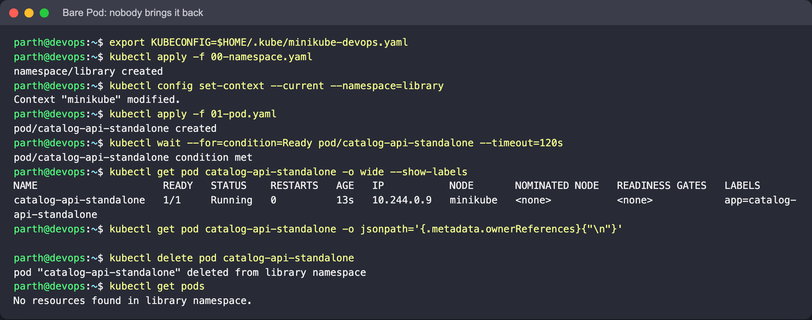

## 2. ReplicaSet: self-healing and scaling

```bash
kubectl apply -f 02-replicaset.yaml
kubectl wait --for=condition=Ready pod -l app=loan-service --timeout=120s
kubectl get rs,pods -l app=loan-service

# kill one Pod and immediately look again
POD=$(kubectl get pods -l app=loan-service -o jsonpath='{.items[0].metadata.name}')
kubectl delete pod "$POD" --wait=false
kubectl get pods -l app=loan-service

# scale out and in
kubectl scale rs loan-service-rs --replicas=5
kubectl get pods -l app=loan-service
kubectl scale rs loan-service-rs --replicas=2
kubectl describe rs loan-service-rs | sed -n '/^Events/,$p'

# each Pod answers with its own name (POD_NAME comes from the downward API)
kubectl port-forward rs/loan-service-rs 5678:5678 &   # then: curl localhost:5678
```

**What to look for:**

- Right after deleting a Pod, a replacement with a new random suffix is already
  `Pending` / `ContainerCreating` while the deleted one is still `Terminating`. The controller acts as
  soon as the matching count drops below 3.
- Scaling to 5 adds two Pods; scaling to 2 deletes three. The Events list one
  `SuccessfulCreate` / `SuccessfulDelete` per Pod.
- Try `kubectl label pod <one-of-them> app=detached --overwrite`. The ReplicaSet no longer
  counts that Pod and creates a new one, and the relabelled Pod keeps running unmanaged.
  This shows the selector really is the only link between them.
- Limitation: editing the image or args in a ReplicaSet template does **not** touch existing
  Pods. That is the gap a Deployment fills.

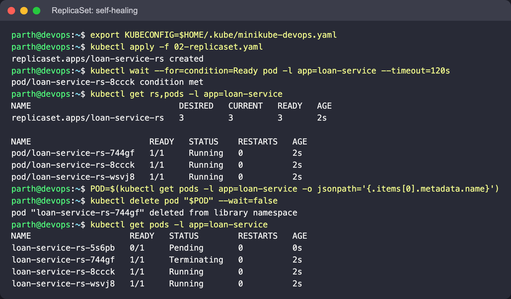

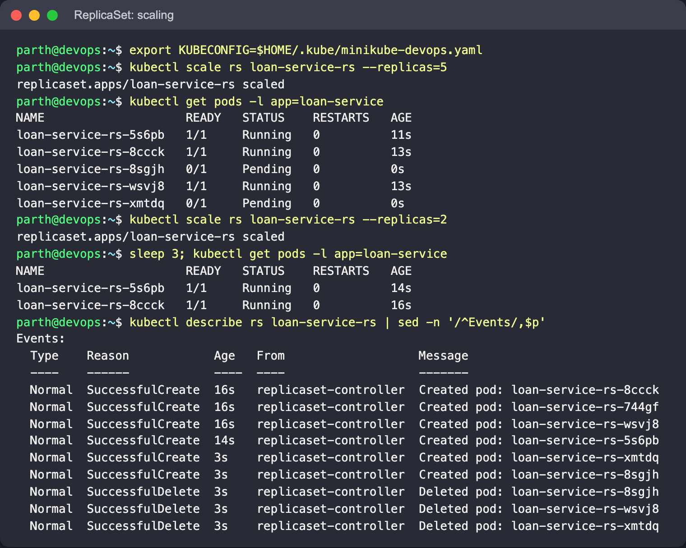

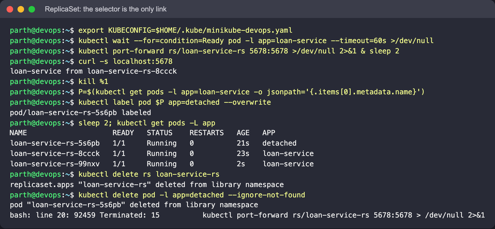

```bash
kubectl delete rs loan-service-rs
kubectl delete pod -l app=detached --ignore-not-found
```

## 3. Deployment: rolling update, history and rollback

```bash
kubectl apply -f 03-deployment-v1.yaml
kubectl rollout status deployment/catalog-api
kubectl get deploy,rs,pods -l app=catalog-api -L version
```

**What to look for:** the chain Deployment → ReplicaSet → Pods is visible in the names:
`catalog-api-<template-hash>-<suffix>`. The ReplicaSet was created by the Deployment, not by
you.

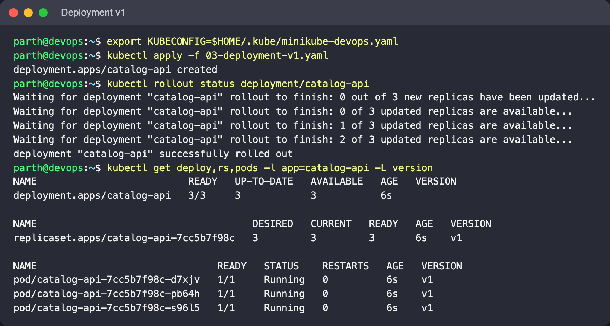

Roll forward to v2. Use a second terminal to watch the Pods change over:

```bash
kubectl get pods -l app=catalog-api -L version -w        # terminal 2

kubectl apply -f 04-deployment-v2.yaml                    # terminal 1
kubectl rollout status deployment/catalog-api
kubectl get rs -l app=catalog-api
kubectl rollout history deployment/catalog-api
kubectl port-forward deploy/catalog-api 5678:5678 &       # curl localhost:5678 -> "... v2 ..."
```

**What to look for:**

- A **new** ReplicaSet appears and scales 0 → 3 while the old one scales 3 → 0. Because
  `maxUnavailable: 0`, an old Pod is only removed after a new one passes its readiness
  probe, so there are always at least 3 ready Pods; `maxSurge: 1` means at most 4 exist.
- The old ReplicaSet is kept with `DESIRED 0`. `revisionHistoryLimit: 5` controls how many
  are kept.
- `rollout history` shows revisions 1 and 2, with the `CHANGE-CAUSE` taken from the
  `kubernetes.io/change-cause` annotation in each manifest.

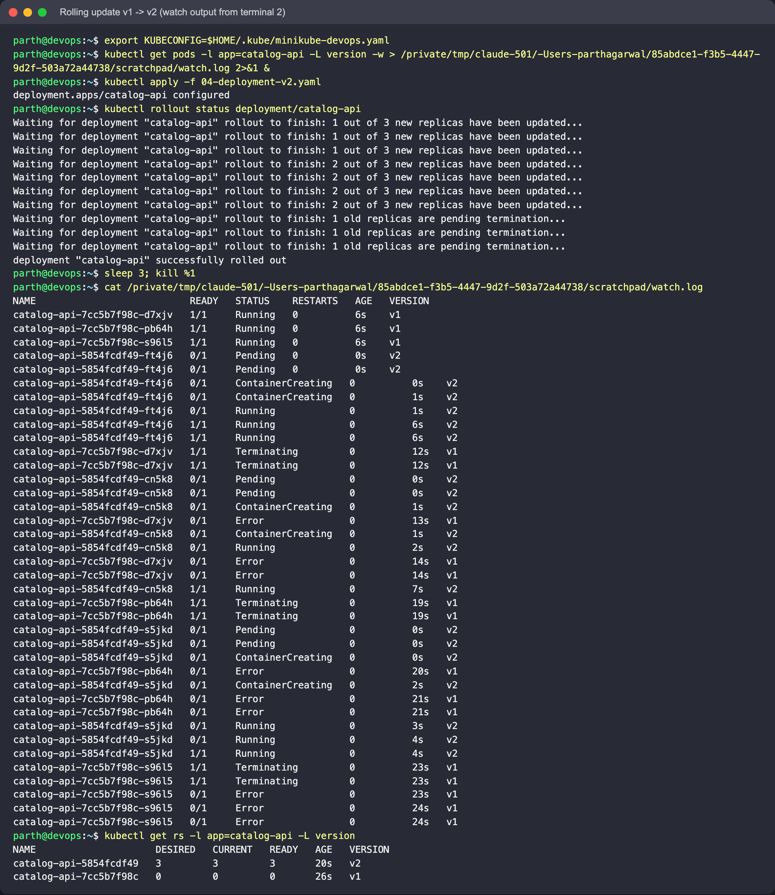

On this run the old `http-echo` Pods briefly show `Error` after `Terminating`: the process exits
non-zero when it receives SIGTERM. That is cosmetic; the new Pods were already Ready.

Roll back:

```bash
kubectl rollout undo deployment/catalog-api
kubectl rollout status deployment/catalog-api
kubectl get pods -l app=catalog-api -L version
kubectl rollout history deployment/catalog-api
```

**Expect:** the Pods are `version=v1` again, achieved by scaling the old ReplicaSet back up
(no new image pull needed). History now shows revisions 2 and 3: an undo is recorded as a
new revision, and revision 1 disappears because its template is now revision 3.

`rollout undo` also prints a warning that the `last-applied-configuration` annotation is not
updated, which is one more reason to prefer re-applying a file (see section 4).

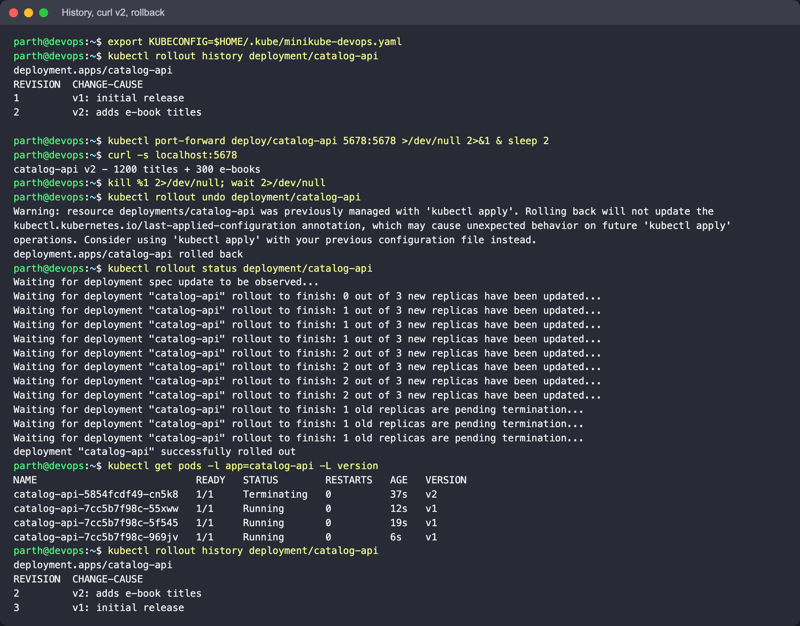

## 4. Troubleshooting a broken rollout

Push an image tag that does not exist:

```bash
kubectl set image deployment/catalog-api catalog-api=hashicorp/http-echo:9.9.9-does-not-exist
kubectl annotate deployment/catalog-api kubernetes.io/change-cause="bad tag (on purpose)" --overwrite
kubectl rollout status deployment/catalog-api --timeout=60s     # times out
kubectl get pods -l app=catalog-api
kubectl describe pod <the-new-pod> | sed -n '/^Events/,$p'
```

**What to look for:**

- One new Pod in `ErrImagePull`, then `ImagePullBackOff`. The Events line says the manifest
  for that tag was not found.
- The three existing Pods stay `Running` and keep serving. The new Pod never becomes Ready,
  and with `maxUnavailable: 0` the Deployment is not allowed to remove an old one, so the
  rollout just stalls. After `progressDeadlineSeconds` (600s by default) the Deployment's
  `Progressing` condition turns `False` with reason `ProgressDeadlineExceeded`.

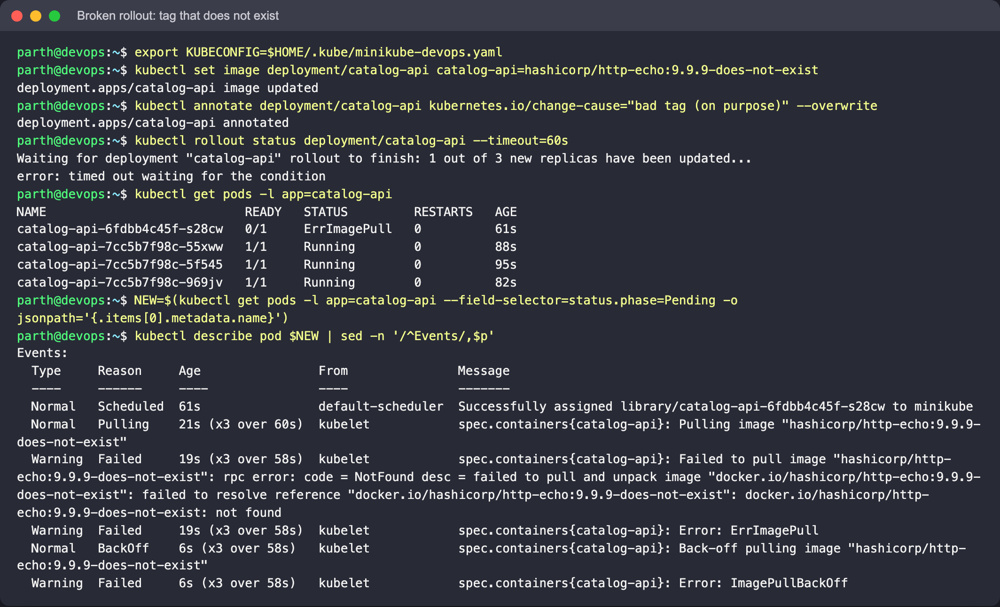

Recover, preferably by re-applying the known-good manifest so the file stays the source of
truth (`rollout undo` also works):

```bash
kubectl apply -f 04-deployment-v2.yaml
kubectl rollout status deployment/catalog-api
```

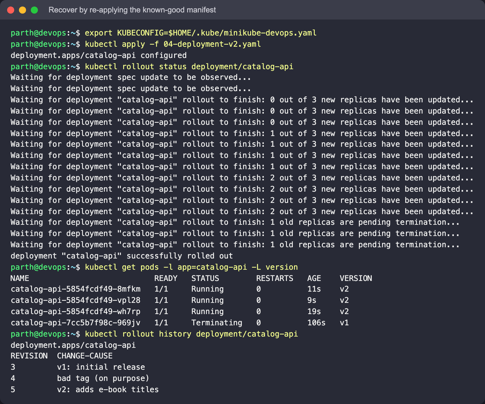

General debugging order: `kubectl get pods` → `kubectl describe pod` (Events) →
`kubectl logs` (add `--previous` for a crash-looping container).

## 5. DaemonSet: one Pod per node

```bash
kubectl apply -f 05-daemonset.yaml
kubectl rollout status ds/shelf-scanner
kubectl get ds shelf-scanner
kubectl get pods -l app=shelf-scanner -o wide
kubectl logs -l app=shelf-scanner --tail=3
```

**Expect:** `DESIRED`, `CURRENT` and `READY` all equal the number of nodes (1 on a default
Minikube), and the log lines name the node the Pod runs on. There is no `replicas` field:
the node count decides.

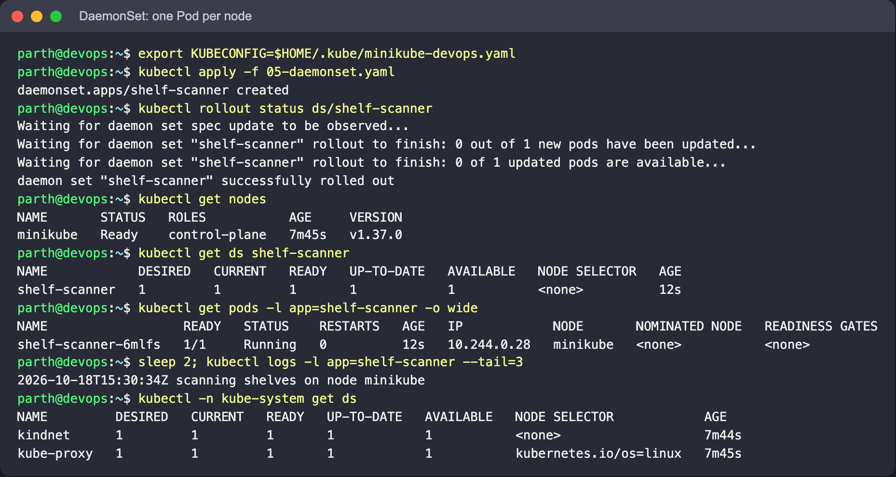

Optional (not run for the screenshots, to keep the shared laptop's memory free): add a node
and watch the DaemonSet follow it.

```bash
minikube node add
kubectl get nodes
kubectl get pods -l app=shelf-scanner -o wide     # a second Pod, on minikube-m02
minikube node delete minikube-m02
```

The toleration for `node-role.kubernetes.io/control-plane` matters on multi-node clusters,
where the control-plane node is usually tainted `NoSchedule`; without it, the DaemonSet
would skip that node. `kube-proxy` in `kube-system` is a DaemonSet built the same way.

## Pod status cheat sheet

| Status | Usually means | Check |
|---|---|---|
| `Pending` | Not scheduled (no CPU/memory, taint, unbound PVC) | `describe pod` Events |
| `ContainerCreating` | Image pull or volume mount in progress | Wait, then `describe pod` |
| `ErrImagePull` / `ImagePullBackOff` | Wrong image/tag or registry auth | Image name, tag, pull secret |
| `CrashLoopBackOff` | Process starts then exits | `kubectl logs --previous` |
| `Running`, `0/1 READY` | Readiness probe failing | Probe port/path, app logs |
| `CreateContainerConfigError` | Missing ConfigMap/Secret or key | `describe pod` Events |

## Cleanup

```bash
kubectl delete -f 05-daemonset.yaml -f 04-deployment-v2.yaml --ignore-not-found
kubectl delete rs loan-service-rs --ignore-not-found
kubectl config set-context --current --namespace=default
kubectl delete -f 00-namespace.yaml     # optional: remove the namespace too
```

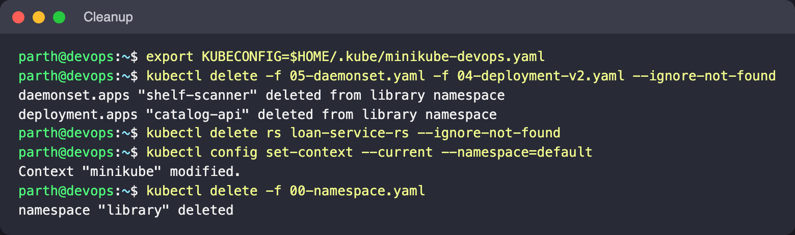
