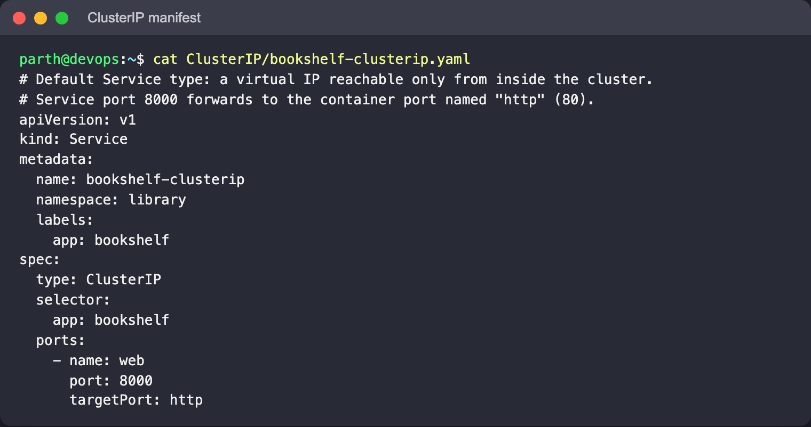
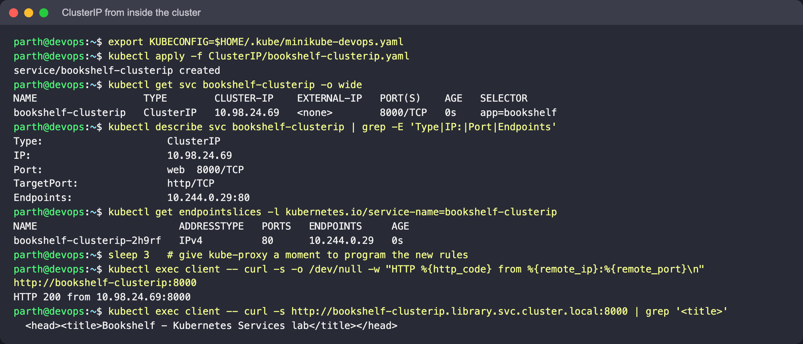
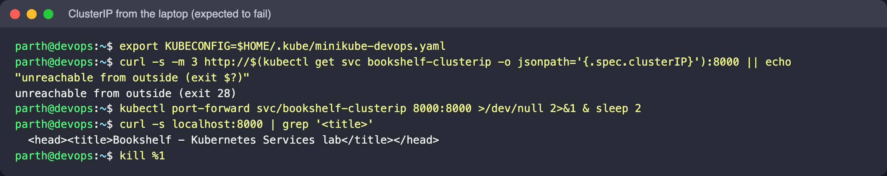
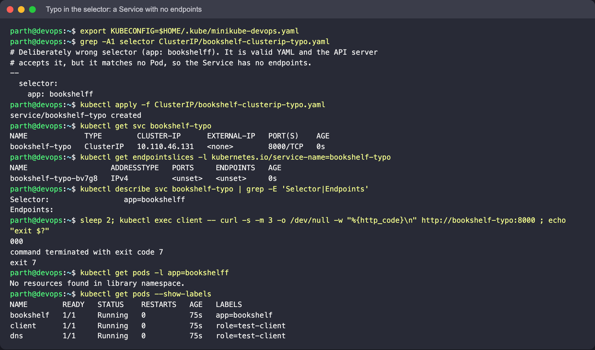

# ClusterIP

The default type. Kubernetes allocates a virtual IP from the service CIDR, and kube-proxy on
every node programs rules so that traffic to `<ClusterIP>:<port>` is forwarded to one of the
ready Pods behind the selector. The IP is not bound to any interface and is not routable
from outside the cluster. Use it for anything only other Pods need: internal APIs, caches,
databases.

## Files

- [`bookshelf-clusterip.yaml`](bookshelf-clusterip.yaml): port `8000` → `targetPort: http` (80).
  The Service port and container port differ on purpose, to make it obvious which is which.
- [`bookshelf-clusterip-typo.yaml`](bookshelf-clusterip-typo.yaml): same Service with the
  selector misspelt as `app: bookshelff`.

## Manifest



## Commands

Run from the `Session 11 - Kubernetes Networking & Services` folder, after the setup in the [parent README](../README.md).

```bash
kubectl apply -f ClusterIP/bookshelf-clusterip.yaml
kubectl get svc bookshelf-clusterip -o wide
kubectl describe svc bookshelf-clusterip
kubectl get endpointslices -l kubernetes.io/service-name=bookshelf-clusterip

# from inside the cluster (right after creating the Service, give kube-proxy a second or two;
# on the first run a curl issued in the same second got "connection refused", exit 7)
kubectl exec client -- curl -s -o /dev/null -w "HTTP %{http_code} from %{remote_ip}:%{remote_port}\n" http://bookshelf-clusterip:8000
kubectl exec client -- curl -s http://bookshelf-clusterip.library.svc.cluster.local:8000 | grep '<title>'

# from the laptop (expected to fail)
curl -s -m 3 http://$(kubectl get svc bookshelf-clusterip -o jsonpath='{.spec.clusterIP}'):8000 || echo "unreachable from outside (exit $?)"

# the supported way to reach it from the laptop for debugging
kubectl port-forward svc/bookshelf-clusterip 8000:8000     # then curl localhost:8000
```

## What to look for

- `TYPE ClusterIP`, an IP such as `10.x.x.x`, and `PORT(S) 8000/TCP`. `describe` shows
  `TargetPort: http/TCP` and `Endpoints: <pod-ip>:80`.
- curl from `client` reports HTTP 200 and that it connected to the **ClusterIP**:8000, not
  the Pod IP. Which Pod served the request is hidden from the client.
- The short name `bookshelf-clusterip` works because `client` is in the same namespace; the
  DNS search path adds `library.svc.cluster.local`. From another namespace you would need at
  least `bookshelf-clusterip.library`.
- From the laptop the request times out (curl exit code 28). That is the expected behaviour
  of this type, not a bug. `port-forward` tunnels through the API server instead.





## Broken selector: a Service with no endpoints

```bash
kubectl apply -f ClusterIP/bookshelf-clusterip-typo.yaml
kubectl get endpointslices -l kubernetes.io/service-name=bookshelf-typo
kubectl describe svc bookshelf-typo | grep -E 'Selector|Endpoints'
kubectl exec client -- curl -s -m 3 -o /dev/null -w "%{http_code}\n" http://bookshelf-typo:8000 ; echo "exit $?"
kubectl get pods -l app=bookshelff          # No resources found -> the selector is the problem
kubectl get pods --show-labels             # the real label is app=bookshelf
# keep it for the overall check in the parent README; its cleanup deletes it
```

**What to look for:** the Service is created without any error and gets a ClusterIP, but
`Endpoints:` is empty and the EndpointSlice has no addresses. The DNS name resolves, the
connection is refused (on this cluster curl got `000` and exit code 7: kube-proxy rejects
traffic to a Service with no endpoints). The API server cannot know the selector is wrong;
comparing `Selector` against `kubectl get pods --show-labels` is how to find it.


