# Session 12 (Advanced): Kubernetes Ingress, ConfigMaps & Secrets

**Goal:** go deeper than the [basic exercise](../README.md):
the different ways a Pod can consume a ConfigMap and what happens when it changes, how
Secrets are (and are not) protected, an Ingress before and after a controller exists, host
plus path routing with TLS, and five deliberately broken setups with their fixes.

Author: Parth Agarwal · Cluster: Minikube, Docker driver · Namespace: `library`

## Layout

| Path | Contents |
|---|---|
| [`manifests/`](manifests) | Numbered manifests for sections 1-3 |
| [`ingress-vs-ingress-controller/`](ingress-vs-ingress-controller) | Written comparison, plus commands to prove it on the cluster |
| [`troubleshooting/`](troubleshooting) | Five broken → fixed scenarios |
| [`screenshots/`](screenshots) | Screenshots from a real run, embedded below |

| Manifest | Creates |
|---|---|
| `00-namespace.yaml` | `library` namespace |
| `01-configmap.yaml` | ConfigMap `loan-policy` (four keys + `opening-hours.txt`) |
| `01-configmap-pod.yaml` | Pod `policy-reader` consuming it three ways |
| `02-secret.yaml` | Secret `payments-credentials` (base64 `data`, demo values) |
| `02-secret-pod.yaml` | Pod `secret-reader` using it as env var and as files |
| `03-reader-web.yaml`, `03-catalog-api.yaml` | Two http-echo Deployments + Services (ports 80 and 8000) |
| `03-ingress.yaml` | Ingress: path routing, host routing and TLS |

## 0. Cluster

```bash
minikube start --driver=docker
kubectl apply -f manifests/00-namespace.yaml
kubectl config set-context --current --namespace=library
```

Do **not** enable the ingress addon yet; section 3 starts without it.

> **On the run captured below** the Minikube cluster was shared with other exercises and
> had to keep the ingress addon enabled throughout, so the "no controller yet" step of
> section 3 was not re-captured. The identical symptom (Ingress accepted, empty ADDRESS, no
> Events) is shown for real in troubleshooting scenario 4, where no controller claims the
> Ingress because of its class.

## 1. ConfigMaps

### Creating

```bash
kubectl apply -f manifests/01-configmap.yaml
kubectl describe configmap loan-policy

# the same ConfigMap built imperatively, printed rather than applied
printf 'Mon-Fri 09:00-20:00\nSat     10:00-16:00\nSun     closed\n' > /tmp/opening-hours.txt
kubectl create configmap loan-policy --from-literal=MAX_LOANS=5 --from-literal=LOAN_DAYS=21 \
  --from-literal=FINE_PER_DAY=0.50 --from-literal=RENEWALS_ALLOWED=2 \
  --from-file=/tmp/opening-hours.txt --dry-run=client -o yaml
```

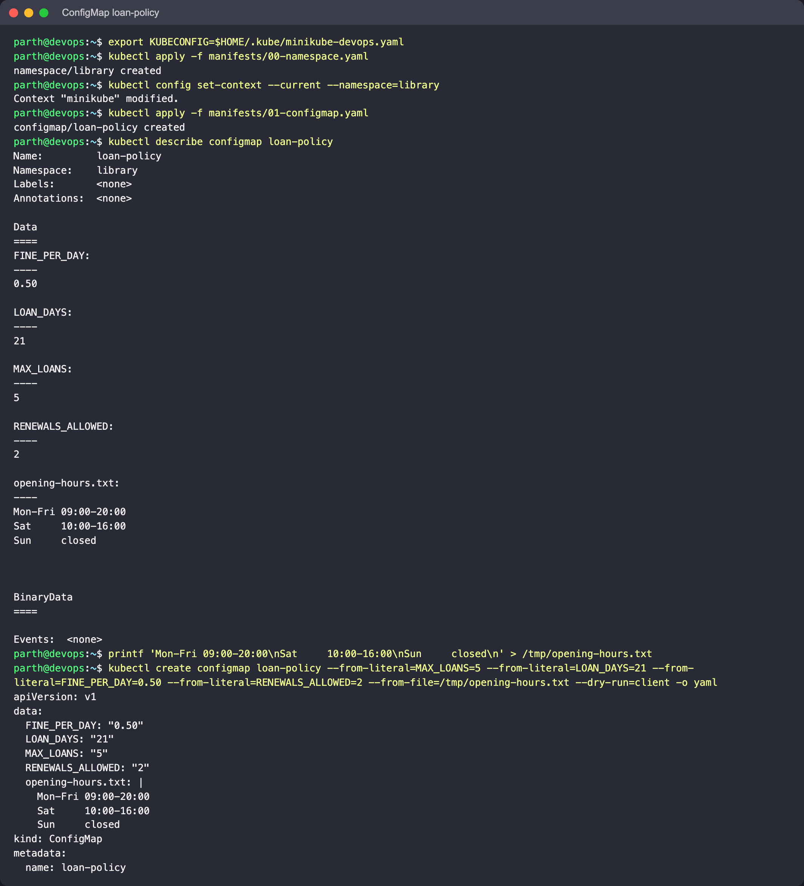

### Three ways into a Pod

`01-configmap-pod.yaml` uses `configMapKeyRef` (one key, renamed to `LOAN_LIMIT`),
`envFrom` (all keys) and a volume (all keys as files).

```bash
kubectl apply -f manifests/01-configmap-pod.yaml
kubectl wait --for=condition=Ready pod/policy-reader
kubectl exec policy-reader -- env | grep -E 'LOAN|FINE|RENEW'
kubectl exec policy-reader -- ls -la /etc/loan-policy
kubectl exec policy-reader -- cat /etc/loan-policy/opening-hours.txt
kubectl logs policy-reader --tail=3
```

**What to look for:**

- `LOAN_LIMIT=5` comes from the single-key reference; `MAX_LOANS`, `LOAN_DAYS`,
  `FINE_PER_DAY` and `RENEWALS_ALLOWED` come from `envFrom`.
- `opening-hours.txt`: on clusters before Kubernetes 1.34 this key is **not** an env var,
  because it is not a C-style variable name; `envFrom` skips it and the Pod gets an
  `InvalidEnvironmentVariableNames` event. Since 1.34 (relaxed env var name validation, GA)
  any printable ASCII name except `=` is allowed, so on the v1.37 cluster used here
  `opening-hours.txt` **is** imported as an env var and there is no event (screenshot
  below). Shells cannot reference such a variable as `$opening-hours.txt`, so it is still
  useless to most apps; prefer the volume for whole files.
- In the volume every key is a file. The files are symlinks into a hidden `..data`
  directory; that indirection is what lets the kubelet swap all of them atomically.

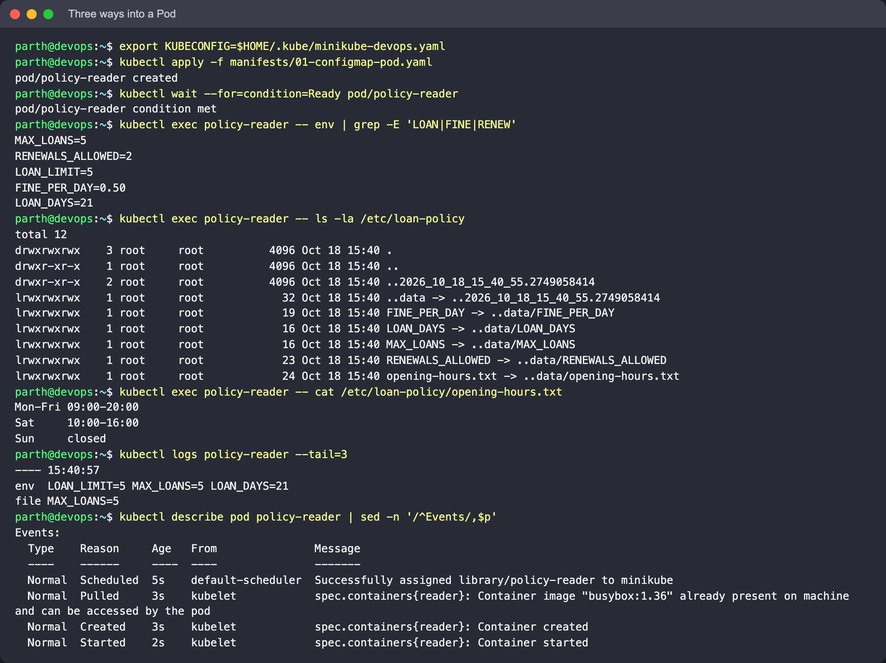

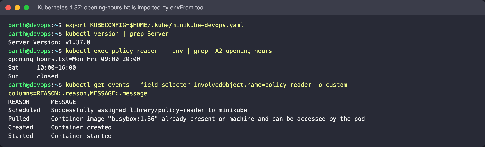

### Changing a ConfigMap under a running Pod

```bash
kubectl patch configmap loan-policy -p '{"data":{"MAX_LOANS":"8"}}'
kubectl logs -f policy-reader          # watch for up to ~1-2 minutes, then Ctrl-C
```

**Expect:** within the kubelet sync period (up to about a minute plus cache TTL) the
`file MAX_LOANS=` line changes to `8`, while `env LOAN_LIMIT=5 MAX_LOANS=5` stays the same
for the life of the container. Env vars are copied in once at start; only volumes are kept
in sync (and not when mounted with `subPath`). To pick up env changes, restart the
workload, for a Deployment `kubectl rollout restart deploy/<name>`. A common pattern is to
put a hash of the config in a Pod annotation so that a config change produces a rollout.

On this run the file changed about 90 seconds after the patch, the env var never did:

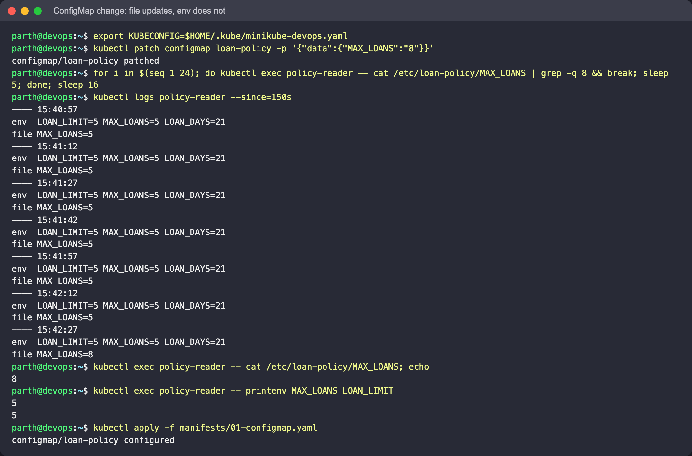

Reset it: `kubectl apply -f manifests/01-configmap.yaml`.

## 2. Secrets

### Creating

```bash
kubectl apply -f manifests/02-secret.yaml
kubectl get secret payments-credentials -o yaml | sed -n '/^data:/,/^kind:/p'

# imperative equivalents (kubectl does the encoding, so no newline mistakes)
kubectl create secret generic payments-credentials-cli \
  --from-literal=PAYMENTS_CLIENT_ID=loan-svc --from-literal=PAYMENTS_CLIENT_SECRET=demo-only-Pay2026 \
  --dry-run=client -o yaml
```

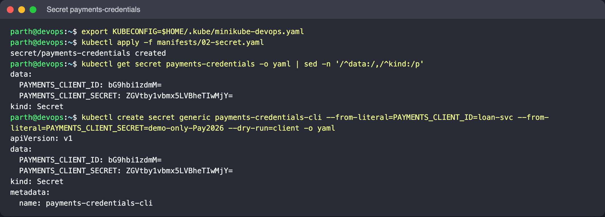

### Consuming

```bash
kubectl apply -f manifests/02-secret-pod.yaml
kubectl wait --for=condition=Ready pod/secret-reader
kubectl logs secret-reader
kubectl exec secret-reader -- mount | grep /etc/payments
```

**What to look for:** the client id printed from the env var, the secret file's length
(17 bytes, the same as `demo-only-Pay2026`, so no stray newline), files with mode
`-r--------`, and the mount type `tmpfs`: Secret volumes are kept in memory on the node and
never written to its disk. (The Pod lists the files with `ls -lL`, because the entries in
the mount are symlinks into `..data`; plain `ls -l` would only show `lrwxrwxrwx`.)

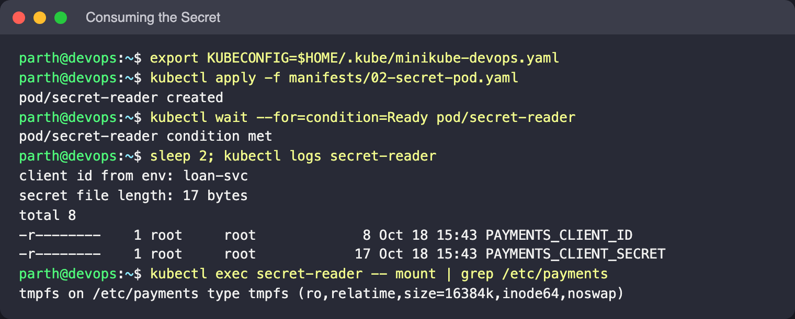

### Why base64 is not protection, and why Secrets stay out of Git

```bash
kubectl get secret payments-credentials -o jsonpath='{.data.PAYMENTS_CLIENT_SECRET}' | base64 -d; echo
```

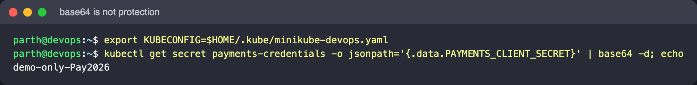

Anyone with `get secret` permission sees the plain value; base64 is only an encoding so
that binary data fits in YAML. Real protection is:

- **RBAC**: grant `get/list/watch` on Secrets narrowly. Note that `list` also returns values.
- **Encryption at rest** for etcd (`EncryptionConfiguration` on the API server, or a KMS
  provider). Without it the values sit in etcd as plain bytes.
- **Keep real values out of Git.** A Secret manifest committed with real credentials stays
  in the repository history after it is "deleted", and has to be treated as leaked and
  rotated. Use `kubectl create secret` at deploy time, Sealed Secrets, SOPS, or the External
  Secrets Operator with a cloud secret manager. The values in this folder are demo
  placeholders.

## 3. Ingress

### The application

```bash
kubectl apply -f manifests/03-reader-web.yaml -f manifests/03-catalog-api.yaml
kubectl rollout status deploy/reader-web && kubectl rollout status deploy/catalog-api
kubectl get deploy,svc,endpointslices
```

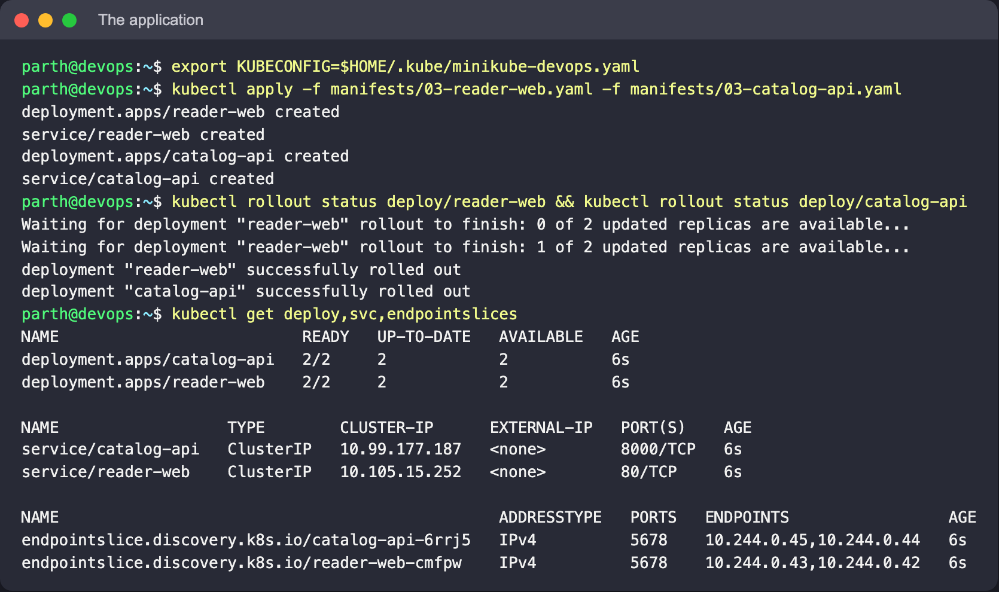

### An Ingress with no controller does nothing

```bash
kubectl get ingressclass                 # No resources found
kubectl apply -f manifests/03-ingress.yaml
kubectl get ingress library-ingress
kubectl describe ingress library-ingress
```

**Expect:** the API server accepts the Ingress, but `ADDRESS` stays empty and the Events
section is empty. Nothing is watching Ingress objects, so there is no proxy to send traffic
to. (The TLS Secret does not exist yet either; nothing complains, because nothing reads it.)

### Installing the controller

```bash
minikube addons enable ingress
kubectl -n ingress-nginx wait --for=condition=Ready pod -l app.kubernetes.io/component=controller --timeout=180s
kubectl get pods,svc -n ingress-nginx
kubectl get ingressclass
```

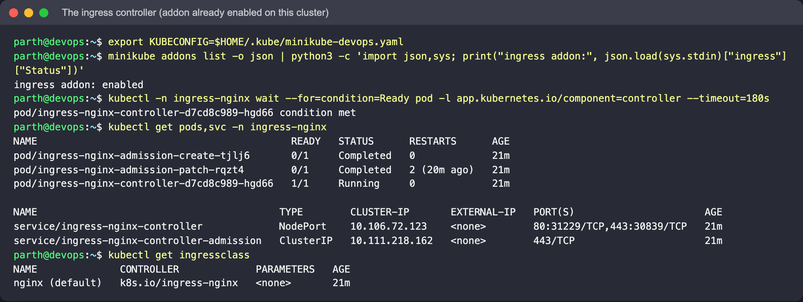

### The same Ingress now works, unchanged

```bash
kubectl get ingress library-ingress -w          # ADDRESS appears within ~30-60 s (56 s here); Ctrl-C
kubectl describe ingress library-ingress        # Events: Sync ... Scheduled for sync

# terminal 2: reach the controller from macOS (the node IP is not routable with the Docker driver)
kubectl -n ingress-nginx port-forward svc/ingress-nginx-controller 8080:80 8443:443
```


### Routing by path and by host

Because the Ingress has a `tls:` section, ingress-nginx redirects plain HTTP for these hosts
to HTTPS (308). Until the real certificate exists (next step) it serves its built-in
self-signed "Fake Certificate", so `-k` is needed for now. `--resolve` makes curl send the
right Host header **and** TLS SNI to the port-forward.

```bash
lib() { curl -sk --resolve "$1:8443:127.0.0.1" "https://$1:8443$2"; echo; }
lib library.local /
lib library.local /api
lib library.local /api/books/42
lib api.library.local /
curl -sk -o /dev/null -w '%{http_code}\n' --resolve unknown.local:8443:127.0.0.1 https://unknown.local:8443/
curl -s -o /dev/null -w '%{http_code} -> %{redirect_url}\n' -H 'Host: library.local' http://localhost:8080/
for i in 1 2 3 4; do lib api.library.local /; done
```

**What to look for:** `library.local/` answers with `reader-web`, both `/api` paths with
`catalog-api`, and `api.library.local` reaches `catalog-api` without any `/api` prefix. An
unknown host gets the controller's default `404`, and plain HTTP gets `308` to `https://`.
The `(pod ...)` suffix alternates between the two replicas. The last command shows the
controller's built-in fake certificate, because `library-tls` does not exist yet.

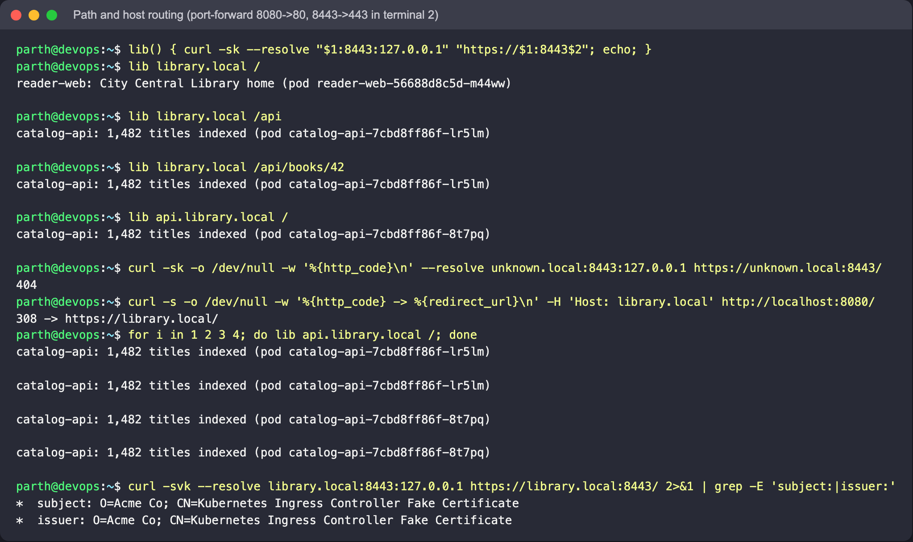

### TLS

Self-signed certificate covering both hosts, stored as a `kubernetes.io/tls` Secret:

```bash
openssl req -x509 -nodes -newkey rsa:2048 -days 30 \
  -keyout /tmp/library.key -out /tmp/library.crt \
  -subj "/CN=library.local/O=Library Lab" \
  -addext "subjectAltName=DNS:library.local,DNS:api.library.local"
kubectl create secret tls library-tls --cert=/tmp/library.crt --key=/tmp/library.key
kubectl describe secret library-tls

curl -sv --resolve api.library.local:8443:127.0.0.1 https://api.library.local:8443/ \
  --cacert /tmp/library.crt 2>&1 | grep -E 'subject:|issuer:|SSL certificate verify'
curl -s --resolve library.local:8443:127.0.0.1 --cacert /tmp/library.crt https://library.local:8443/api
```

**What to look for:** no `-k` is needed any more. The certificate subject is `CN=library.local`, and with `--cacert` the verification
succeeds because both hosts are in the SAN list. Before `library-tls` existed the
controller served its built-in "Kubernetes Ingress Controller Fake Certificate"; that is
the tell-tale sign of a missing or wrong TLS Secret. The controller picks up the new Secret
without the Ingress being touched (allow a few seconds).

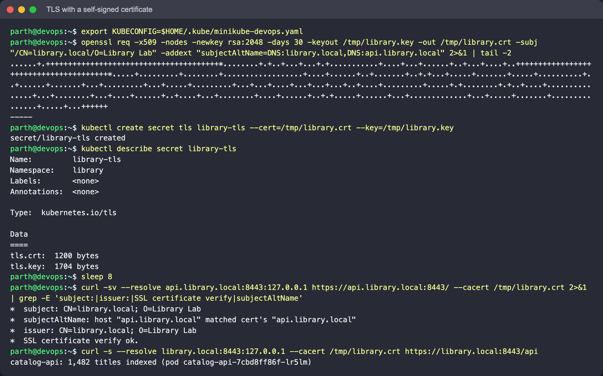

For a browser: add `127.0.0.1 library.local api.library.local` to `/etc/hosts` and open
`https://library.local:8443/` (expect a self-signed warning). The screenshots below used
Chromium's `--host-resolver-rules` instead of editing `/etc/hosts`, with the self-signed
warning accepted:

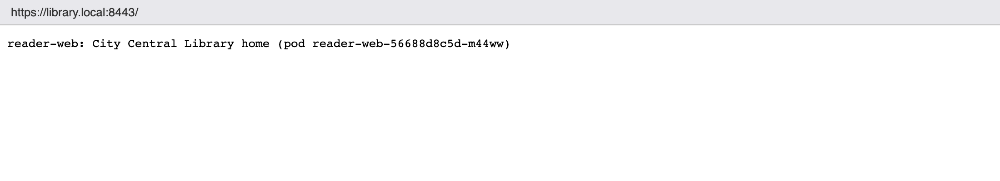

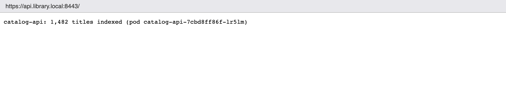

## 4. Ingress vs Ingress Controller

See [`ingress-vs-ingress-controller/README.md`](ingress-vs-ingress-controller/README.md).
Short version: the **Ingress** is a set of routing rules stored in the API; the **Ingress
controller** is a running proxy that reads those rules and serves traffic. Section 3 shows
the first without the second doing nothing at all.


## 5. Troubleshooting

See [`troubleshooting/README.md`](troubleshooting/README.md): Secret with a trailing newline,
missing ConfigMap key, Ingress pointing at a non-existent Service, wrong `ingressClassName`,
and a Service `targetPort` that does not match the container.

## Cleanup

```bash
kubectl delete -f manifests/03-ingress.yaml -f manifests/03-catalog-api.yaml -f manifests/03-reader-web.yaml
kubectl delete -f manifests/02-secret-pod.yaml -f manifests/02-secret.yaml
kubectl delete -f manifests/01-configmap-pod.yaml -f manifests/01-configmap.yaml
kubectl delete secret library-tls
rm -f /tmp/library.key /tmp/library.crt /tmp/opening-hours.txt
kubectl config set-context --current --namespace=default
kubectl delete -f manifests/00-namespace.yaml     # optional
# minikube addons disable ingress
```

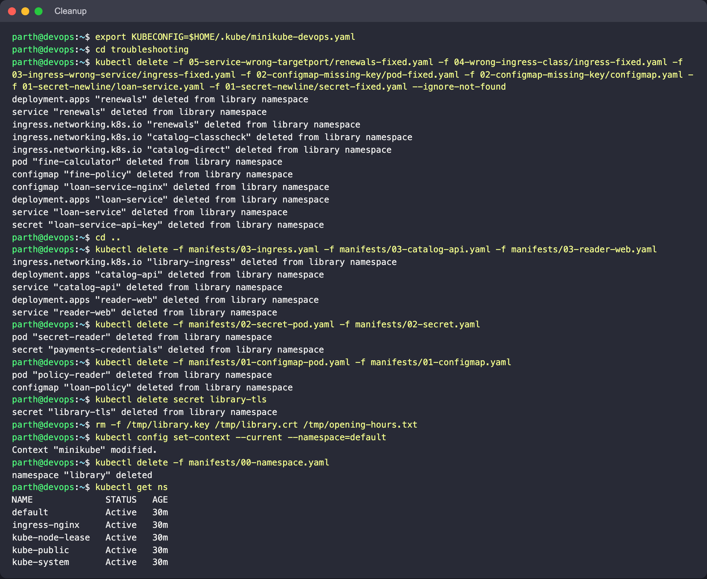

## Cheat sheet

```bash
# ConfigMap
kubectl create configmap NAME --from-literal=K=V --from-file=path [--dry-run=client -o yaml]
kubectl get cm NAME -o yaml ; kubectl rollout restart deploy/APP   # env vars need a restart
# Secret
kubectl create secret generic NAME --from-literal=K=V
kubectl create secret tls NAME --cert=crt --key=key
kubectl get secret NAME -o jsonpath='{.data.K}' | base64 -d
# Ingress
kubectl get ingressclass ; kubectl describe ingress NAME
kubectl -n ingress-nginx logs deploy/ingress-nginx-controller --tail=50
```
