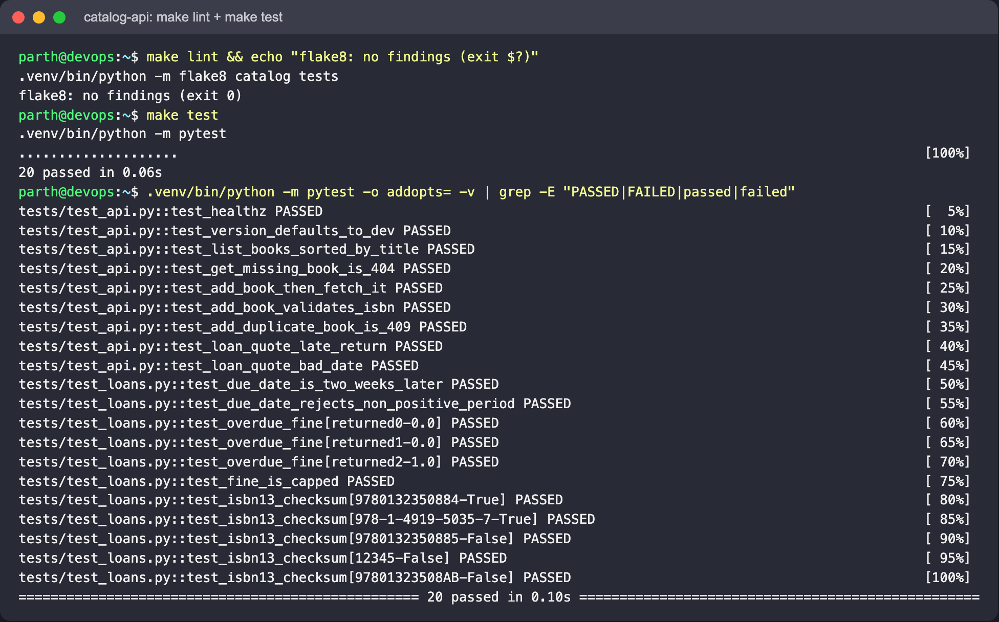
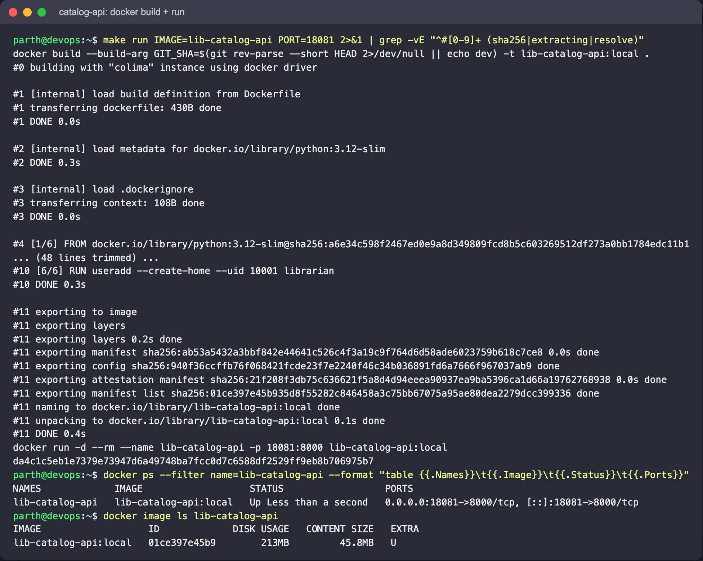
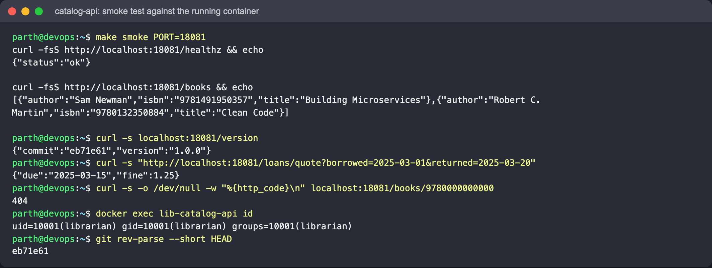
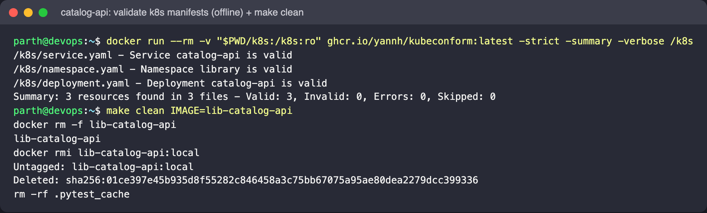
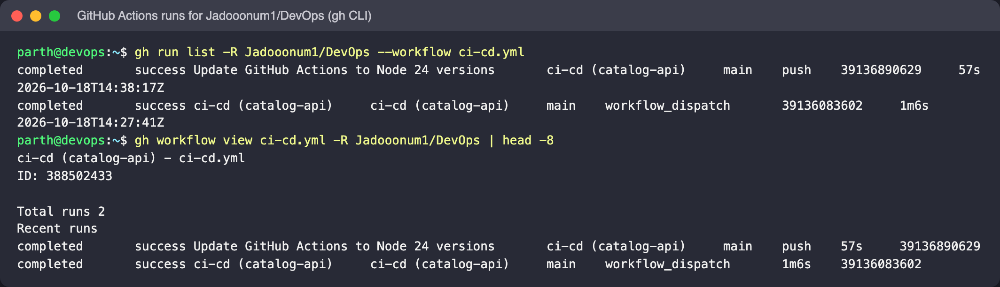
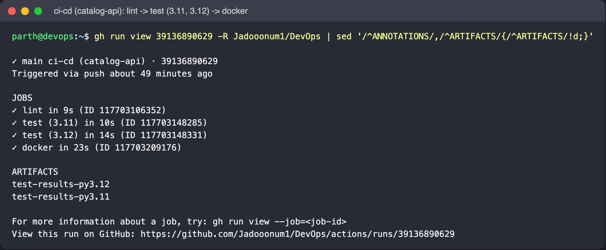
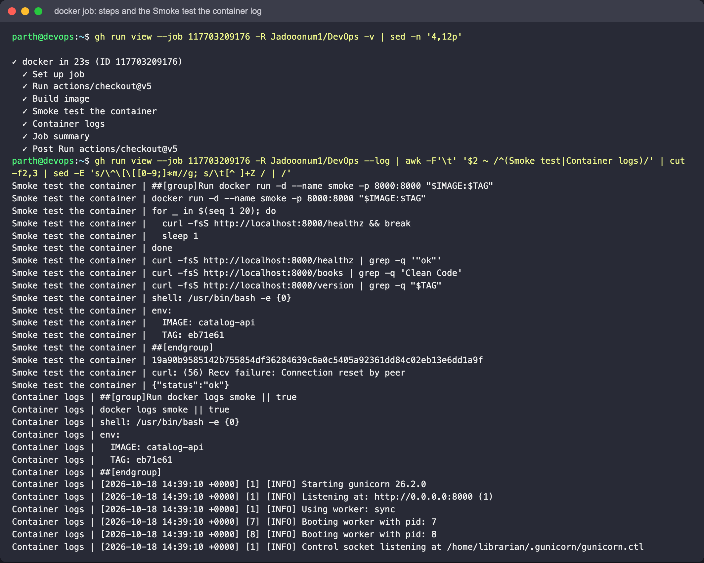
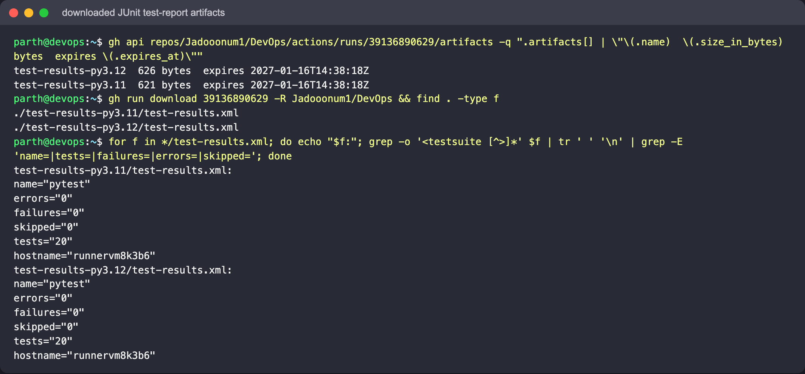
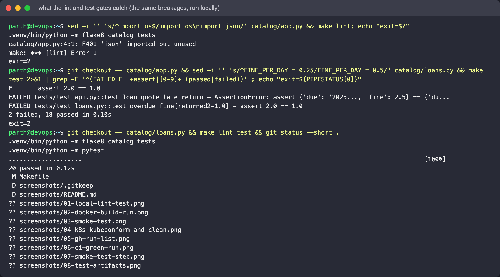

# Session 16: CI/CD & GitHub Actions

Author: Parth Agarwal

## Goal

Build a small `catalog-api` service for a library (books + loan fines) and wire it into a GitHub Actions
pipeline that lints, tests and builds a Docker image on every change, then smoke-tests the running
container. Nothing is pushed to a registry, so the pipeline needs **no secrets** to go green.

## Concepts in brief

| Term | Meaning here |
|------|--------------|
| **CI** (Continuous Integration) | Every push/PR is automatically linted, tested and built so broken code is caught before merge. |
| **CD** (Continuous Delivery/Deployment) | The verified artifact (our image, tagged with the commit SHA) is ready to ship; a later step would push it and roll it out to Kubernetes. |
| **Workflow** | A YAML file in `.github/workflows/`. GitHub only reads workflows from the *repository root*, which is why `ci-cd.yml` lives at `/.github/workflows/ci-cd.yml` and not in this folder. |
| **Job** | A set of steps that runs on a fresh runner VM. Jobs run in parallel unless linked with `needs:`. |
| **Step** | A shell command (`run:`) or a reusable action (`uses:`). |
| **Runner** | The machine executing a job (`ubuntu-latest`, GitHub-hosted). |
| **Matrix** | One job definition fanned out over several values - here Python 3.11 and 3.12. |
| **Artifact** | A file uploaded from a job (the JUnit XML test report) that you can download from the run page. |
| **Path filter** | `on.push.paths` - the workflow only triggers when files in this folder (or the workflow itself) change, so other coursework folders don't trigger it. |

## Pipeline

```
push / PR touching "Session 16 - CI-CD & GitHub Actions/**"
        |
     [lint] flake8
        |
     [test] pytest  (matrix: 3.11, 3.12)  -> uploads test-results-*.xml
        |
    [docker] docker build (tag = short SHA) -> run container -> curl /healthz, /books, /version
```

`defaults.run.working-directory: "Session 16 - CI-CD & GitHub Actions"` makes every `run:` step execute inside this
folder (the path is quoted because it contains spaces).

## Files

```
Session 16 - CI-CD & GitHub Actions/
├── catalog/
│   ├── __init__.py        version string
│   ├── loans.py           pure functions: due_date, overdue_fine, is_valid_isbn13
│   └── app.py             Flask routes: /healthz /version /books /books/<isbn> /loans/quote
├── tests/
│   ├── test_loans.py      unit tests for the business rules
│   └── test_api.py        API tests via Flask's test client
├── k8s/                   namespace, deployment (probes + limits), service  (namespace: library)
├── Dockerfile             python:3.12-slim, gunicorn, non-root user, GIT_SHA build arg
├── Makefile               venv / lint / test / build / run / smoke / clean
├── requirements*.txt      pinned runtime and dev dependencies
├── .flake8, pytest.ini, .dockerignore
└── screenshots/
../.github/workflows/ci-cd.yml   the pipeline
```

## Run it locally first

```bash
cd "Session 16 - CI-CD & GitHub Actions"
make venv          # creates .venv and installs requirements-dev.txt
make lint          # flake8
make test          # pytest
make run           # docker build + run on :8000  (PORT=18081 make run if 8000 is taken)
make smoke         # curl /healthz and /books     (same PORT=... as for run)
curl "http://localhost:8000/loans/quote?borrowed=2025-03-01&returned=2025-03-20"
make clean
```

Expected behaviour: flake8 prints nothing, pytest reports all 20 tests passing, `/healthz` returns
`{"status":"ok"}`, `/version` shows the commit the image was built from, and the loan quote above
returns a due date of 2025-03-15 and a fine of 1.25 (5 days late x 0.25).



The image builds from `python:3.12-slim` and runs gunicorn as the non-root user `librarian` (UID 10001).
On this machine port 8000 was already in use, so the screenshots use `IMAGE=lib-catalog-api PORT=18081`
(both are Makefile variables):





The Kubernetes manifests are validated offline with kubeconform (strict mode). They were not deployed here
because the shared cluster was reserved for other work; the deploy commands are further down.



## Running it on GitHub

1. Push the repository to GitHub (the workflow is already at the repo root).
2. Edit any file in this folder (or run the workflow manually from the **Actions** tab - `workflow_dispatch`).
3. Open **Actions -> ci-cd (catalog-api)** and watch `lint -> test (3.11, 3.12) -> docker`.
4. Open the run summary: the docker job writes the image tag and size to the job summary, and the
   test reports appear under **Artifacts**.

The screenshots below are the real runs of this workflow on the (private) repository, read with the GitHub CLI
(`gh run list / gh run view / gh run download`). Both the manual `workflow_dispatch` run and the push run are green:





The docker job's steps and the log of **Smoke test the container** (the first `curl` races gunicorn's start-up and
gets a connection reset, the retry loop then gets `{"status":"ok"}`), followed by the container logs:



The JUnit reports uploaded by both matrix legs, downloaded with `gh run download`:



### Show that CI blocks bad code

- **Lint failure**: add an unused import to `catalog/app.py`, push -> `lint` goes red and `test`/`docker` are skipped.
- **Test failure**: change `FINE_PER_DAY` in `catalog/loans.py` to `0.5`, push -> `test` goes red on both matrix legs.
- Revert and push again -> the run is green.

Red runs on GitHub need throw-away commits pushed to a branch, which was not done for this write-up (the repository
history is kept clean). The exact same two breakages were run locally with the same commands the jobs run, then reverted:



### Deploying (needs a cluster, not done in CI)

```bash
kind load docker-image catalog-api:local     # or minikube image load
kubectl apply -f k8s/namespace.yaml -f k8s/deployment.yaml -f k8s/service.yaml
kubectl -n library rollout status deploy/catalog-api
kubectl -n library port-forward svc/catalog-api 8080:80
```

## Cleanup

```bash
make clean && rm -rf .venv
kubectl delete namespace library   # if deployed
```
