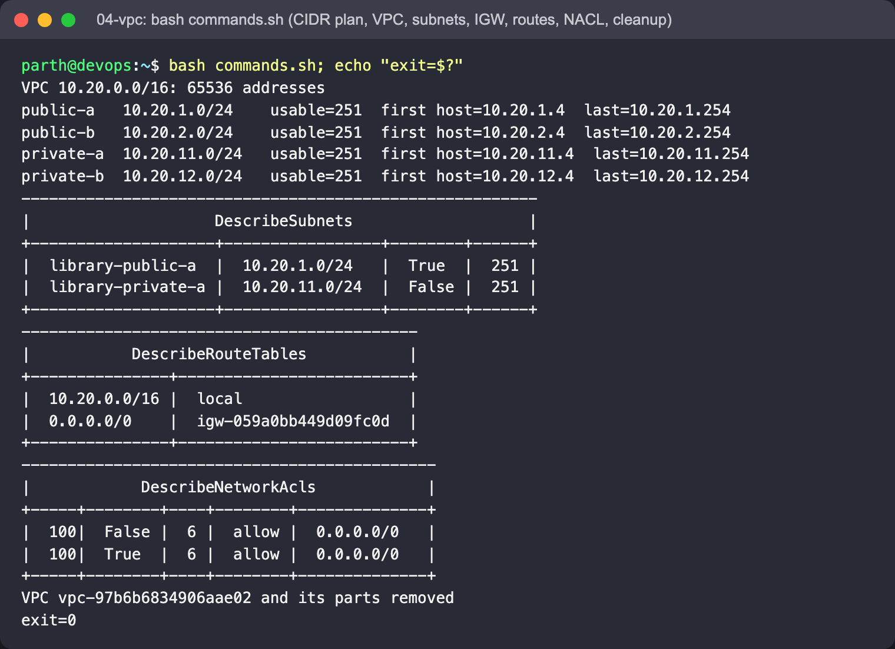

# 04 - VPC: Virtual Private Cloud

## Concepts

- **CIDR** - `10.20.0.0/16` = first 16 bits fixed = 65,536 addresses. A `/24` = 256 addresses, of which AWS
  reserves 5 (network, VPC router, DNS, future use, broadcast) -> 251 usable.
- **Subnet** - a slice of the VPC CIDR inside **one** AZ.
- **Route table** - decides where traffic leaves a subnet. Every table has the implicit `local` route for the VPC.
- **Internet Gateway (IGW)** - the VPC's door to the internet. A subnet is *public* only because its route table
  sends `0.0.0.0/0` to an IGW.
- **NAT Gateway** - lets *private* subnets make outbound connections (updates, APIs) without being reachable
  from outside. Billed per hour, so it is described here but not created.
- **Security group vs NACL** - SG: stateful, per ENI, allow-only. NACL: stateless, per subnet, numbered allow
  *and* deny rules evaluated in order - so return traffic (ephemeral ports 1024-65535) must be allowed explicitly.

## Files

`cidr_plan.py` (subnet arithmetic with Python's `ipaddress`), `commands.sh` (build + tear down).

## Run

```bash
cd "Session 18 - Terraform & Infrastructure as Code/aws-services/04-vpc"
bash commands.sh
```

## What to look for

Real output (LocalStack 4.9.2):

```
VPC 10.20.0.0/16: 65536 addresses
public-a   10.20.1.0/24    usable=251  first host=10.20.1.4  last=10.20.1.254
...
|  library-public-a  |  10.20.1.0/24   |  True  |  251 |
|  library-private-a |  10.20.11.0/24  |  False |  251 |
|  10.20.0.0/16 |  local                  |
|  0.0.0.0/0    |  igw-a9a14a51b2230d81e  |
```

The public subnet maps public IPs on launch and its route table has the IGW route; the private subnet does not.
The NACL table shows the inbound HTTP rule and the outbound ephemeral-port rule (real AWS also shows the final
`*` deny rules; LocalStack omits them). The script creates the NACL to show the rules but does not associate it
with the subnet.

## Screenshots

`commands.sh` (exit 0): the CIDR plan from `cidr_plan.py` (AWS reserves 5 addresses per subnet, so a /24 has 251 usable),
the public and private subnets, the public route table (`local` + `0.0.0.0/0 -> igw`), the NACL entries (protocol 6 = TCP),
and the reverse-order cleanup:


