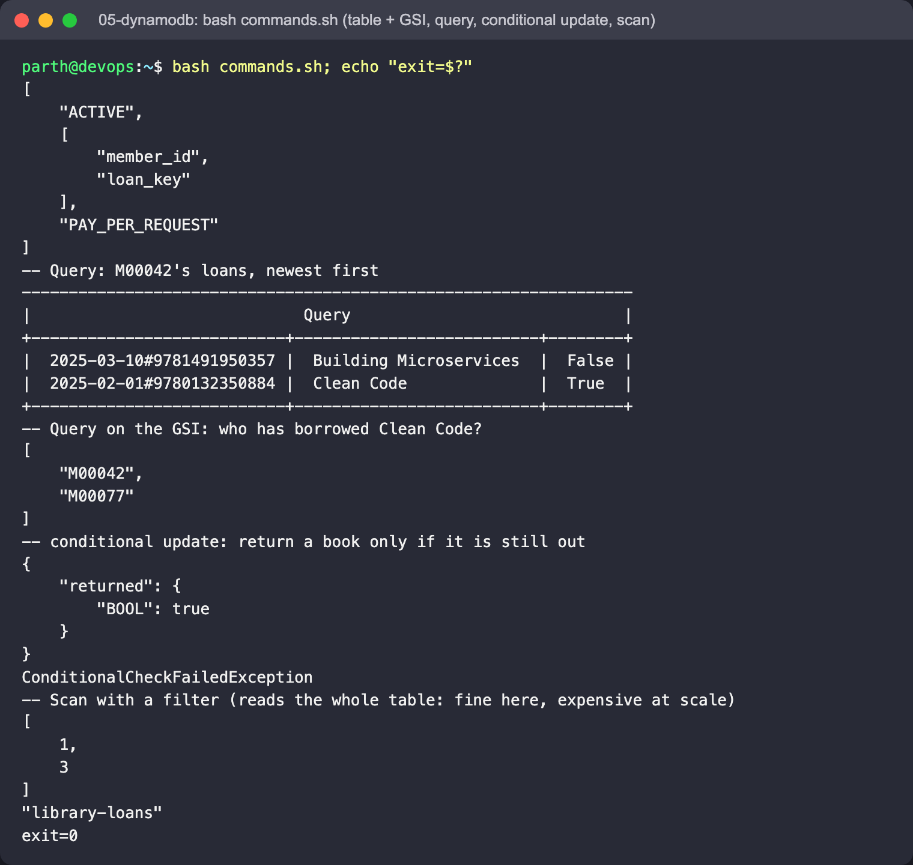
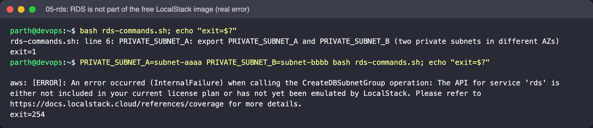

# 05 - DynamoDB and RDS

## DynamoDB concepts

- Fully managed **NoSQL key-value / document** store; no servers, scales per request.
- **Partition key** (HASH) decides which partition stores an item; optional **sort key** (RANGE) orders items
  inside a partition. Here: `member_id` + `loan_key` (`<date>#<isbn>`), so "all loans for a member, newest first"
  is a single cheap `Query`.
- **GSI** (global secondary index) - a second key layout for another access pattern: `by-isbn` answers "who has
  borrowed this book?".
- **Query vs Scan** - Query reads one partition; Scan reads the whole table and filters afterwards (compare
  `Count` vs `ScannedCount`).
- **Conditional writes** - `--condition-expression` makes updates safe under concurrency (a book can't be returned twice).
- **Capacity** - on-demand (`PAY_PER_REQUEST`) or provisioned RCU/WCU.

## RDS concepts

- Managed **relational** databases (PostgreSQL, MySQL, MariaDB, Oracle, SQL Server; Aurora). AWS handles
  patching, backups, point-in-time restore, failover.
- **Multi-AZ** = synchronous standby for availability; **read replicas** = async copies for read scaling.
- Put it in private subnets (DB subnet group), not publicly accessible, encrypted, with the master password
  managed by Secrets Manager (`--manage-master-user-password`).
- Pick RDS when you need joins, transactions across tables and SQL; DynamoDB when access patterns are known and
  you need predictable latency at any scale.

## Files

- `commands.sh` - the DynamoDB exercise (creates and deletes table `library-loans`)
- `rds-commands.sh` - RDS commands for reference (needs LocalStack Pro or real AWS, plus two private subnet IDs)

## Run

```bash
cd "Session 18 - Terraform & Infrastructure as Code/aws-services/05-dynamodb-rds"
bash commands.sh
```

Real output (LocalStack 4.9.2, trimmed):

```
-- Query: M00042's loans, newest first
|  2025-03-10#9781491950357 |  Building Microservices  |  False |
|  2025-02-01#9780132350884 |  Clean Code              |  True  |
-- Query on the GSI: who has borrowed Clean Code?
[ "M00042", "M00077" ]
-- conditional update: return a book only if it is still out
ConditionalCheckFailedException
-- Scan with a filter
[ 1, 3 ]
```

RDS on the free LocalStack image is not available - the real response was:

```
An error occurred (InternalFailure) when calling the DescribeDBInstances operation: The API for service 'rds'
is either not included in your current license plan or has not yet been emulated by LocalStack.
```

## Screenshots

`commands.sh` (exit 0): table + GSI, the newest-first query, the GSI query, the conditional update succeeding once and then
failing with `ConditionalCheckFailedException`, and the filtered scan (1 match out of 3 items read):



`rds-commands.sh` could not run here: it first checks for the two subnet variables, and with them set the very first RDS
call is refused by the free LocalStack image. It needs LocalStack Pro or a real AWS account:


