# Session 20: Monitoring, Observability & GitOps

Author: Parth Agarwal

This lab gives the library system a monitoring stack and a GitOps workflow:

- **Metrics**: Prometheus (via kube-prometheus-stack) scrapes the cluster and the
  `catalog-api` sample app. Grafana shows dashboards, and Alertmanager receives alerts
  from custom PrometheusRules.
- **Logs**: Grafana Alloy (a DaemonSet) tails container logs on the node and pushes them
  to Loki. Grafana queries Loki with LogQL.
- **GitOps**: Argo CD keeps a namespace in sync with a folder in Git.

Target environment: Minikube with the metrics-server addon. Everything below was run on a
Minikube node with **4 CPUs and 4 GB** (docker driver, arm64): with the whole monitoring
stack and the sample apps running, the node used about 2.7 GiB. Argo CD was installed
after the monitoring stack had been removed.

Chart versions used for the run: kube-prometheus-stack 92.10.1 (Prometheus Operator
v0.94.1, Grafana 13.2), loki 7.3.0 (Loki 3.6), alloy 1.13.1 (Alloy v1.20.1), argo-cd
10.10.5 (Argo CD v3.5.5).

```text
Session 20 - Monitoring, Observability & GitOps/
├── monitoring/
│   ├── helm-values/   kube-prometheus-stack, loki, alloy values
│   ├── alerts/        library-rules.yaml (PrometheusRule: 2 recording + 6 alerting rules)
│   └── sample-app/    namespace library-obs: catalog-api (+ServiceMonitor), search-traffic,
│                      reindex-job (CPU hog), overdue-mailer (crash loop), reader-web (never Ready)
├── observability/     README.md: monitoring vs observability, metrics/logs/traces, tools, Kubernetes
├── gitops/            README.md, argocd-values.yaml, git-server.yaml, gitops-repo/{app,argocd}
└── screenshots/
```

| Sample workload | What it does | What it should trigger |
|---|---|---|
| `catalog-api` (podinfo 6.7.1, 2 replicas) | HTTP API with `/metrics`, `/status/<code>`, `/delay/<s>` | scraped through a ServiceMonitor |
| `search-traffic` (curl loop) | 2 good requests per loop, every 2nd loop a `/status/500`, every 7th a 1 s delay | `LibraryApiHighErrorRate` |
| `reindex-job` (busybox busy loop) | burns CPU against its 150m limit | `LibraryPodCpuNearLimit`, chart's `CPUThrottlingHigh` |
| `overdue-mailer` (busybox) | prints `ERROR smtp relay unreachable` and exits after 20 s | `LibraryPodRestarting`, chart's `KubePodCrashLooping` |
| `reader-web` (nginx) | readiness probe on `/ready`, which returns 404 | `LibraryPodNotReady` |

## 0. Install the stack

```bash
export KUBECONFIG=...            # your Minikube kubeconfig
minikube addons enable metrics-server
helm repo add prometheus-community https://prometheus-community.github.io/helm-charts
helm repo add grafana https://grafana.github.io/helm-charts
helm repo update

helm install kps prometheus-community/kube-prometheus-stack -n monitoring --create-namespace \
  -f monitoring/helm-values/kube-prometheus-stack-values.yaml --wait
helm install loki grafana/loki -n logging --create-namespace -f monitoring/helm-values/loki-values.yaml
helm install alloy grafana/alloy -n logging -f monitoring/helm-values/alloy-values.yaml

kubectl apply -f monitoring/sample-app/ -f monitoring/alerts/
kubectl get pods -n monitoring; kubectl get pods -n logging; kubectl get pods -n library-obs
```

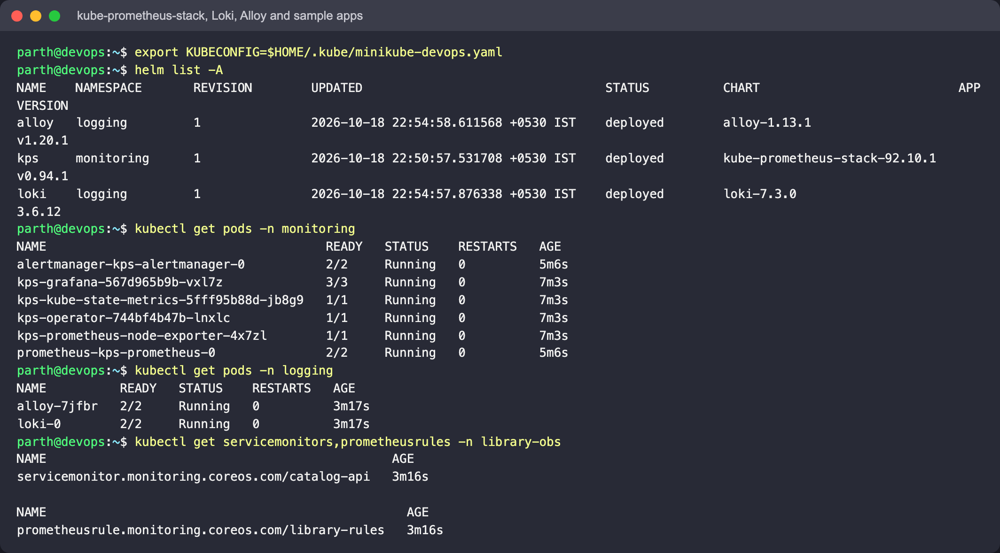

UIs (run each in its own terminal or in the background):

```bash
kubectl -n monitoring port-forward svc/kps-prometheus 9090:9090
kubectl -n monitoring port-forward svc/kps-alertmanager 9093:9093
kubectl -n monitoring port-forward svc/kps-grafana 3000:80          # admin / library-lab-only
```

Main value choices: Minikube's control-plane components (etcd, scheduler,
controller-manager, kube-proxy) are not scraped, because they listen on localhost inside
the node and would otherwise show up as permanently down. The `*SelectorNilUsesHelmValues:
false` settings let Prometheus pick up ServiceMonitors and rules from any namespace. Loki
is added to Grafana as a datasource. Alertmanager sends `team="library"` alerts to their
own placeholder receiver.

## 1. Metrics

**Targets.** In Prometheus, *Status → Target health* lists `serviceMonitor/library-obs/catalog-api/0`
with 2 endpoints `UP`. All other targets (Alertmanager, API server, CoreDNS, Grafana,
kube-state-metrics, kubelet/cAdvisor, operator, node-exporter, Prometheus) were `UP` as
well, with no permanently down control-plane targets.

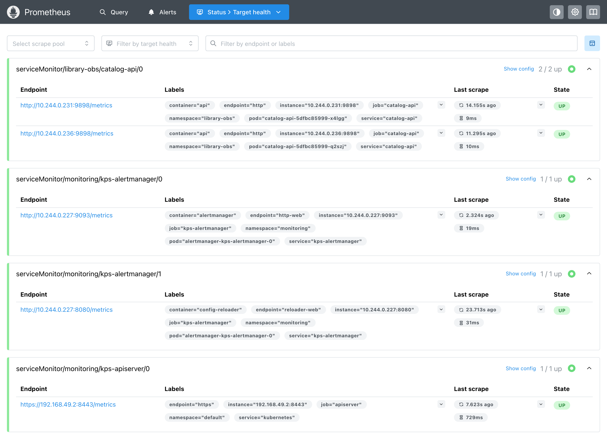

**PromQL** queries to try (Query tab):

```promql
# request rate per status code
sum by (status) (rate(http_requests_total{service="catalog-api"}[2m]))

# recording rules from library-rules.yaml
library:http_requests:rate5m
library:http_errors:ratio5m

# share of failed requests, computed by hand
sum(rate(http_requests_total{service="catalog-api",status=~"5.."}[2m]))
  / sum(rate(http_requests_total{service="catalog-api"}[2m]))

# p95 latency
histogram_quantile(0.95, sum by (le) (rate(http_request_duration_seconds_bucket{service="catalog-api"}[5m])))

# CPU (cores) and memory per Pod in the namespace
sum by (pod) (rate(container_cpu_usage_seconds_total{namespace="library-obs", container!=""}[5m]))
sum by (pod) (container_memory_working_set_bytes{namespace="library-obs", container!=""})

# restarts and readiness from kube-state-metrics
kube_pod_container_status_restarts_total{namespace="library-obs"}
kube_pod_status_ready{namespace="library-obs", condition="false"} == 1
```

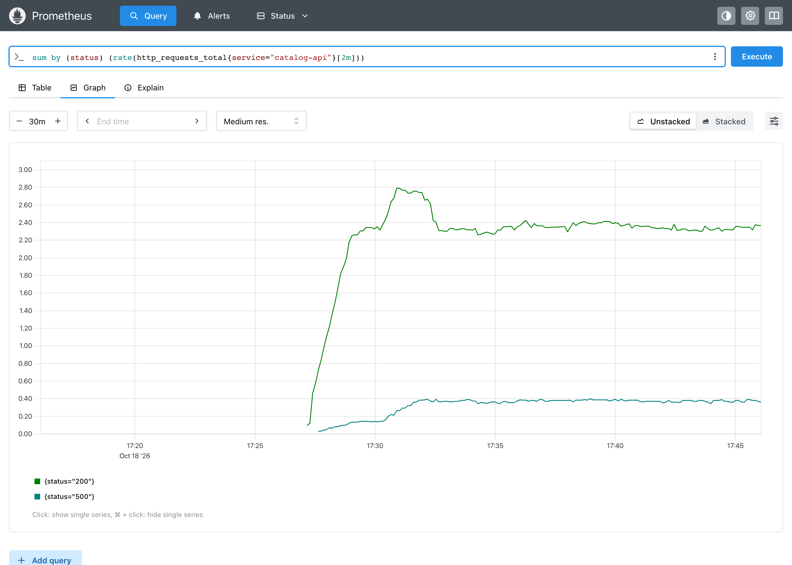

The error ratio settled at about **0.14**, not 0.2. `search-traffic` sends one 500 for
every four good requests, but podinfo also counts the kubelet's `/readyz` and `/healthz`
probes and Prometheus' own `/metrics` scrapes, and all of those return 200. The step at
17:30 is where the traffic generator was changed from every 5th loop to every 2nd loop. At
the old rate the ratio hovered around 5 %, which made the alert flap at its threshold.

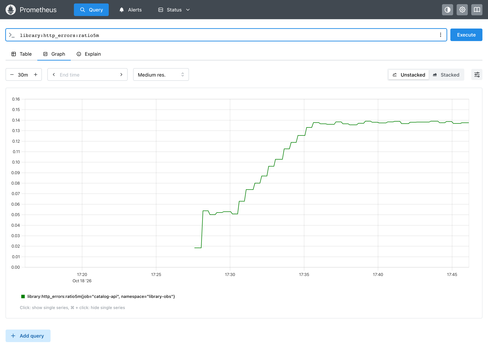

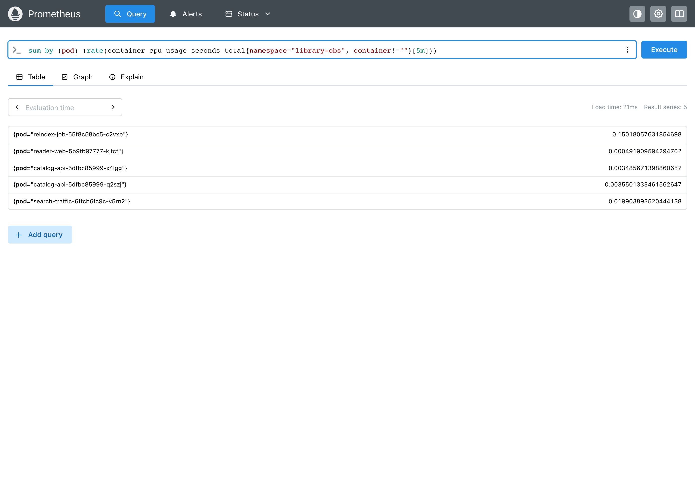

## 2. Logs

`kubectl logs` shows a single container, only while that Pod exists, and has no search
across Pods:

```bash
kubectl -n library-obs logs deploy/search-traffic --tail=5
kubectl -n library-obs logs deploy/overdue-mailer --previous
kubectl -n library-obs logs deploy/overdue-mailer
```

The run below shows this limitation. `overdue-mailer` had restarted 5 times, and
`--previous` could not return the earlier container's log. Only the current container's
output was available.

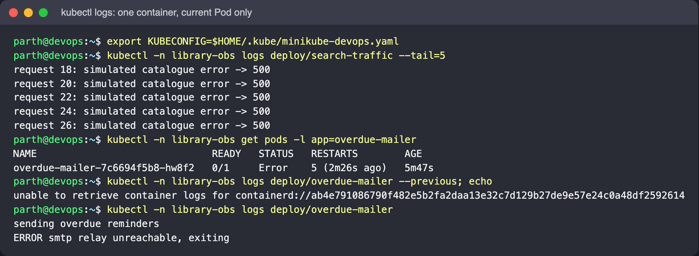

In Grafana go to *Explore → Loki*. Example LogQL:

```logql
{namespace="library-obs"}
{namespace="library-obs", app="overdue-mailer"} |= "ERROR"
{namespace="library-obs", app="search-traffic"} |= "-> 500"
sum by (app) (count_over_time({namespace="library-obs"} |~ "ERROR|-> 500" [1m]))
sum(rate({app="search-traffic"} |= "-> 500" [1m]))
```

Loki has the `ERROR smtp relay unreachable, exiting` line from **every** past
`overdue-mailer` container, including the ones `kubectl logs --previous` could not show:

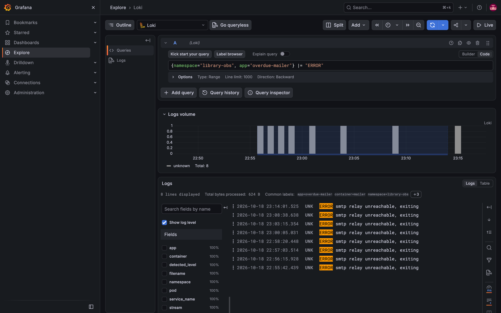

A LogQL metric query turns log lines into a time series. Here, `search-traffic` logs about
20 lines with `-> 500` per minute, which matches the Prometheus 500 rate of about 0.35 req/s
(see the side-by-side view in [`observability/README.md`](observability/README.md)):

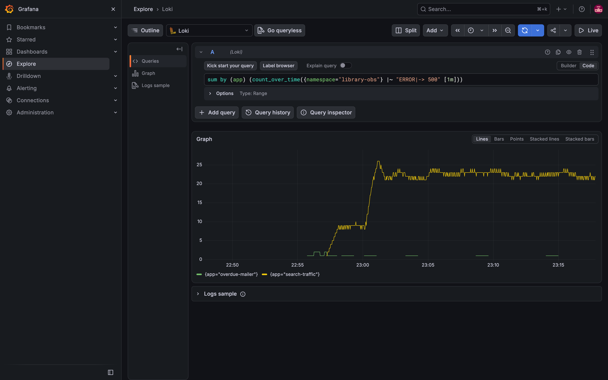

## 3. Alerts

`monitoring/alerts/library-rules.yaml` passes `promtool check rules` (8 rules: 2 recording, 6 alerting):

| Alert | Fires because of | Expression idea | Seen firing |
|---|---|---|---|
| `LibraryApiHighErrorRate` | `search-traffic` (about 14 % 5xx) | `library:http_errors:ratio5m > 0.05` for 2 m | yes |
| `CatalogApiDown` | scale `catalog-api` to 0 to test it | `absent(up{job="catalog-api"} == 1)` for 1 m | yes (test below) |
| `LibraryApiSlowRequests` | p95 latency > 500 ms for 5 m | histogram_quantile on `http_request_duration_seconds` | no (p95 is about 40 ms, so it stays inactive) |
| `LibraryPodRestarting` | `overdue-mailer` exits every 20 s | `increase(restarts[15m]) >= 2` | yes |
| `LibraryPodNotReady` | `reader-web` probes `/ready` (404), and `overdue-mailer` between restarts | `kube_pod_status_ready{condition="false"}` for 3 m | yes (2 Pods) |
| `LibraryPodCpuNearLimit` | `reindex-job` busy loop | CPU usage / CPU limit > 90 % for 5 m | yes (value about 1.0) |

`LibraryPodRestarting` originally used `increase(...[10m]) > 2`. In CrashLoopBackOff the
kubelet waits up to 5 minutes between restarts, so a 10 minute window saw only about 2
restarts, and the alert fired and then resolved again. The rule now uses a 15 minute window
with `>= 2`.

```bash
kubectl -n library-obs get prometheusrules
# Prometheus → Alerts: rules move Inactive → Pending → Firing
# Alertmanager UI: firing alerts grouped by alertname+namespace, receiver library-team
```

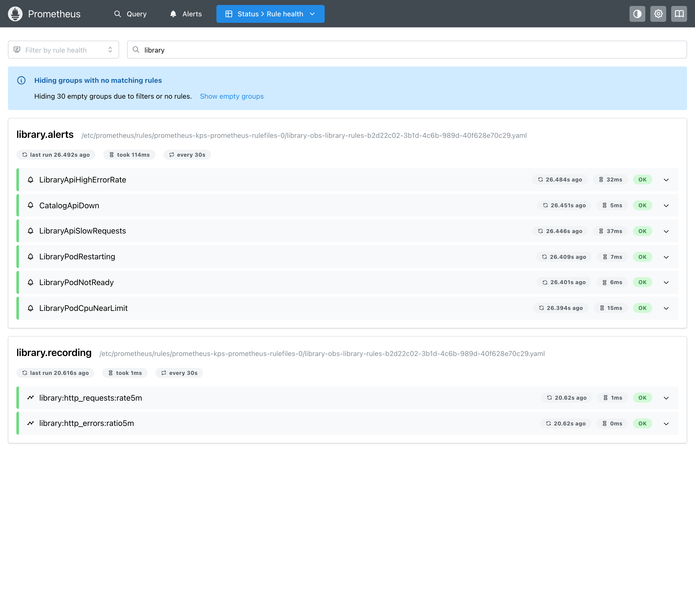

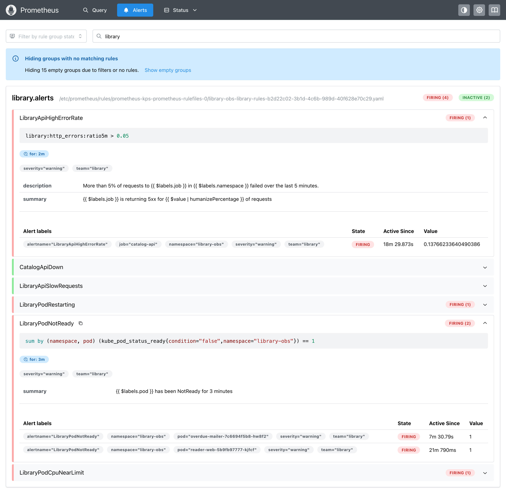

Alertmanager groups the alerts by `alertname` and `namespace`. The `team="library"` route
sends the custom alerts to `library-team`, and the chart's default alerts
(`KubePodCrashLooping`, `KubePodNotReady`, `CPUThrottlingHigh`, ...) go to `null`:

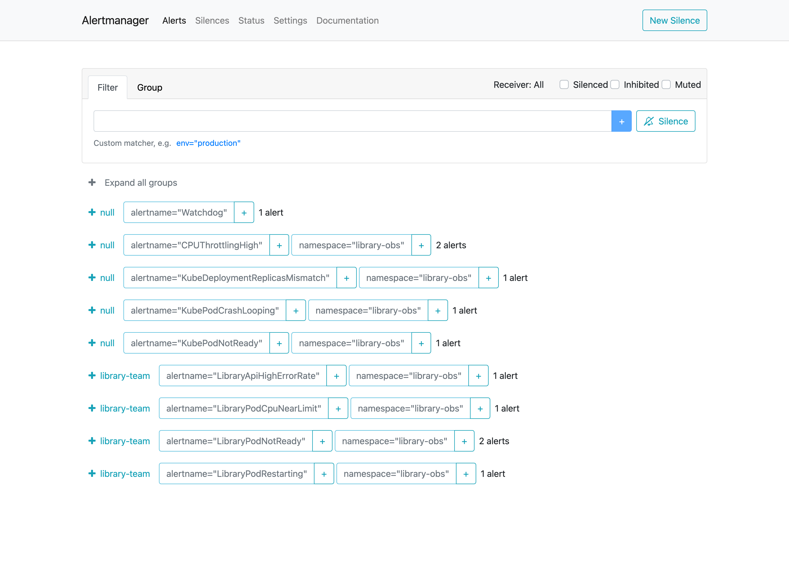

Test `CatalogApiDown` by scaling the API to zero:

```bash
kubectl -n library-obs scale deploy catalog-api --replicas=0   # CatalogApiDown after ~1-2 min
kubectl -n library-obs scale deploy catalog-api --replicas=2
```

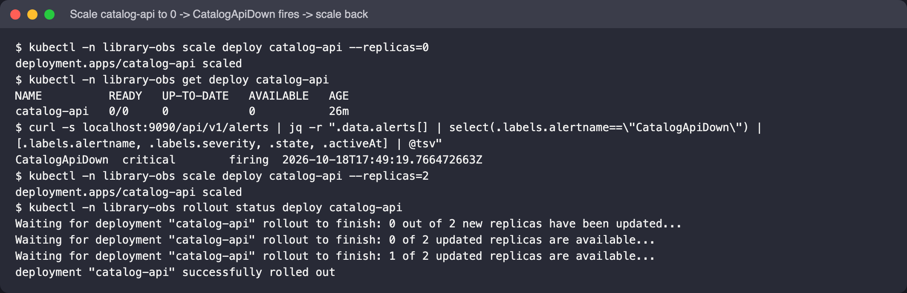

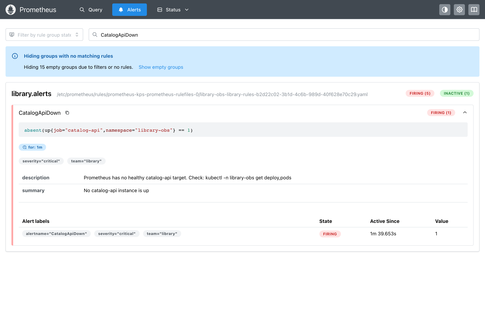

## 4. CPU and memory utilisation

```bash
kubectl top nodes
kubectl top pods -n library-obs --sort-by=cpu
```

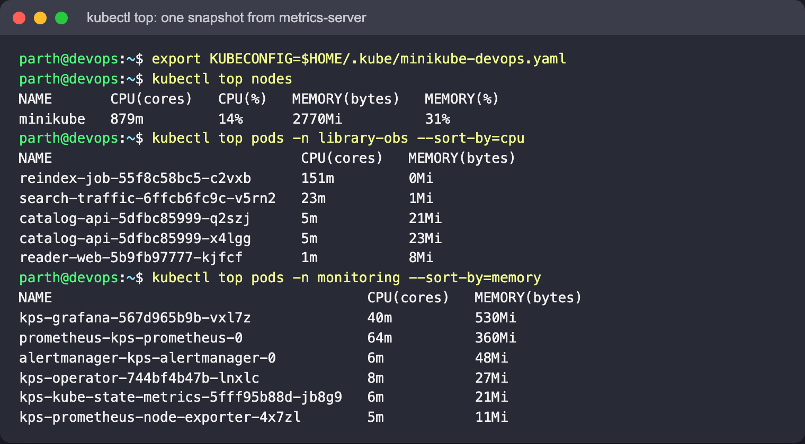

`kubectl top` gives a single snapshot from metrics-server. For history, use the Grafana
dashboards that ship with the chart: *Kubernetes / Compute Resources / Namespace (Pods)*
for `library-obs` (usage vs requests and limits per Pod), and *Node Exporter / Nodes*.
`reindex-job` sits at its 150m CPU limit, which is about 300 % of its 50m request. `catalog-api`
uses about 20 % of its 20m request.

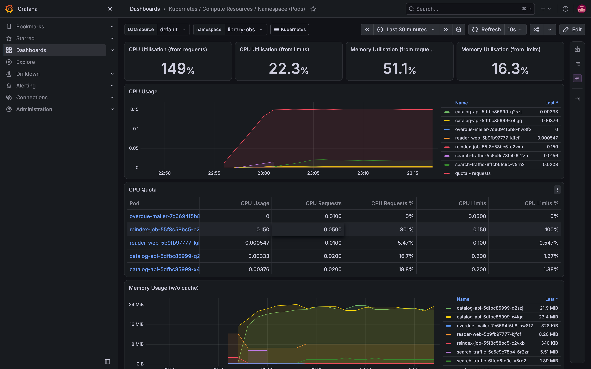

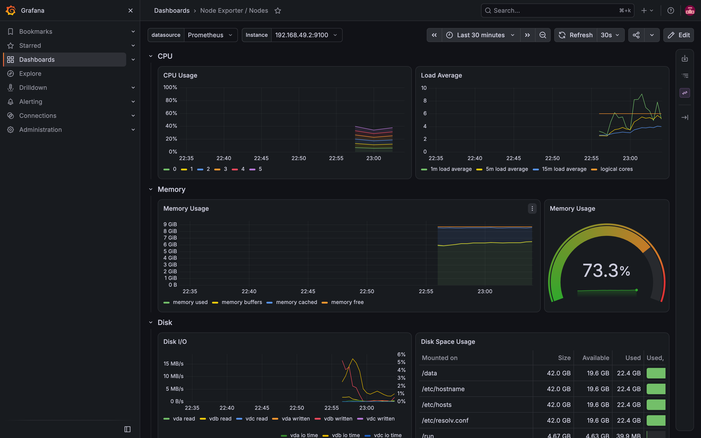

## 5. Application health

```bash
kubectl -n library-obs get deploy,pods
kubectl -n library-obs get endpointslices
kubectl -n library-obs describe pod -l app=reader-web | grep -E "Readiness|Unhealthy"
kubectl -n library-obs port-forward svc/catalog-api 9898:9898 & curl -s localhost:9898/healthz
```

`catalog-api` is 2/2 Ready, with both Pod IPs in its EndpointSlice. `reader-web` stays 0/1
with a 404 readiness failure. `overdue-mailer` is in CrashLoopBackOff with a growing
restart count. These are the same facts that the alerts above turn into notifications.

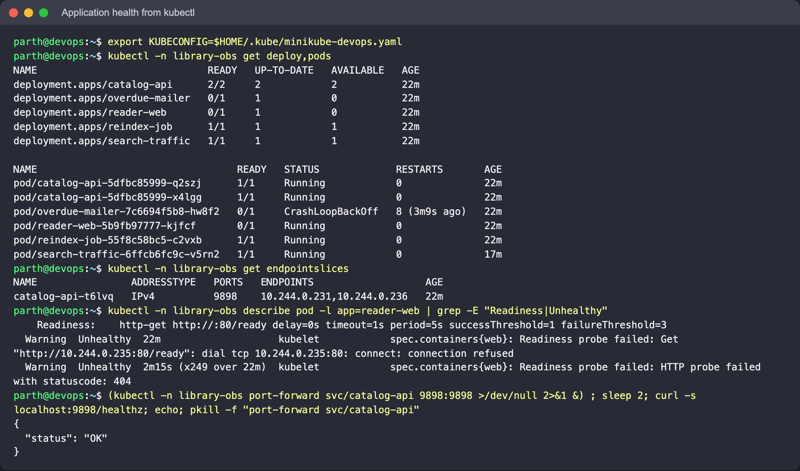

## 6. Observability concepts

See [`observability/README.md`](observability/README.md): monitoring vs observability, the
three pillars and how they connect, common tools, and what to observe in Kubernetes.

## 7. GitOps with Argo CD

See [`gitops/README.md`](gitops/README.md): concepts (declarative, versioned, pulled,
reconciled; push vs pull), then installing Argo CD with an in-cluster Git server and
walking through initial sync, deploy-by-commit, drift self-heal and rollback by `git revert`.

## Validation

Run on Minikube (4 CPU / 4 GB, arm64), with the screenshots above taken from that run:

- All three Helm charts installed with these values files, and every Pod became Ready.
  The full stack plus the sample apps used about 2.7 GiB of the node's 4 GiB.
- Every Prometheus target was `UP`. The rules loaded, and 5 of the 6 custom alerts were seen
  firing in both Prometheus and Alertmanager. `LibraryApiSlowRequests` stayed inactive,
  as expected.
- Loki received the logs of all Pods through Alloy, with the `namespace`, `pod`,
  `container` and `app` labels.

Checks that do not need a cluster:

- `kubeconform -strict` on `monitoring/sample-app`, `monitoring/alerts` and
  `gitops/gitops-repo`, with ServiceMonitor, PrometheusRule and Application checked against
  the datreeio CRDs-catalog schemas. This was run before the cluster run. The files changed
  during the run (`02-traffic.yaml`, `library-rules.yaml`, `application.yaml` and the new
  `gitops/git-server.yaml`) were not re-checked with kubeconform, but the API server
  accepted all of them.
- `promtool check rules` (prom/prometheus v3.5.0) on the rule groups: 8 rules, SUCCESS.

## Cleanup

```bash
kubectl delete -f monitoring/sample-app/ -f monitoring/alerts/
helm uninstall alloy loki -n logging
helm uninstall kps -n monitoring
kubectl delete ns logging monitoring library-obs
# Helm leaves these behind:
kubectl get crd -o name | grep monitoring.coreos.com | xargs kubectl delete
kubectl delete crd podlogs.monitoring.grafana.com          # installed by the Alloy chart
kubectl -n kube-system delete svc kps-kubelet              # created by the Prometheus Operator
```

## Cheat sheet

```bash
kubectl get servicemonitors,prometheusrules -A
kubectl -n monitoring port-forward svc/kps-prometheus 9090:9090
kubectl -n monitoring port-forward svc/kps-grafana 3000:80
kubectl top pods -A --sort-by=memory
kubectl -n argocd get applications
kubectl -n argocd get application NAME -o jsonpath='{.status.sync.status} {.status.health.status}{"\n"}'
```
