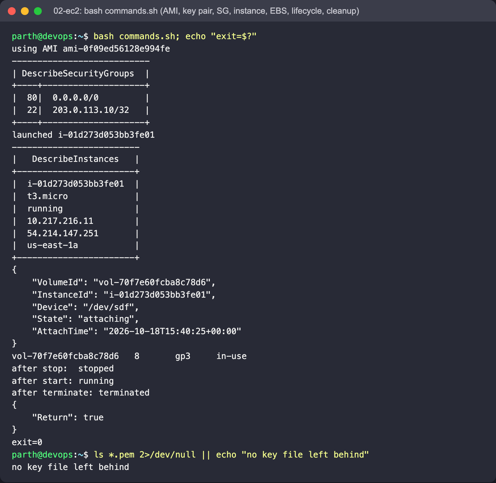

# 02 - EC2: Elastic Compute Cloud

## Concepts

- **AMI** - the disk image an instance boots from (OS + preinstalled software). Region-specific IDs.
- **Instance type** - CPU/RAM/network size: family + generation + size, e.g. `t3.micro` (burstable, 2 vCPU, 1 GiB).
- **Key pair** - AWS keeps the public key, you download the private key once. Used for SSH.
- **Security group** - a *stateful* firewall on the instance's network interface. Only allow rules; return
  traffic is automatically allowed. Here: HTTP from anywhere, SSH only from one admin IP.
- **EBS** - network block storage. Root volume + extra volumes; volumes live in one AZ and survive a stop.
- **User data** - a script cloud-init runs once at first boot (`user-data.sh` installs nginx).
- **Public vs private IP** - private IP is fixed for the instance's life; the auto-assigned public IP changes on
  stop/start (use an Elastic IP if it must stay).
- **Lifecycle** - `pending -> running -> stopping -> stopped -> running ... -> shutting-down -> terminated`.
  Stopped instances don't bill compute, but their EBS volumes still bill.

## Files

`commands.sh` (whole exercise including cleanup), `user-data.sh`, `.gitignore` (keeps `*.pem` out of git).

## Run

```bash
cd "Terraform and AWS/aws-services/02-ec2"
bash commands.sh
```

## What to look for

The security-group table lists port 80 open to `0.0.0.0/0` and port 22 to `203.0.113.10/32`; the instance table
shows `t3.micro`, `running`, a private and a public IP; the volume shows `in-use`; and the lifecycle lines print
`stopped`, `running`, `terminated`.

Real output (LocalStack 4.9.2, trimmed):

```
|  80|  0.0.0.0/0         |
|  22|  203.0.113.10/32   |
launched i-cfedaeb8a17636db6
vol-1e8f0623577859cc7	8	gp3	in-use
after stop:  stopped
after start: running
after terminate: terminated
```

LocalStack's EC2 is a mock: no VM boots, so user data doesn't execute and SSH is not possible. On real AWS use
the latest Amazon Linux AMI and `ssh -i reader-web-key.pem ec2-user@<public-ip>`.

## Screenshots

The whole lifecycle in one run of `commands.sh` (exit 0): AMI lookup, security-group rules, the launched instance, the
attached gp3 volume, stop/start/terminate, and cleanup (the generated `.pem` file is deleted at the end):


